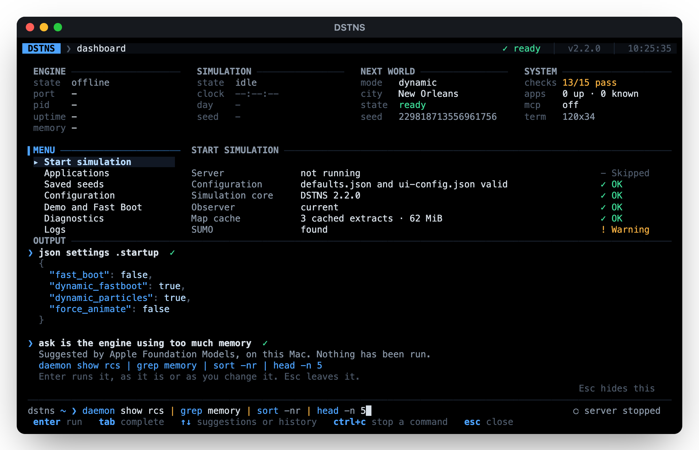

<div align="center">

<picture>
  <source media="(prefers-color-scheme: dark)" srcset="docs/assets/wordmark-light.svg">
  
</picture>

<br><br>

**Deterministic Spatiotemporal Transport Network Simulator**

A seed chooses a real district of a real city. DSTNS simulates a whole day there,<br>
and you watch it, change it, and build on it.

<br>

<picture>
  <source media="(prefers-color-scheme: light)" srcset="docs/assets/screenshots/observer-light.png">
  
</picture>

</div>

<br>

## What it is

Give DSTNS a number. It resolves to one of 181 cities on every inhabited continent and a district inside it, downloads that district's streets from OpenStreetMap, and builds a day of traffic, signals, demand, weather, flooding and incidents on one clock.

The same seed, configuration, map and build give the same day, on any machine. You can pause it, step it, seek back through it, and export a report of what happened.

<table>
<tr>
<td width="50%" valign="top">

**The simulation**

Signals snapped to real junctions and coordinated in green waves. Demand from the schools, offices and homes that are really there, different on a weekday and at a weekend. Storms that cross the district and flood its low roads. Collisions whose queues spread back up the road.

Flows and queues per road are what make a whole day of a 3,000-junction district fast enough to seek through. For individual vehicles, any world exports to Eclipse SUMO.

</td>
<td width="50%" valign="top">

**The observer**

A live map with telemetry, notifications and an Auto Focus camera that follows what matters. Place search, changeable shortcuts, light and dark themes, and palettes for colour vision.

It's built on one physical model of motion, so that everything can be interrupted and nothing jumps. Panels divide from the control that opened them like a cell, dialogs are one card with a line drawing that acts out their question, and every corner sits concentric with the one around it. It keeps up with the simulation by itself, and tells you when it can't.

</td>
</tr>
</table>

## Start

From source, on macOS or Linux:

```bash
git clone https://github.com/varunkarthic/DSTNS.git && cd DSTNS
./launcher
```

Or with Docker, with nothing else to install:

```bash
docker run -d --name dstns -p 127.0.0.1:8090:8090 \
  -v dstns-maps:/app/data/maps -v dstns-logs:/app/logs \
  -e DSTNS_SEED=382923 ghcr.io/varunkarthic/dstns:stable
```

Then open `http://localhost:8090`. The first run downloads its city, which takes up to a minute; after that, [Dynamic Fastboot](#fast-starts) has the next one ready before you ask.

To build from source you need a C++20 compiler, CMake 3.22, SQLite, zlib and libcurl headers, Node 20 and Rust 1.89. On Windows, use WSL 2. Nothing needs Python.

| | |
|---|---|
| **The first launch** | `./launcher` builds itself (about a minute, once), checks the machine, and walks through a short setup: how a run starts, how it looks and sounds, how hard it works your machine, and what may connect to it |
| **After that** | The dashboard, in a few milliseconds |

## The launcher


The launcher checks your environment, builds what's needed, and runs everything from one place. It's a Rust program with a console's look: a status line, live readings of the engine, the simulation, the next world and the system, the server's own log as it's written, and a prompt at the foot of every page.

```bash
./launcher start --seed 382923 --day-type weekend --speed 3
./launcher start --osm-file data/fixtures/real_network.osm.xml   # offline
./launcher start --seed 42 --save-seed demo                      # keep it
./launcher start --saved-seed demo                               # replay it
./launcher ui demo                                               # the interface, on its Demo page, playing
```

It starts your own programs along with the simulation. Give each one its commands, and choose which to bring up when a run starts. The engine comes up, the observer opens, your applications start, and only when all of them are ready does the day begin.

```bash
./launcher apps add planner --command "node planner.js --url {url}" --ready fabric
./launcher start --apps planner
```

Every feature has a setting, named for what it does, and settings that can't go together never are: turn one on and the launcher turns the other off, and says so.

**Advanced Security** asks for Touch ID or your system password before the launcher can be changed, and keeps AI clients from changing the launcher or the engine through the MCP Handler. Turning it off asks again.

Type what you want in plain words, and the launcher's own model (Apple's Foundation Models on the Mac, or Ollama, or Groq) suggests the commands, checked and on the prompt for you to run, never by itself. On a terminal too small for all this, **Simplified Launch Control** does the essentials on a few lines.

### The console

The launcher reads command lines as a shell does, in its command bar, with `-c`, in `./launcher shell`, or one command at a time from your own shell:

```bash
./launcher ps | grep server                                # plain text, to pipe
./launcher -c 'logs api | grep 500 | wc -l'                # how many requests failed
./launcher -c 'stop && start --seed 42 --no-open'          # one thing after another
./launcher -c 'ps | grep -q running || start'              # only if nothing is running
```



`ls`, `cat`, `tail`, `ps`, `get`, `env`, `uptime`, `about` and `docs` read the launcher's state; `json` shows any of it, or the server's, as JSON you can look inside (`json settings .api.port`, `json endpoints -k`); `set`, `unset`, `env set`, `edit` and `api` change almost everything, with the same checks as the interface; `ps -a` shows every DSTNS server on the machine; `grep`, `wc`, `sort`, `uniq`, `cut` and `tee` filter it all; and every other command is one of the launcher's own, captured so it pipes too. In the interface, `:` opens the prompt, with suggestions, completion, a history kept between sessions, and the server's processor and memory at its right.

## Fast starts

| | |
|---|---|
| **Dynamic Fastboot** | While a world runs, the next one is chosen, in another city, and its map fetched in the background. A new world, or tomorrow's first start, is ready in seconds. On by default |
| **Fast Boot** | `./launcher fastboot download` keeps every city, compressed, so that no start ever downloads |
| **New worlds prepared ahead** | Ask the observer for a new world and it is prepared while you decide; *Generate* puts it in at once, *Cancel* forgets it |
| **The adaptive film** | The start-up film plans itself by the server's estimate of when the world will be ready: as many scenes as fit, in a new order every time, always opening on the name and closing on the flight into the map |

`./launcher demo` plays the film on a loop, full screen, with an original score, including scenes on time control, many worlds and AI, in whatever order you set. The score can be swapped for music of your own, an MP3, M4A or WAV file, for Demo Mode and the start-up film separately (`demo.music_file`, `presentation.music_file`).

## Daemons

Watchers inside the server keep an eye on things: the **Resource Control Subsystem** checks each module's memory and processor against an α (the least it should use), β (a lot) and γ (the most it ever should); others watch memory, disk and a stalled run; and the **auto cache handler** keeps the map cache within its budget. What they notice is in the launcher and the observer, and on two queues, **daemonEmergencyQueue** and **daemonNotificationQueue**, that applications subscribe to.

## AI ready

The **MCP Handler** lets an AI client call DSTNS through the Model Context Protocol: every API route is a tool, and so are starting and stopping runs. No agent is included, and it is closed by default; you choose whether a client may read, change things, or start runs.

```bash
./launcher config set mcp.enabled on
./launcher mcp client-config          # what to add to your MCP client
```

<br>

<div align="center">
<picture>
  <source media="(prefers-color-scheme: dark)" srcset="docs/assets/brand/fabric-white.png">
  
</picture>
&nbsp;&nbsp;&nbsp;&nbsp;&nbsp;&nbsp;&nbsp;&nbsp;
<picture>
  <source media="(prefers-color-scheme: dark)" srcset="docs/assets/brand/webfabric-white.png">
  
</picture>
</div>

<br>

## Fabric and WebFabric

**Fabric** is the layer everything reaches the engine through: 153 documented paths over HTTP and JSON, described in OpenAPI 3.1, with an index the server serves itself. **WebFabric** lets your own programs become part of the observer. There's nothing to install. A program registers itself and declares what it wants to show as data, and the observer draws it in its own design.

```python
token = post("/api/v1/fabric/apps", {
    "id": "org.example.planner", "name": "Planner", "version": "1.0.0",
    "capabilities": ["ui.panels", "ui.overlays", "ui.camera", "ui.layers"],
})["data"]["token"]

# A line along real roads, in a colour of its own, with vehicles that obey the signals.
put("/api/v1/fabric/apps/org.example.planner/ui/line", {"slot": "overlay", "features": [
    {"type": "path", "id": "bus-1", "nodes": route, "color": "auto", "style": "flow", "glow": True,
     "drive": True, "count": 3, "speed_mps": 12, "loop": True},
]})

# Show a junction, and bring up the traffic layer, once a person has allowed it.
post("/api/v1/fabric/apps/org.example.planner/view", {"action": "node", "node": 42, "span_m": 800})
put("/api/v1/fabric/apps/org.example.planner/presentation", {"layers": {"traffic": True}})
```

| An application can | |
|---|---|
| **Add to the interface** | Status lines, panels, a sidebar, map controls, notifications, dialogs, and its own page in a sandbox, from 29 widgets the observer draws in its own design, down to a QR code for a phone |
| **Draw on the map** | Markers on junctions, vehicles on roads, and paths that animate along real routes with nothing sent per frame |
| **Direct the view** | Say where the map looks and how close, and hold layers and places on or off |
| **Follow the simulation** | Events, timers on the simulation's clock, its own storage, and messages to other applications |
| **Act on it** | Playback, events and the world, each only with a person's permission, and each on the record |

A planner, such as a bus network planner, has a [template](https://dstns.readthedocs.io/en/v3/components/webfabric/#templates) to follow: a tab per algorithm, its results in figures, a replay of what it built, and a journey picked on the map; `Fabric/examples/bus_planner.py` runs it against any world. An application asks, and the observer decides. It can never change a person's settings: what it asks for is laid over their choices, a person's own move comes first, and it all ends when the application does. Tokens are hashed, requests can be signed, the audit log is a hash chain, and pages run in a sandbox with no way into the observer.

## The report


Export a report of any run as a PDF, in six parts that each begin a page: at a glance, the city, traffic, disruptions, how it ran, and reference. It opens with the day in one sentence, the figures that matter across the whole run, the day's congestion and a handful of numbered findings, then gives every part its charts, tables and maps. Statements are labelled by where they come from, whether observed, derived or interpretation, and the report is put together on a worker, so that the interface keeps moving meanwhile.

The cover is drawn from the run itself: its city, how busy each street is at that moment, and even the hour.

<br clear="right">

## Repeatable, within limits

The same seed, resolved configuration, map bytes and compatible build give the same results. A seed alone won't reproduce an old experiment if the map upstream or the model has changed, so keep those alongside it. The limits, floating point among them, are documented.

DSTNS is for research, teaching, algorithm integration and demonstrations. It has no calibration or certification for controlling real traffic.

## State machines

The engine's lifecycle, the next world's preparation, backpressure, WebFabric applications, the launcher's supervised
applications and the observer's start-up, tutorial, panels and reports are each a state machine, with their states,
transitions and guards set out in [State machines](docs/design/state-machines.md).

## Tested

Every test is C++, Rust or TypeScript: 33 engine and HTTP suites under ctest (each HTTP suite a program that starts a real server on a port of its own, with stand-ins for every upstream), 61 launcher tests, and 478 for the observer. The HTTP contract is replayed against a recorded baseline of 155 calls, and every route is fuzzed with hostile values on every run.

```bash
./scripts/test.sh
```

## Security

DSTNS is a single-operator tool. It listens on loopback, refuses cross-site and DNS-rebinding requests, and has no user accounts, so anyone who can reach the port can read the run. To expose it beyond one machine, put an authenticating gateway in front of it. Report a suspected vulnerability privately, as described in [SECURITY.md](SECURITY.md).

## Documentation

The full documentation is at **[dstns.readthedocs.io](https://dstns.readthedocs.io/)**. It covers the model and its mathematics, every API route, building applications, deployment, and the formulas behind every animation.

## Versions

Engine **2.2.0**, observer **3.1.0**, API contract **1.4**. `./build/dstns_server --version` and `/api/v1/system/info` report what's running, and the changelog is in [CHANGELOG.md](CHANGELOG.md).

## Licence

Copyright © 2026 Varun Karthic. DSTNS is free software under the [GNU Affero General Public License v3.0 or later](LICENSE). If you offer a modified DSTNS over a network, you must offer its source to its users. It's provided as is, and it doesn't take outside contributions.

Map data © [OpenStreetMap contributors](https://www.openstreetmap.org/copyright), ODbL 1.0. Third-party components and their licences are listed in the documentation.
