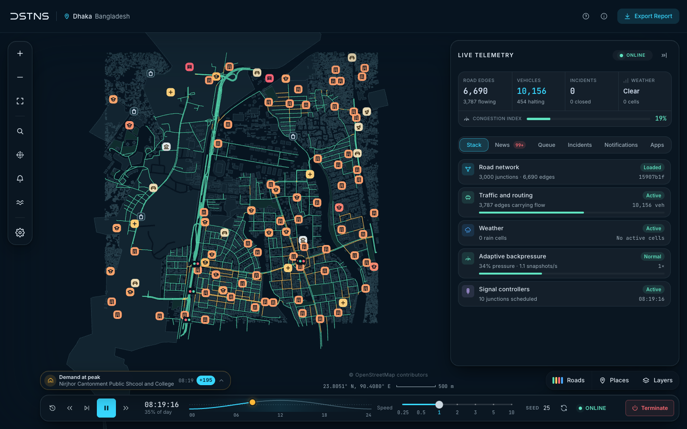
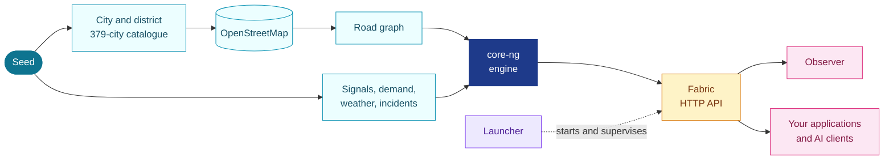
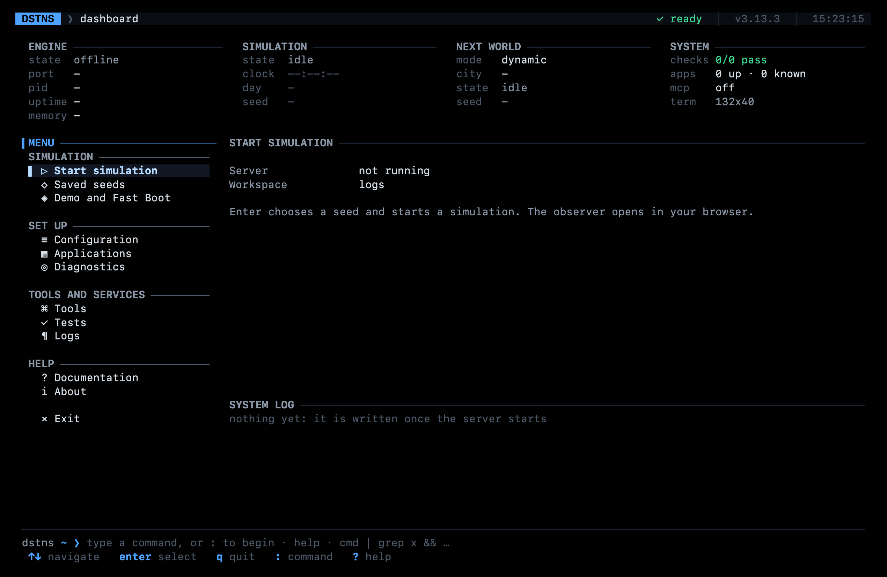
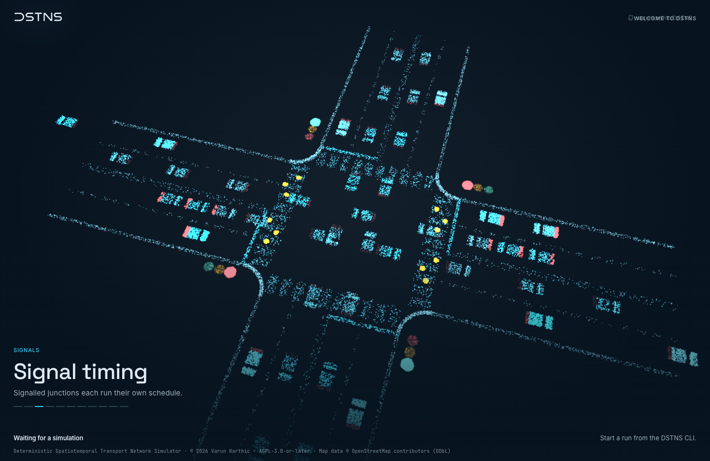
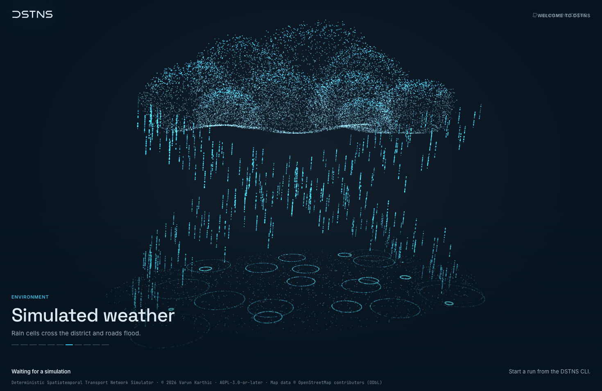

<div align="center">

<picture>
  <source media="(prefers-color-scheme: dark)" srcset="docs/assets/wordmark-light.svg">
  
</picture>

<br><br>

### Deterministic Spatiotemporal Transport Network Simulator

A seed chooses a real district of a real city. DSTNS simulates a whole day there,<br>
and you watch it, change it, and build on it.

<br>

[](https://github.com/varunkarthic/DSTNS/actions/workflows/ci.yml)
[](https://dstns.readthedocs.io/v3-core-ng/)
[](https://github.com/varunkarthic/DSTNS/pkgs/container/dstns)
[](LICENSE)

[](CHANGELOG.md)
[](https://dstns.readthedocs.io/v3-core-ng/guide/engines/)
[](https://dstns.readthedocs.io/v3-core-ng/guide/operator-cli/)
[](https://dstns.readthedocs.io/v3-core-ng/guide/observer-interface/)
[](https://dstns.readthedocs.io/v3-core-ng/api/versioning/)

<br>

<picture>
  <source media="(prefers-color-scheme: light)" srcset="docs/assets/screenshots/observer-light.png">
  
</picture>

<br>

**[Quick start](https://dstns.readthedocs.io/v3-core-ng/getting-started/quick-start/)** &nbsp;·&nbsp;
**[Documentation](https://dstns.readthedocs.io/v3-core-ng/)** &nbsp;·&nbsp;
**[API](https://dstns.readthedocs.io/v3-core-ng/api/endpoints/)** &nbsp;·&nbsp;
**[Knowledge graph](https://dstns.readthedocs.io/v3-core-ng/graph/)** &nbsp;·&nbsp;
**[Changelog](CHANGELOG.md)** &nbsp;·&nbsp;
**[Security](SECURITY.md)**

</div>

<br>

<div align="center">
<table>
<tr>
<td align="center" width="25%"><h3>379</h3>cities</td>
<td align="center" width="25%"><h3>126</h3>countries</td>
<td align="center" width="25%"><h3>Up to 10×</h3>playback speed</td>
<td align="center" width="25%"><h3>Same seed</h3>same day, every time</td>
</tr>
</table>
</div>

## Contents

[Overview](#overview) · [Quick start](#quick-start) · [How it works](#how-it-works) · [Engines](#engines) ·
[The launcher](#the-launcher) · [The observer](#the-observer) · [Fabric and WebFabric](#fabric-and-webfabric) ·
[AI ready](#ai-ready) · [Knowledge graph](#the-knowledge-graph) · [Reports](#reports) ·
[Performance](#performance) · [Quality](#quality) · [Documentation](#documentation) · [Security](#security) ·
[Versions](#versions) · [Licence](#licence)

## Overview

Give DSTNS a number. It resolves to a district in one of **379 cities in 126 countries**, downloads that district's
streets from OpenStreetMap, and runs a full day of traffic, signals, demand, weather, flooding and incidents on one
clock. **The same seed, configuration, map and build always give the same day**, on any machine. Pause it, step
through it, jump back and forward in time, and export a report of what happened.

| Feature | What it gives you |
|---|---|
| **A real simulation** | Signals snapped to real junctions and coordinated in green waves. Demand from the schools, offices and homes that are really there, different on weekdays and weekends. Storms that cross the district and flood its low roads; queues from collisions that spread back up the road |
| **A live observer** | A map with live telemetry, notifications, Time Control and an Auto Focus camera. Light and dark themes, palettes for colour vision, map labels in 15 languages, keyboard shortcuts you can change |
| **Two engines, one contract** | **core-ng** runs every world; **core-legacy**, the engine before it, stays installed for comparison. Both make the same world from the same seed, bit for bit |
| **Open to your programs** | **Fabric**, an HTTP API described in OpenAPI 3.1, and **WebFabric**, which lets your applications add panels and map layers to the observer |
| **Ready for AI** | An MCP server makes every API route a tool for AI clients. It is closed by default |
| **One launcher** | Builds, checks, starts, supervises and configures everything, from a dashboard or a shell |

## Quick start

**From source** (macOS or Linux):

```bash
git clone https://github.com/varunkarthic/DSTNS.git
cd DSTNS
./launcher
```

**With Docker:**

```bash
git clone https://github.com/varunkarthic/DSTNS.git
cd DSTNS
docker compose up --pull always
```

Then open **http://localhost:8090**.

**From your own code**, once a server is running:

```bash
curl -s http://127.0.0.1:8090/api/v1/playback/status
```

> [!NOTE]
> The first launch builds the launcher (about a minute, with a progress bar), checks the machine, and walks you
> through a short setup. The first run downloads its city's district from OpenStreetMap, which takes up to a minute.
> After that, the next world is prepared while the current one runs.

<details>
<summary><b>Requirements</b></summary>

<br>

| To | You need |
|---|---|
| Build the server | A C++20 compiler, CMake 3.22, and SQLite, zlib and libcurl headers |
| Build the launcher | Rust 1.89 |
| Build the observer | Node.js 20 or later (CI uses 22) |
| Run with Docker | Docker with Compose; images for amd64 and arm64 |
| Build the documentation | Python 3.12 (only for the documentation) |

On Windows, use WSL 2. See [Requirements](https://dstns.readthedocs.io/v3-core-ng/getting-started/requirements/).

</details>

## How it works



Everything random in a day comes from the seed, so the same seed always gives the same day, and jumping to a time
gives exactly what playing to it would. See [Deterministic seeding](https://dstns.readthedocs.io/v3-core-ng/concepts/deterministic-seeding/)
and [Reproducibility](https://dstns.readthedocs.io/v3-core-ng/concepts/reproducibility/).

| Part | What it is | Language |
|---|---|---|
| `Core/common` | The host every engine runs in: lifecycle, clock, operator commands and undo, model, maps, events | C++20 |
| `Core/core-ng` | The engine: selection, compiler, physics, checkpoints, lifecycle and world-job tables | C++20 |
| `Core/core-legacy` | The engine before core-ng, kept for comparison | C++20 |
| `Fabric` | The HTTP API and the application protocol | C++20 |
| `Daemon` | Watchers inside the server: resources, memory, disk, stalled runs | C++20 |
| `LaunchKit` | The launcher: dashboard, console, settings, supervisor, MCP Handler | Rust |
| `WebKit` | The observer: map, telemetry, Time Control, WebFabric, reports | TypeScript, React |

## Engines

| Engine | Version | Channel | State | What it is |
|---|---|---|---|---|
| **core-ng** | 1.2.2 |  | The default; cannot be disabled | Its own world selection, compiler, physics tick, checkpoints and lifecycle tables |
| **core-legacy** | 3.13.4 |  |  | The engine before core-ng, frozen. Enable it to compare: both make the same world, hash for hash |

| Selection policy | Cities | What it does |
|---|---|---|
| `urban-crfg-v3` | 181 | Every seed's city as engine 3.0 chose it |
| `urban-geo-v1` | 181 | Countries or cities from those 181, or leave some out |
| `urban-geo-v2` | 379 | The same rules over 379 cities; what the launcher uses on core-ng |

- **A policy never changes meaning.** New cities arrive with a new policy, so recorded seeds keep their cities.
- **No city twice in a session**, while the policy allows another.
- **An alpha or beta engine's run waits for a person to accept the risk**, in the observer or with `--accept-risk`.
  A new version of the running engine is announced once in the notifications.

See [Engines and places](https://dstns.readthedocs.io/v3-core-ng/guide/engines/) and
[Engine governance](https://dstns.readthedocs.io/v3-core-ng/design/engine-governance/).

## The launcher



One program checks your machine, builds what is needed and runs everything. Its dashboard shows live readings of the
engine, the simulation, the next world and the system.

| Area | What it does |
|---|---|
| **Runs** | Start with a seed, day type, speed and engine; save a configuration and run it again; your own applications start with the run, and the day begins once they are ready |
| **Places** | A checklist of every country with its code and number of cities, or `engine add IN AE`, `engine add -PK`, `engine del all` from a shell |
| **Launch codes** | One code that carries the setup, and optionally the world, to another machine, from the current moment or from 00:00 |
| **Console** | Pipes, `&&`, `json` to look inside any state, and `set` to change any setting |
| **Tools** | Build and check, server and services, engines and AI, launcher state, maintenance; any output can be exported |
| **Reset** | By scope; `reset builds` frees what builds and tests leave behind, often gigabytes, and says how much |
| **Security** | Advanced Security can require Touch ID or your password before the launcher can be changed |

```bash
./launcher start --seed 382923 --day-type weekend --speed 3   # a weekend in one district, at 3×
./launcher start --seed 42 --save-seed demo                   # keep a configuration
./launcher version                                            # every part's version, and each engine
./launcher engine add IN, AE                                  # worlds only in India and the UAE
./launcher cities export cities.csv                           # every supported city, as CSV
./launcher launch-code --start --copy                         # this world, from 00:00, on the clipboard
```

<table>
<tr>
<td width="50%"></td>
<td width="50%"></td>
</tr>
<tr>
<td align="center"><sub>Places: every country, ticked from a list</sub></td>
<td align="center"><sub>Supported cities: filter all 379 and save them</sub></td>
</tr>
</table>

More in the [launcher guide](https://dstns.readthedocs.io/v3-core-ng/guide/operator-cli/) and the
[console guide](https://dstns.readthedocs.io/v3-core-ng/guide/console/).

## The observer

<table>
<tr>
<td width="33%"></td>
<td width="33%"></td>
<td width="33%"></td>
</tr>
<tr>
<td align="center"><sub>Signals in green waves</sub></td>
<td align="center"><sub>Storms and flooding</sub></td>
<td align="center"><sub>Time Control</sub></td>
</tr>
</table>

- **Time Control.** Play from 0.25× to 10×, step, or jump to any moment of the day; seeking is exact.
- **Live Telemetry.** Roads, vehicles, incidents and weather, with a stack, news, queue, incidents, notifications and
  applications.
- **Start-up film.** Scenes that explain what is happening while a world is prepared; choose which play, and which
  come first and last.
- **About** reports the server, API, observer and running engine, the run's seed, policy and hashes, and the build.

See the [observer guide](https://dstns.readthedocs.io/v3-core-ng/guide/observer-interface/).

## Fabric and WebFabric

<p align="center">
  <picture>
    <source media="(prefers-color-scheme: dark)" srcset="docs/assets/brand/fabric-white.png">
    
  </picture>
  &nbsp;&nbsp;&nbsp;&nbsp;&nbsp;&nbsp;&nbsp;&nbsp;
  <picture>
    <source media="(prefers-color-scheme: dark)" srcset="docs/assets/brand/webfabric-white.png">
    
  </picture>
</p>

<table>
<tr>
<td width="50%" valign="top">

**Fabric** is the layer everything reaches the engine through: HTTP and JSON, described in OpenAPI 3.1. Start, play,
pause and jump through a run; read its state, map and events; change roads, weather and demand.

</td>
<td width="50%" valign="top">

**WebFabric** lets your programs become part of the observer. A program registers itself and declares what it wants
to show as data, and the observer draws it in its own design.

</td>
</tr>
</table>

Registering an application, then drawing a bus route on the map:

```python
token = post("/api/v1/fabric/apps", {
    "id": "org.example.planner", "name": "Planner", "version": "1.0.0",
    "capabilities": ["ui.panels", "ui.overlays", "ui.camera"],
})["data"]["token"]

# A route along real roads, with buses that stop at red signals.
put("/api/v1/fabric/apps/org.example.planner/ui/line", {"slot": "overlay", "features": [
    {"type": "path", "id": "bus-1", "nodes": route, "style": "flow", "drive": True, "count": 3},
]})
```

| An application can | A person always decides |
|---|---|
| Add panels, a sidebar and notifications, with 29 widgets | Every permission is granted, and can be withdrawn, in the observer |
| Draw markers, routes and moving vehicles on the map | Tokens are stored hashed; requests can be signed |
| With permission, direct the view and turn layers on or off | Every change is in a hash-chained audit log |
| Follow the simulation's events and timers, and keep its own storage | Rate limits and leases stop a runaway application |

See the [Fabric API](https://dstns.readthedocs.io/v3-core-ng/api/fabric-api/),
[WebFabric](https://dstns.readthedocs.io/v3-core-ng/components/webfabric/) and its
[planner template](https://dstns.readthedocs.io/v3-core-ng/components/webfabric/#templates), and
[security](https://dstns.readthedocs.io/v3-core-ng/api/security/).

## AI ready

The **MCP Handler** lets an AI client call DSTNS through the Model Context Protocol: typed tools for the world and
playback, every API route as a tool, resources for status, settings and the documentation, and prompts to explain a
world or diagnose a run. No agent is included. It is closed by default, and you choose whether a client may read,
change things or start runs. A client can never change the settings that limit it.

```bash
./launcher config set mcp.enabled enabled
./launcher mcp client-config          # what to add to your MCP client
```

See the [MCP guide](https://dstns.readthedocs.io/v3-core-ng/guide/mcp/).

## The knowledge graph


The [Graph](https://dstns.readthedocs.io/v3-core-ng/graph/) page maps every file, class, function and page of DSTNS,
and how they connect, rebuilt from the source with every documentation build. Search it in plain words (`what calls
sha256`, `functions in the launcher`), see one part on its own, and open anything on GitHub at its exact line. The
same graph answers `./launcher graph`, the MCP Handler and a downloadable Claude skill.

## Reports

<table>
<tr>
<td width="68%" valign="top">

Export any run as a PDF in six parts: at a glance, the city, traffic, disruptions, how it ran, and reference. It
opens with the day in one sentence, the figures that matter and numbered findings, and labels each statement as
observed, derived or interpretation.

The cover is drawn from the run itself: its streets, how busy each one is, and the hour.

See [Reports](https://dstns.readthedocs.io/v3-core-ng/guide/reports/).

</td>
<td width="32%" align="center"></td>
</tr>
</table>

## Performance

Measured with `build/dstns_benchmark` on an Apple M4, Release build, medians of three runs:

| Grid | Roads | core-ng tick | core-legacy tick | core-ng jump | core-legacy jump | Headroom (core-ng) |
|---|---:|---:|---:|---:|---:|---:|
| 10 × 10 | 360 | 9 µs | 12 µs | 6.0 ms | 7.4 ms | 74.7× |
| 25 × 25 | 2,400 | 61 µs | 91 µs | 37.5 ms | 58.1 ms | 11.4× |
| 50 × 50 | 9,800 | **246 µs** | 376 µs | 158 ms | 240 ms | 2.8× |
| 75 × 75 | 22,200 | **564 µs** | 854 µs | 357 ms | 902 ms | 1.2× |
| 100 × 100 | 39,600 | **1.02 ms** | 1.61 ms | 951 ms | 1.35 s | 0.7× |

core-ng takes 20 to 36% less time per simulated second than core-legacy, with every result unchanged, and keeps its
checkpoints in 90% less memory. Headroom is how many times over core-ng keeps up with the fastest playback (a
day in 60 seconds); the default one-hour day needs a twenty-fourth of that. The full report, with charts, is
[Engine benchmarks](https://dstns.readthedocs.io/v3-core-ng/deployment/engine-benchmarks/).

## Quality

| Suite | What it proves |
|---|---|
| **Golden fixtures** | Results recorded from engine 3.0.0, reproduced bit for bit by both engines on macOS and Linux |
| **46 engine and HTTP suites** | Each starts real servers; `dstns_core_ng_alone` builds core-ng with no core-legacy code |
| **Lifecycle races and stress** | 48 races at four delays, and a four-client stress test of every state machine, in CI |
| **Launcher** | Over 100 tests, including the interface drawn at every terminal size |
| **Observer** | Over 500 unit tests and browser suites |
| **CodeQL** | C++, Rust and TypeScript |

`./scripts/test.sh` runs them all.

## Documentation

| Section | Read it for |
|---|---|
| [Get started](https://dstns.readthedocs.io/v3-core-ng/getting-started/quick-start/) | Requirements, installation, Docker, your first simulation |
| [Guides](https://dstns.readthedocs.io/v3-core-ng/guide/) | The launcher, engines and places, the console, playback, seeds, configuration |
| [Concepts](https://dstns.readthedocs.io/v3-core-ng/concepts/simulation-engine/) | How a seed becomes a world and a day, with the equations |
| [API](https://dstns.readthedocs.io/v3-core-ng/api/endpoints/) | Every endpoint, errors, schemas, versioning, Fabric |
| [Operations](https://dstns.readthedocs.io/v3-core-ng/deployment/) | Containers, TLS, security, logging, upgrades, performance, engine benchmarks |
| [Reference](https://dstns.readthedocs.io/v3-core-ng/reference/) | Commands, variables, files, limits, components, the changelog |
| [Develop](https://dstns.readthedocs.io/v3-core-ng/design/state-machines/) | Design, state machines, building, testing, the code graph |

## Security

DSTNS is a single-operator tool. It listens on loopback only, refuses cross-site and DNS-rebinding requests, and has
no user accounts, so anyone who can reach the port can read the run. To expose it beyond one machine, put an
authenticating gateway in front of it. [SECURITY.md](SECURITY.md) sets out what is supported, the protections in this
version, and how to report a suspected vulnerability privately.

## Versions

| Part | Version | Reported by |
|---|---|---|
| Engine (server) | 3.13.4 | `./build/dstns_server --version`, `/api/v1/system/info` |
| core-ng | 1.2.2, stable | `GET /api/v1/engine` |
| Launcher | 3.16.1 | `./launcher version` |
| Observer | 3.9.0 | About, in the observer |
| API contract | 1.13 | `api_version` in every response |

Changes are listed in [CHANGELOG.md](CHANGELOG.md). DSTNS is for research, teaching, algorithm integration and
demonstrations. It is not calibrated or certified for controlling real traffic.

## Licence

Copyright © 2026 Varun Karthic. DSTNS is free software under the
[GNU Affero General Public License v3.0 or later](LICENSE). If you offer a modified DSTNS over a network, you must
offer its source to its users. It is provided as is, and it does not take outside contributions.

Map data © [OpenStreetMap contributors](https://www.openstreetmap.org/copyright), ODbL 1.0.
