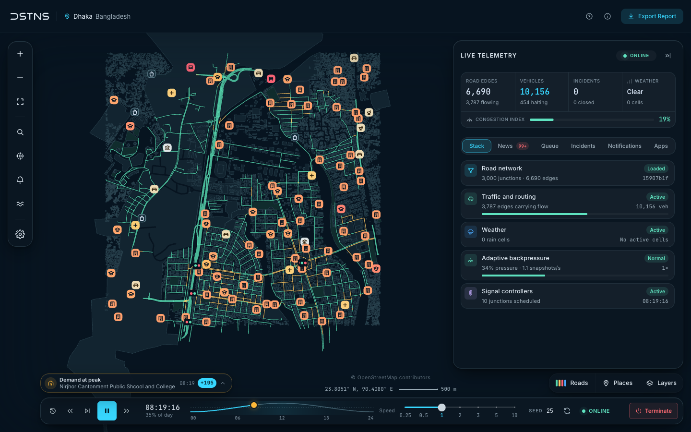
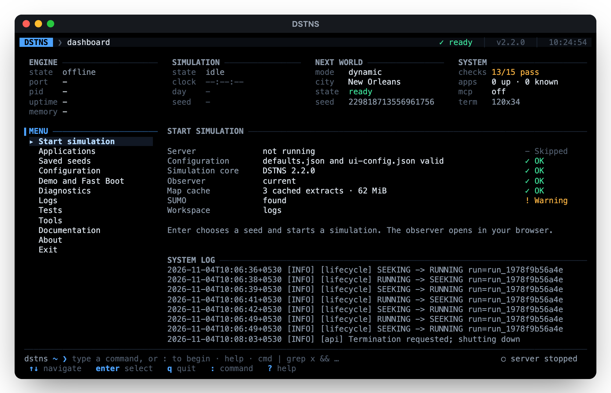
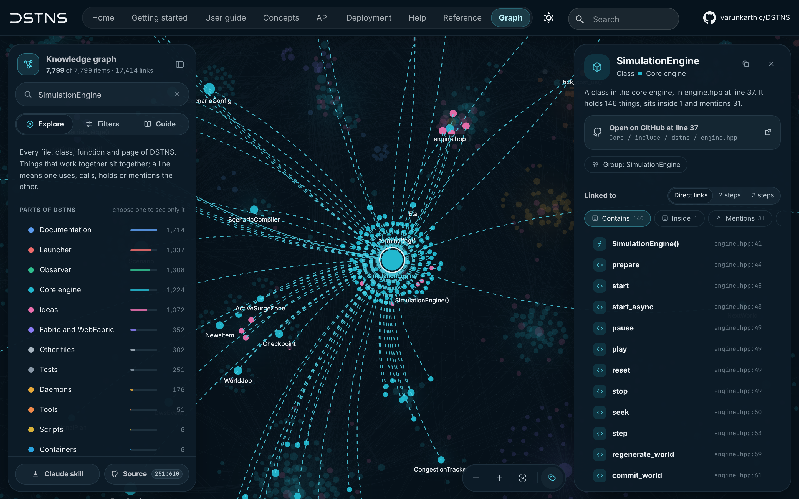
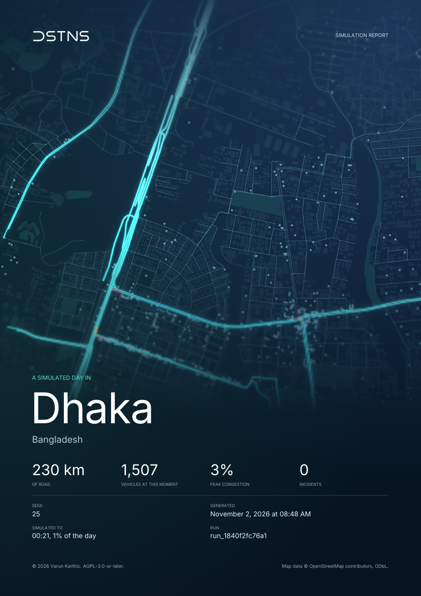

<div align="center">

<picture>
  <source media="(prefers-color-scheme: dark)" srcset="docs/assets/wordmark-light.svg">
  
</picture>

<br><br>

**Deterministic Spatiotemporal Transport Network Simulator**

A seed chooses a real district of a real city. DSTNS simulates a whole day there,<br>
and you watch it, change it, and build on it.

<br>

[](https://github.com/varunkarthic/DSTNS/actions/workflows/ci.yml)
[](https://dstns.readthedocs.io/v3/)
[](LICENSE)
[](https://github.com/varunkarthic/DSTNS/pkgs/container/dstns)

<br>

<picture>
  <source media="(prefers-color-scheme: light)" srcset="docs/assets/screenshots/observer-light.png">
  
</picture>

**[Quick start](https://dstns.readthedocs.io/v3/getting-started/quick-start/)** ·
**[Documentation](https://dstns.readthedocs.io/v3/)** ·
**[Knowledge graph](https://dstns.readthedocs.io/v3/graph/)** ·
**[Changelog](CHANGELOG.md)**

</div>

<br>

## Overview

Give DSTNS a number. It resolves to a district in one of 181 cities on every inhabited continent, downloads that district's streets from OpenStreetMap, and runs a full day of traffic, signals, demand, weather, flooding and incidents on one clock.

**The same seed, configuration, map and build always give the same day**, on any machine. You can pause it, step through it, jump back and forward in time, and export a report of what happened.

- **A real simulation.** Signals are snapped to real junctions and coordinated in green waves. Demand comes from the schools, offices and homes that are really there, and differs between weekdays and weekends. Storms cross the district and flood its low roads, and queues from collisions spread back up the road.
- **A live observer.** A map with telemetry, notifications, Time Control and an Auto Focus camera that follows what matters. It has light and dark themes, palettes for colour vision, and keyboard shortcuts you can change.
- **Open to your programs.** Through **Fabric**, an HTTP API with 152 documented paths, and **WebFabric**, which lets your applications add panels and map layers to the observer.
- **Ready for AI.** An MCP server makes every API route a tool for AI clients. It is closed by default.

## Quick start

On macOS or Linux, from source:

```bash
git clone https://github.com/varunkarthic/DSTNS.git && cd DSTNS
./launcher
```

Or with Docker, with nothing else to install:

```bash
docker run -d --name dstns -p 127.0.0.1:8090:8090 \
  -v dstns-maps:/app/data/maps -v dstns-logs:/app/logs \
  -e DSTNS_SEED=382923 ghcr.io/varunkarthic/dstns:stable
```

Then open **http://localhost:8090**.

> [!NOTE]
> The first launch builds the launcher (about a minute, with a progress bar), checks the machine, and walks you through a short setup. The first run then downloads its city's district from OpenStreetMap, which takes up to a minute. After that, the next world is prepared while the current one runs.

Building from source needs a C++20 compiler, CMake 3.22, SQLite, zlib and libcurl headers, Node 20 and Rust 1.89. On Windows, use WSL 2. Nothing needs Python. See [Requirements](https://dstns.readthedocs.io/v3/getting-started/requirements/).

## The launcher



One program checks your machine, builds what is needed, and runs everything. Its dashboard shows live readings of the engine, the simulation, the next world and the system. The menu is in four sections: **Simulation**, **Set up**, **Inspect** and **Help**.

```bash
./launcher start --seed 382923 --day-type weekend --speed 3   # a weekend in one district, at 3×
./launcher start --seed 42 --save-seed demo                   # keep a configuration
./launcher start --saved-seed demo                            # run it again
./launcher demo                                               # the start-up film on a loop
```

- **Your own applications start with a run.** The day begins only once they are all ready.
- **A shell-style console.** Pipes, `&&`, `json` to look inside any state, and `set` to change any setting.
- **Plain words.** A local model can turn a request into a command for you to check and run.
- **Advanced Security.** Touch ID or your password can be required before the launcher can be changed.

More in the [launcher guide](https://dstns.readthedocs.io/v3/guide/operator-cli/) and the [console guide](https://dstns.readthedocs.io/v3/guide/console/).

## Fabric and WebFabric

<p>
  <picture>
    <source media="(prefers-color-scheme: dark)" srcset="docs/assets/brand/fabric-white.png">
    
  </picture>
  &nbsp;&nbsp;&nbsp;&nbsp;
  <picture>
    <source media="(prefers-color-scheme: dark)" srcset="docs/assets/brand/webfabric-white.png">
    
  </picture>
</p>

**Fabric** is the layer everything reaches the engine through: 152 documented paths over HTTP and JSON, described in OpenAPI 3.1. **WebFabric** lets your programs become part of the observer. A program registers itself and declares what it wants to show as data, and the observer draws it in its own design.

```python
token = post("/api/v1/fabric/apps", {
    "id": "org.example.planner", "name": "Planner", "version": "1.0.0",
    "capabilities": ["ui.panels", "ui.overlays", "ui.camera"],
})["data"]["token"]

# A route along real roads, with buses that stop at red signals.
put("/api/v1/fabric/apps/org.example.planner/ui/line", {"slot": "overlay", "features": [
    {"type": "path", "id": "bus-1", "nodes": route, "style": "flow", "drive": True, "count": 3},
]})
```

An application can:

- add panels, a sidebar and notifications, using 29 widgets;
- draw markers, routes and moving vehicles on the map;
- with a person's permission, direct the view and turn layers on or off;
- follow the simulation's events and timers.

A person always decides. Tokens are hashed, requests can be signed, and the audit log is a hash chain.

To start building, see the [Fabric API](https://dstns.readthedocs.io/v3/api/fabric-api/), [WebFabric](https://dstns.readthedocs.io/v3/components/webfabric/) and its [planner template](https://dstns.readthedocs.io/v3/components/webfabric/#templates), and [security](https://dstns.readthedocs.io/v3/api/security/).

## AI ready

The **MCP Handler** lets an AI client call DSTNS through the Model Context Protocol. Every API route is a tool, and so are starting and stopping runs. No agent is included. It is closed by default, and you choose whether a client may read, change things, or start runs.

```bash
./launcher config set mcp.enabled on
./launcher mcp client-config          # what to add to your MCP client
```

See the [MCP guide](https://dstns.readthedocs.io/v3/guide/mcp/).

## The knowledge graph



The [Graph](https://dstns.readthedocs.io/v3/graph/) page maps every file, class, function and page of DSTNS, and how they connect. It is rebuilt from the source with every documentation build. You can:

- search it in plain words, such as `what calls snapshot` or `functions in the launcher`;
- see one part of DSTNS on its own;
- open anything on GitHub at its exact line.

The same graph answers `./launcher graph`, the MCP Handler and a downloadable Claude skill.

## Reports



Export any run as a PDF in six parts: at a glance, the city, traffic, disruptions, how it ran, and reference. It opens with the day in one sentence, the figures that matter, and numbered findings. Each statement is labelled as observed, derived or interpretation.

The cover is drawn from the run itself: its streets, how busy each one is, and even the hour.

See [Reports](https://dstns.readthedocs.io/v3/guide/reports/).

<br clear="right">

## More

| | |
|---|---|
| **Fast starts** | While a world runs, the next one is prepared in another city. `./launcher fastboot download` keeps every city on disk. See [Fast Boot](https://dstns.readthedocs.io/v3/guide/fast-boot/) |
| **Daemons** | Watchers inside the server for resources, memory, disk and stalled runs, and a cache handler. See [Daemons](https://dstns.readthedocs.io/v3/guide/daemons/) |
| **Reproducibility** | The same seed, configuration, map bytes and build give the same results. See the [limits](https://dstns.readthedocs.io/v3/concepts/reproducibility/) |
| **State machines** | Every lifecycle, with its states and transitions, is in [State machines](https://dstns.readthedocs.io/v3/design/state-machines/) |
| **Tests** | 34 engine and HTTP suites, 85 launcher tests and 500 observer tests, with 155 recorded API calls replayed on every run. `./scripts/test.sh` runs them all |
| **Deployment** | Containers, a TLS gateway, logging and upgrades. See [Deployment](https://dstns.readthedocs.io/v3/deployment/) |

## Security

DSTNS is a single-operator tool. It listens on loopback only, refuses cross-site and DNS-rebinding requests, and has no user accounts, so anyone who can reach the port can read the run. To expose it beyond one machine, put an authenticating gateway in front of it. To report a suspected vulnerability privately, see [SECURITY.md](SECURITY.md).

## Versions

Engine **3.7.0** · Observer **3.3.0** · API contract **1.8**. `./build/dstns_server --version` and `/api/v1/system/info` report what is running. Changes are listed in [CHANGELOG.md](CHANGELOG.md).

DSTNS is for research, teaching, algorithm integration and demonstrations. It is not calibrated or certified for controlling real traffic.

## Licence

Copyright © 2026 Varun Karthic. DSTNS is free software under the [GNU Affero General Public License v3.0 or later](LICENSE). If you offer a modified DSTNS over a network, you must offer its source to its users. It is provided as is, and it does not take outside contributions.

Map data © [OpenStreetMap contributors](https://www.openstreetmap.org/copyright), ODbL 1.0.
