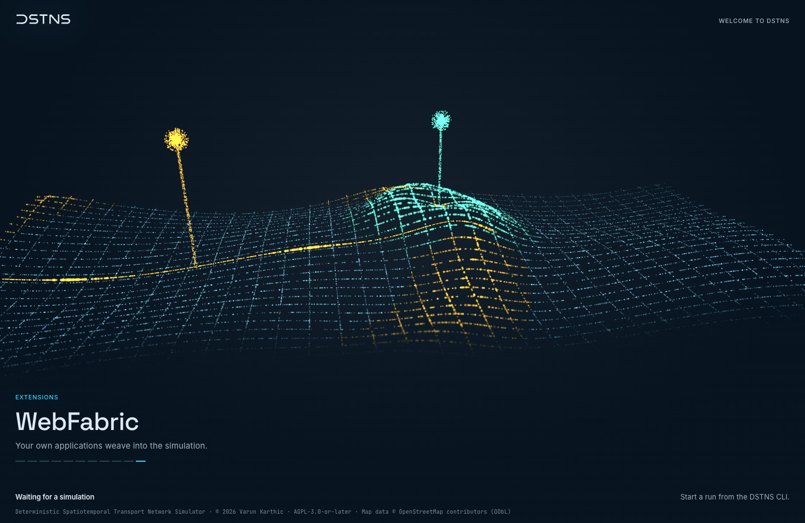
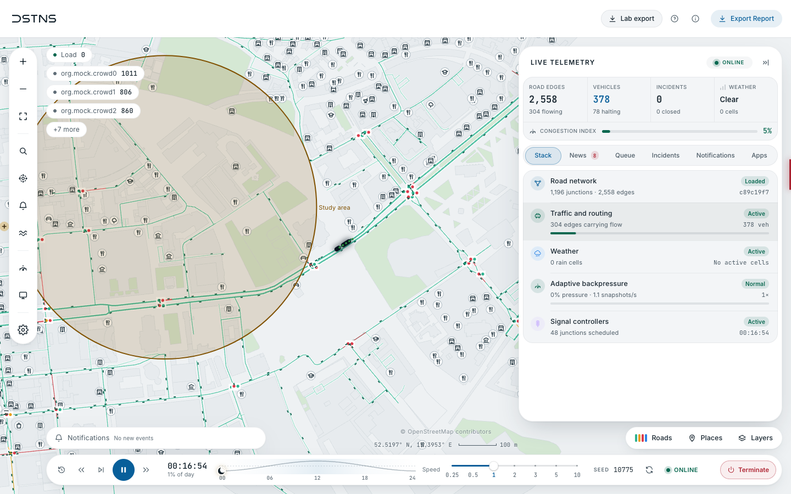
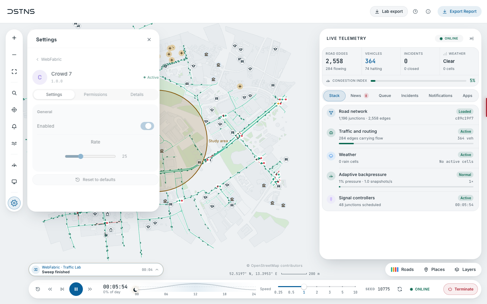

# WebFabric { .dstns-logo-title }

{ width="190" }
{ width="190" }

WebFabric is how independent applications appear in the observer. An application is
any program that calls the [Fabric API](../api/fabric-api.md). It registers itself,
declares what it wants on screen as data, and the observer draws it. Source:
`WebKit/src/webfabric/`. To write one, see
[Building applications](../development/webfabric-apps.md).

{ .screenshot }

## How it works

```text
application ──HTTP──▶ Fabric registry ◀──one poll── observer ──▶ controlled slots
     ▲                       │                          │
     └────── events ◀────────┘                          └─ sandboxed frames (optional)
```

The observer polls `GET /api/v1/fabric/state` once a second, with the revision it
already has. An idle poll costs one small response, however many applications exist.

## Slots

The observer owns every slot: placement, limits, order and appearance. An application
names a slot and supplies content. Content is rendered as text from known fields only,
so markup in a label stays visible text, and unknown fields, including style, are
ignored.

| Slot | Appears as | Limit on screen | Capability |
|---|---|---|---|
| `header` | A button in the header | 3 | `ui.header` |
| `status` | A status line over the map | 4, then "+N more" | `ui.status` |
| `map_control` | A button in the map dock | 4 | `ui.map-controls` |
| `indicator` | A mark on an edge of the map | 8 | `ui.indicators` |
| `overlay` | Shapes on the map | 16 | `ui.overlays` |
| `panel` | A side panel, one open at a time | 32 | `ui.panels` |
| `sidebar` | Room beside the map for an application's work. The map refits around it; several share it by tabs, and a person can put it away | 8 | `ui.sidebar` |
| `deck` | A section of the telemetry deck on the right, under its own tab | 8 | `ui.deck` |
| `dialog` | A dialog, one at a time, when nothing else is | 1 | `ui.dialogs` |

Limits are shared, in registration order, so a conflict resolves the same way every
time and no application can push another off screen by updating more often.

Applications name **tones** (`neutral`, `accent`, `ok`, `warn`, `danger`) and numbered
**series** (0 to 7, for things like bus lines), never colours. Fabric refuses anything
else, so light mode and colour-vision palettes reach application content by themselves. Branding, tokens and legal text are not
reachable from any declaration, and the reserved names `dstns`, `fabric` and
`webfabric` cannot be registered. Every notification is marked as coming from WebFabric, with the name of the
application that sent it and a design of its own, and every dialog says who it is from.

## Motion

An element's `motion` chooses how it arrives: `none`, `fade`, `rise`, `slide`, `scale`, `pop`
or `drop`, or a custom `{"stiffness": k, "damping": c}`. Custom springs must keep to the guidelines,
and Fabric refuses others: stiffness in [40, 1200], overshoot under 12%, and settled within 1.5 s, so
nothing feels out of place. On an overlay, a custom spring is also how its named points glide.

## On the road network

Overlay features can name parts of the road network instead of coordinates, so they stay on
the roads. They use the node and edge IDs from `GET /api/v1/view/topology`.

| Feature | Required | Options |
|---|---|---|
| `marker` | `node` | `shape`: `pin`, `stop`, `ring` or `diamond`; `size`, `label` |
| `entity` | `edge` | `at` (0 to 1 along the edge), `shape`: `bus`, `vehicle` or `dot`; `size`, `label`. With an `id` it glides between reports, facing along the road |
| `route` | `nodes` | Adjacent junctions in order, drawn along the real road shape; `width`, `dash`. With `draw_s` it draws itself along the road over that many seconds |
| `path` | `id`, `nodes` | The same route, animated. See below |

A `path` is played by the observer, so an application declares it once and sends nothing per
frame.

| Option | Default | Meaning |
|---|---|---|
| `speed_mps` | 40 | Metres of map per second of real time, 1 to 1000 |
| `loop` | false | Play again from the start |
| `bounce` | false | Turn round at each end. With `loop` it continues; without, it finishes back at the start |
| `dwell_s` | 0 | Time held at each junction on the way, and at the ends, up to 60 |
| `delay_s` | 0 | Time before it sets off, up to 600 |
| `spring` | `standard` | `smooth`, `standard`, `lively` or `snappy`, or a custom spring within the motion guidelines |
| `shape` | `bus` | `bus`, `vehicle`, `dot` or `none` |
| `reveal` | true | Draw the line as it travels |
| `trail` | true | Keep the whole line faintly visible beneath it |
| `paused` | false | Hold where it is |
| `run` | 0 | Change this number to play it again |
| `draw_s` | | Draw the line along the road over this many seconds, up to 600, rather than at `speed_mps` |
| `drive` | false | Drive it as the map's own traffic does: pull away, brake, keep to its side of the road, with brake lights. `spring` then has no effect |
| `obey_signals` | true | With `drive`, wait at junctions where the core's signal is red |
| `count` | 1 | With `drive`, how many vehicles run in a convoy, up to 12 |
| `spacing_m` | 14 | With `drive`, how far apart a convoy keeps, 2 to 200 |

The entity follows a guide that travels at the path's speed and holds at junctions. The spring
is what shapes how it pulls away and settles. With reduced motion on, the route is shown whole and nothing
travels.

Every junction in `nodes` must have a road to the next. A sequence that is not adjacent is not drawn in part: the
element is refused.

Fabric checks what it can when the UI is declared. A shape or range it does not offer is refused with
`400 INVALID_ELEMENT`. A node or edge the loaded world does not have, or a `nodes` sequence with no road
from one junction to the next, is refused with `422 NOT_ON_NETWORK`. If the world is replaced afterwards, the
observer leaves out whatever no longer exists. Roads are directed, so a two-way street is two edges.

## Several applications

Where several applications share a place, such as the deck or the sidebar, a list at the top chooses which one is
shown. Beside it are the application's own web interface, if it has one, **Reload** and **Turn off**.

- **Reload** ends the application's connection at once. If the launcher started it, the launcher starts it again, and
  it comes back with a new token and keeps what you granted it.
- **Turn off** suspends it. Its elements leave the interface, and an open panel of its own leaves gracefully rather
  than vanishing. In Settings, select any number of applications to turn off or on together, or all of them at once.

If the operator has turned WebFabric off, nothing of any application appears, and the Apps tab is gone.

## Directing the view

{ .screenshot }

With a person's grant, an application can say where the map looks and how close (`ui.camera`), and hold layers and places on or off (`ui.layers`). Its own routes and paths can choose a `style` (solid, dashed, dotted or flow), a `glow`, and a `color`, which is `auto` or one the observer makes legible.

An application asks, and the observer decides. None of it changes a person's settings, none of it is saved, and it ends when the application does. A person's move comes first, and reduced detail under load can't be undone. See the [API](../api/fabric-api.md#directing-the-view) and [security](../api/security.md#directing-the-view).

## Widgets

Every widget is drawn by the observer's own components, in its type, spacing and motion. An application says what to
show, never how to draw it.

| Kind | Widgets |
|---|---|
| Words | `heading`, `text`, `note`, `divider`, `link` (http or https only, opens in a tab of its own) |
| Figures | `stat`, `stats`, `metric` (with `delta` and `unit`), `keyvalues`, `progress`, `gauge`, `status`, `table` |
| Over time | `sparkline`, `chart` (`line`, `area` or `bars`), `bars`, `timeline` |
| The network | `route` (stops in order, each `passed`, `current` or `next`), `list` rows with a `badge`, `share` bar, `value` and `series`, `legend` (a key, or a switch with `value`) |
| Taking part | `button` (with `pick: true`, the next click on the map is reported as a place), `toggle`, `select`, `slider`, `input` (`text`, `time` or `number`), `chips` |
| Arranging | `tabs` (each with an optional `caption` above its label), `card` (widgets inside it, three deep at most) |
| A phone | `qr`: a code for a `url` or `text` of up to 213 bytes, with an optional `label` and `caption`, drawn dark on a light plate in either theme so a camera reads it |
| Booking | `seats`: up to 120 places in `columns_count` columns with an `aisle`, each `free`, `mine`, `held` or `taken`, and a `caption` at the front; choosing a free one reports `select` with its id. `countdown`: time left until `until` (milliseconds since the epoch), ticking in the observer with nothing sent, then `text` |
| Finding | `combobox`: up to 2,000 `choices` (`value`, `label`, `caption`) filtered as a person types; choosing reports `change` |
| Replaying | `player`: play and pause, a line of `steps` at `position`, and a `caption` for the step; it reports `toggle` and `seek` |
| Asking | `form`: up to 12 `fields` (`text`, `number`, `time` or `select`) sent together as `submit` with an object of values. `notice`: a line in a `tone` with one `action` button that reports `activate` |
| Showing | `code`: up to 200 `lines_text`, as written. `empty`: one of the observer's figures with a `label` and `text`. Buttons and links take an `icon` from the observer's own set |

On a panel, a sidebar or inside a tab, widgets are laid out on a grid. Without `area` each takes the whole width in
order; with `"area": {"column": 1, "width": 3}` (columns and rows from 1 to 12) two can sit side by side. Give the
element `"layout": {"columns": 6}` to choose the grid; a tab with placed widgets uses six.

An application that declares a `web` address in its manifest gets two buttons in its bar: one opens the page in a tab,
and one shows a code to scan for it on a phone. The code opens in a sheet that divides from the bar and stays inside
the application's panel, so nothing about it leaves WebFabric.

## Templates

These are arrangements of the widgets above that read well together. None needs anything beyond them.

**A planner** (`sidebar`). One tab per algorithm, each `caption`ed with which it is. Each tab opens with a sentence of
what the algorithm does, then its result as `stats` and a `progress`, then what it made as a `list`, then a way to
watch or try it: a `button` and a `slider` side by side to replay its construction, or two `button`s with `pick: true`
for the two ends of a journey and one to plan it, followed by `stats` that compare the algorithms. A `legend` closes
the sidebar, with switches for what is drawn on the map. Its network is an `overlay` of `route`s and `marker`s in
`series` colours, its vehicles a separate overlay of `path`s, and its answer a `path` with `"style": "flow"`.

```json
{"id": "planner", "slot": "sidebar", "title": "Bus planner", "label": "Built on Fabric", "widgets": [
  {"type": "tabs", "id": "view", "tabs": [
    {"id": "network", "caption": "Algorithm 1", "label": "The network", "widgets": [
      {"type": "text", "text": "Each line starts at the busiest stop not yet served."},
      {"type": "stats", "items": [{"label": "Demand covered", "value": "97%", "tone": "accent"}, {"label": "Lines", "value": "5/6"}]},
      {"type": "progress", "label": "Stops served", "value": 0.97},
      {"type": "list", "id": "lines", "rows": [{"id": "line-0", "badge": "R0", "title": "7 stops", "share": 0.2, "value": "20%", "series": 0}]},
      {"type": "button", "id": "replay", "label": "Replay the construction", "area": {"column": 1, "width": 2}},
      {"type": "slider", "id": "seek", "label": "Line", "min": 0, "max": 5, "step": 1, "value": 2, "area": {"column": 3, "width": 4}}]},
    {"id": "journey", "caption": "Algorithm 2", "label": "A journey", "widgets": [
      {"type": "button", "id": "pick-from", "label": "Choose where from", "pick": true, "area": {"column": 1, "width": 3}},
      {"type": "button", "id": "pick-to", "label": "Choose where to", "pick": true, "area": {"column": 4, "width": 3}},
      {"type": "button", "id": "plan", "label": "Plan the journey", "tone": "accent"},
      {"type": "stats", "items": [{"label": "A* settled", "value": 973, "tone": "accent"}, {"label": "Dijkstra settled", "value": 2650, "tone": "warn"}]}]}]},
  {"type": "legend", "legend": [{"label": "Bus line", "series": 0, "mark": "line"}, {"id": "moving", "label": "Moving buses", "value": true}]}]}
```

**A board** (`deck` or `panel`). A `metric` or `stats` row at the top, a `chart` or `sparkline` of how it has
changed, then the detail as a `list` or `table`. Updated with `PUT .../ui/{element}` once a second at most.

**Sharing to a phone** (`web` in the manifest, or a `qr` widget). For a page people should open on their own phones,
such as ticketing, declare it as `web` and the code comes with the bar. To show a code for something else, a seat or
a booking, put a `qr` in a `card`.

`Fabric/examples/bus_planner.py` is the planner template running against any world, with `--web` to offer a page on a
phone.

### From an existing application

The group-08 bus route planner (a ticketing portal, an algorithm dashboard and a control room) uses these, and each has
its widget:

| In the application | In WebFabric |
|---|---|
| Algorithm tabs with a step caption | `tabs` with `caption` |
| Figures (demand covered, lines, stops), A* against Dijkstra | `stats`, `metric` |
| Coverage bar, a line's share | `progress`, `list` rows with `share` |
| Lines with a coloured badge | `list` rows with `badge` and `series` |
| Replay the construction | `player` |
| From and to stops, searched | `combobox`, or `button` with `pick: true` to choose on the map |
| Swap, random, re-plan | `button` with `icon` |
| Next bus, ride length, walks | `metric`, `route`, `timeline` |
| Seat map and its key | `seats` |
| Seat held for you | `countdown` |
| Journey summary, fare | `keyvalues` |
| Conductor's validation form | `form` |
| Errors with Try again | `notice` |
| Phone link and ticket codes | `web` in the manifest, `qr` |
| Control room logs | `code` |
| No bookings yet | `empty` |
| Legend with layer switches | `legend` |
| Bus lines and buses on the map | `overlay` with `route`, `marker` and `path` |

## What is checked

| | What |
|---|---|
| Refused (`400 INVALID_ELEMENT`) | An unknown slot or tone; a colour where a tone belongs; a link that is not http or https; an `area` outside 1 to 12; widgets nested more than three deep; a `qr` with nothing in it or more than 213 bytes; a custom motion that is too stiff, overshoots more than 12% or takes longer than 1.5 s to settle; a frame without its grant |
| Refused (`413 UI_TOO_LARGE`) | More than 64 elements, or more than 4 MiB of declared interface |
| Adjusted | A route or path's own colour is made legible against the map and given a pattern under a colour-vision palette; elements past a slot's limit wait their turn, in registration order; a grid asks for 1 to 12 columns; text is drawn as text, so markup in it stays visible |
| Reported | An element that fails to draw hides its application and is reported as a failure; refusals, rate limits and lapsed leases are counted in the application's health in Settings |

## Where it lives

The server side is in `Fabric/src/webfabric/` (`routes.cpp`, `registry.cpp`) and
`Fabric/include/dstns/webfabric/`. The observer's side, which draws what is declared, is in
`WebKit/src/webfabric/`. A worked example is `Fabric/examples/bus_planner.py`.

## Isolation

| Boundary | What it gives |
|---|---|
| Declarative slots | An application's data never becomes markup or code in the page |
| Sandboxed frames | A panel's own page runs with `sandbox="allow-scripts"` and no `allow-same-origin`. It has an opaque origin, so the browser denies it this page's DOM, storage and cookies, and the server refuses it |
| Capability-checked bridge | A frame can only post messages. Each is checked against what its application has been granted |
| Error boundaries | A fault while drawing one application hides that application and reports it; the rest of the interface carries on |
| Content Security Policy | The observer's own page loads scripts only from this server |
| Leases | An application that stops checking in is suspended, then unloaded, and its UI goes with it |

See [what this does not protect](../deployment/security.md#applications).

!!! note "A limit of frames"
    A sandboxed frame may share a thread with the page in some browsers, so a frame in
    a tight loop can slow the interface even though it cannot reach it. Keep heavy work
    in the application's own process, or in a worker inside the frame.

## Settings

{ .screenshot }

**Settings → Applications → WebFabric** lists registered applications, with search.
One application is on screen at a time, so any number stays navigable. Each has its
settings, drawn from its schema with the same controls as the rest of Settings; its
permissions; and details including state, recorded actions, suspend, resume and
forget. A separate list shows applications waiting for permission.

Unlike the observer's own presentation preferences, which stay in each browser,
application settings live on the server, because the application has to read them.
Each is reachable only with that application's token or from the observer.

## Performance

| Rule | Why |
|---|---|
| One poll for all applications | Twelve applications cost the same as one |
| After the first poll, only changes travel | An application moving its buses resends one element, not its network |
| Named overlay points glide | A bus reported once a second moves on a spring between reports |
| Declared UI is state and coalesces | A thousand updates between polls are one render of the latest value |
| Unchanged elements keep their identity | Memoised components skip them, so one application updating does not redraw the others |
| Overlays redraw outside React | A camera move does not re-render the shell |
| Events are lossless | Notifications and actions use cursors, and a flood is refused with `RATE_LIMITED`, never dropped silently |
| Frames follow the observer | They receive the simulation summary once per delivered snapshot, latest only |

Measured in Chrome with twelve applications, each updating as fast as the server would
answer: over 20,000 updates in six seconds held 60 fps, with a 95th-percentile frame of
16.8 ms and no long tasks (`WebKit/tests/browser-webfabric.mjs`). That is a headless
run on an Apple silicon laptop, so treat it as a comparison rather than a promise.

## Licence

WebFabric is part of DSTNS, © 2026 Varun Karthic, under
[AGPL-3.0-or-later](../license.md). Applications are independent; see
[Applications and the licence](../license.md#applications-and-the-licence).
