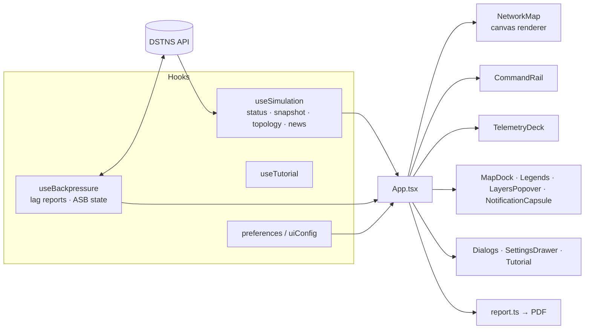

# Observer (WebKit)

Source: `WebKit/` — React 19, TypeScript, Vite, Vitest, jsPDF. The full
user-facing guide is [Observer interface](../guide/observer-interface.md); this
page is the developer's map.

## Data flow



## Subsystems

`WebKit/src` is divided into subsystems, each a folder with one responsibility. Lower ones never
use higher ones, so a model or a motion primitive can be read, tested and reused without the
interface around it; `tests/architecture.test.ts` holds the table and fails on any import across
it that is not there on purpose.

| Subsystem | Holds | May use |
|---|---|---|
| `CoreMotion/` | Motion shared by everything: the spring model and interaction physics (`motion.ts`, `motion.css`), how a limit gives when pushed (`resistance.ts`), keeping a surface mounted while it leaves (`presence.ts`), panels that grow and settle (`FluidPanel.tsx`), and the only door to the vendored Hairline figures (`EmptyFigure.tsx`); see the [interface system](../design/interface-system.md) | `vendor/` |
| `core/` | What everything reads: the typed API client (`api.ts`), the server's types, features and configuration (`uiConfig.ts`, `preferences.tsx`, `shortcuts.ts`), units and time formats, themes (`appearance.ts`), and the plain models of the map and the news (`mapModel.ts`, `mapProjection.ts`, `notificationModel.ts`, `notificationGroups.ts`) | `CoreMotion/` |
| `simulation/` | The live run: polling status, snapshots and news (`useSimulation.ts`), backpressure (`useBackpressure.ts`), steady status, the daemons, and the telemetry record (`telemetryModel.ts`, `telemetryRecorder.ts`) | `core/` |
| `components/` | Building blocks with no knowledge of a run: popovers, tooltips, the quantized slider, icons, logos and the settings controls | `core/`, `CoreMotion/` |
| `notifications/` | The notification capsule, history, the ISD handler, and choosing and framing events (`autoFocus.ts`, `focusNotification.ts`) | `core/`, `CoreMotion/`, `components/` |
| `map/` | The map (`NetworkMap.tsx`), its dock, readout, legends, layers, tiles, traffic flow and place glyphs | the above, and `notifications/` |
| `webfabric/` | Registered applications: state, slots, sandboxed frames, overlays and settings; see [WebFabric](webfabric.md) | `core/`, `CoreMotion/`, `components/`, `map/` |
| `film/` | The start-up film (`BootScene.tsx`, `bootScenes.ts`), splash, loading surface, the jump film and Presentation | the above, and `webfabric/` |
| `report/` | The PDF report, its cover, map and illustrations, built on a worker (`reportWorker.ts`), and the film while it is made | `core/`, `components/`, `simulation/`, `map/`, `film/` |
| `tutorial/` | The guided tour | `core/`, `components/` |
| `panels/` | The command rail, Time Control, the telemetry deck, Settings, shortcuts, dialogs and the viewport | everything above but `report/` and `map/` |
| `styles/` | Design tokens and layout (`theme.css`, `system.css`, `hud.css`, `style.css`, `design.css`, `webfabric.css`) | |

`App.tsx` composes them and `main.tsx` starts it. Two imports cross the table for now, and the
test names them: an inspection tooltip draws a place's glyph from the map's legends, and an
application's dialog shares the observer's scrim from `panels/Dialogs.tsx`.

## Principles

- **No simulation state of its own.** Everything shown comes from the API;
  preferences only change presentation.
- **One poll at a time.** A new poll starts a second after the previous one
  finishes, so a slow server is never flooded.
- **Same-origin requests.** In development Vite proxies `/api`; in production
  the server serves the bundle. Writes from other origins are refused by the
  server.
- **Minimum size** 1280 × 640; below it the interface says so.
- **Applications are data.** What applications declare is drawn by the observer in
  slots it controls, and arrives through one poll of its own.

## Working on it

```bash
npm ci --prefix WebKit
./scripts/dev.sh                          # server on 8090 + Vite on 5173
npm test --prefix WebKit               # 24 files, 286 tests
npx --prefix WebKit tsc -b             # type check
```

See [Testing: observer suites](../development/testing.md#observer-suites).
