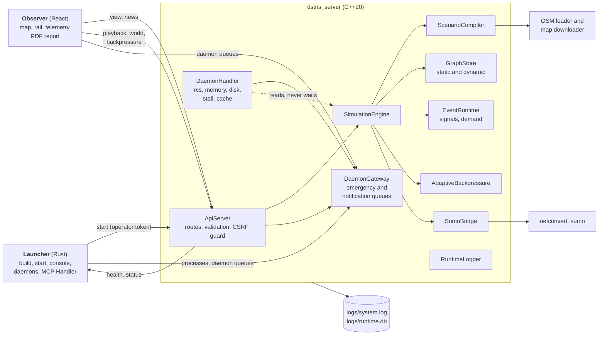
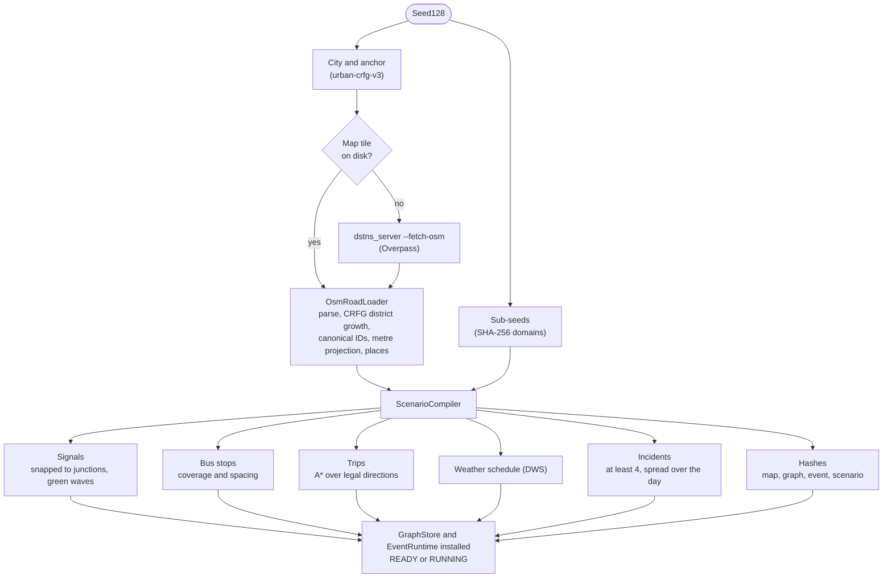
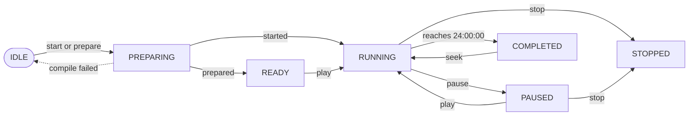

# Architecture

DSTNS is one C++20 process that owns the simulation and serves it over HTTP,
with daemons inside it that watch it and the machine; a Rust launcher that
builds, starts and supervises that process; and a React observer that watches
a run in the browser. This page describes how those parts
fit together, which threads exist and what they own, how a run moves through
its lifecycle, and where each concern lives in the source tree.


## System overview



The core is the single authority. The CLI decides *what* runs: seed, map,
day type, duration, speed. The observer decides only *how it is watched*,
apart from a small set of playback controls and world regeneration. Neither
holds simulation state of its own; both read what the core publishes.

## Source layout

| Path | Contents |
|---|---|
| `Core/server/main.cpp` | Process entry: flags, operator credential, cache sweep, engine and API start-up |
| `Core/common/` | What every engine stands on, library `dstns_common`: the types, RNG, map catalogue and OSM pipeline, the demand and signal model (`events.cpp`, `demand.cpp`), weather helpers, logging, ASB, and the runtime host `SimulationEngine`, which has no engine of its own |
| `Core/core-ng/` | `core-ng`, the default engine, library `dstns_core_ng`, which links `dstns_common` only: selection policies (`selection.cpp`), the compile (`compile.cpp`, `network.cpp`, `plans.cpp`), the tick (`physics.cpp`), checkpoints (`timeline.cpp`), and the lifecycle and world-job tables. `dstns_core_ng_alone` proves it runs a world with no core-legacy code linked |
| `Core/core-legacy/` | `core-legacy`, kept installed and selectable, library `dstns_core_legacy`: its compiler (`scenario.cpp`), tick and checkpoints (`physics.cpp`), and its registration (`legacy.cpp`) |
| `Core/engines/` | `install_engines`: registers both engines in a runtime host, through the same hooks (`dstns/engine_hooks.hpp`) |
| `Fabric/` | The HTTP API library `dstns_fabric`, one route module per API group |
| `Core/common/src/engine.cpp` | `SimulationEngine`, the runtime host: lifecycle, clock, controls, undo/redo, views; the compile, tick and checkpoints are the running world's engine's, through its hooks |
| `Fabric/src/` | `ApiServer`: every HTTP route, request validation, error mapping, CSRF guard |
| `Core/core-legacy/src/scenario.cpp` | `ScenarioCompiler`: seed and config to a complete `Scenario` (graph, signals, stops, trips, weather, incidents) |
| `Core/common/src/osm.cpp` | `OsmRoadLoader`: OSM XML to a connected, canonically numbered road graph and its places |
| `Core/common/src/osm_fetch.cpp`, `osm_download.cpp` | On-demand map download, run as `dstns_server --fetch-osm` in a process of its own, progress, cache sweep |
| `Core/common/src/geo.cpp` | The 181-city catalogue and seed-to-location resolution |
| `Core/common/src/graph.cpp` | `GraphStore` (static graph plus per-tick dynamic arrays) and `RoutePlanner` (A*) |
| `Core/common/src/events.cpp` | `EventRuntime`: signal controller heap, demand schedule, couplings, event history |
| `Core/common/src/demand.cpp` | Place taxonomy, diurnal demand curves, demand couplings, bus-stop thinning |
| `Core/common/src/asb.cpp` | Adaptive Simulation Backpressure |
| `Core/common/src/rng.cpp` | `Seed128`, SHA-256 sub-seed derivation, counter-based Philox RNG |
| `Core/common/src/sumo_bridge.cpp` | SUMO detection, export, `netconvert` and `sumo` invocation |
| `Core/common/src/logging.cpp` | `RuntimeLogger`: text system log and SQLite runtime journal |
| `Core/common/src/utf8.cpp` | UTF-8 repair and JSON serialisation guard for untrusted text |
| `WebKit/` | The observer: React 19, Vite, Vitest, jsPDF |
| `LaunchKit/` | The launcher, in Rust: command line, console and its tools (`inspect.rs`), terminal interface (ratatui) and Simplified Launch Control, compatibility mode, application supervisor, the MCP Handler, Advanced Security (`security.rs`, with `assets/verify.swift`), the launcher's model for plain-word requests (`assistant.rs`) and its side of the daemons (`daemons.rs`) |
| `CoreAI/` | DSTNS's model layer, in Rust: every provider (Apple's Foundation Models, Ollama, LM Studio, Anthropic, OpenAI, Gemini, Groq, Mistral, OpenRouter, Hugging Face, any Chat Completions server), their keys, typed errors and fallback, and a token-guarded service on 127.0.0.1 for the engine's news ([CoreAI](../components/coreai.md)) |
| `launcher` | Builds the launcher when its sources change, then runs it |
| `Core/common/src/next_world.cpp` | Dynamic Fastboot: the next world chosen and its city fetched while this one runs |
| `Daemon/` | The daemons, `dstns_daemon`: the handler, the gateway and its two queues, the Resource Control Subsystem, the memory, disk and stall watchers, the auto cache handler, process and machine readings, and `messages.json`, the templates every message is made from. See [the daemons](../guide/daemons.md) |
| `Fabric/src/routes_daemon.cpp` | `/api/v1/daemon/…`: the open overview, the queues, acknowledgement, and turning daemons on and off |
| `tools/release/` | `dstns_release`: image metadata, publishing, the image smoke test and licence headers |
| `scripts/` | Build, test, fetch and reset helpers |
| `tests/` | Native unit, property, replay and performance suites; the HTTP suites (`tests/http/`, C++, on one harness) |
| `tools/` | `dstns_scenario_export`, `dstns_road_index`, `dstns_replay_verify`, `dstns_benchmark` |
| `docker/`, `Dockerfile`, `docker-compose.yml` | Container build and TLS gateway |
| `config/` | `defaults.json` (run defaults), `ui-config.json` (observer defaults) and `daemon-alerts.json` (the daemons' alerts) |

## The core process

### Threads and locking

| Thread | Created by | Does |
|---|---|---|
| HTTP workers | cpp-httplib's thread pool | Parse requests, call the engine, serialise responses |
| Engine loop (`worker_`) | `SimulationEngine` constructor | Wakes every 50 ms; while `RUNNING`, advances the model to where the wall clock says it should be; writes `global_view.json` every 10 s |
| World worker (`world_worker_`) | `start_async`, `regenerate_world` | Compiles a scenario (possibly downloading a map) off the request thread, then installs it |
| Downloader child | `osm_fetch.cpp` via `posix_spawn` | Runs `dstns_server --fetch-osm` in its own process group, so termination can kill it and its descendants |
| Shutdown worker | `terminate` handler | Stops the listener; a detached 3 s backstop guarantees the process exits |
| Daemons | `DaemonHandler::start`, as the API starts | One thread for each daemon, each waking at its own interval (1 s for `rcs` and `stall`, 2 s for `memory`, 5 s for `cache`, 10 s for `disk`). They read the engine only through accessors that try its lock and give up at once, so a compile never holds them up, and they stop first when the server ends |
| Signal listener | `main` | Waits on a pipe that the `SIGTERM`, `SIGINT` and `SIGHUP` handlers write to; stops the map downloads, then ends the process by the same signal |

One mutex, `SimulationEngine::mutex_`, guards all simulation state. Every view
and every control takes it, so a response is always a coherent picture of
one instant. Compilation deliberately runs **without** the lock: a map
download can take a minute, and status, health and map progress must stay
readable throughout. Three mechanisms make that safe:

- **A compile lease** (`CompileLease`, an atomic flag) means at most one compile
  is in flight. A second start or regeneration gets HTTP 409.
- **A compile generation counter.** Every start, prepare, reset or regeneration
  increments `compile_generation_`, and a compile installs its result only if
  the counter has not moved since it began. A reset during a download therefore
  discards the downloaded world rather than installing it.
- **A lock-free lifecycle mirror.** `transition()` mirrors the lifecycle into an
  atomic, so `/health` answers without the mutex.

SUMO runs follow the same rule: `sumo_simulate` copies the scenario under the
lock and runs the external tools without it.

### From seed to world



See [deterministic seeding](deterministic-seeding.md), [OSM map
generation](osm-map-generation.md) and [graph model](graph-model.md).

### Static and dynamic state

`GraphStore` keeps the compiled `Scenario` immutable and holds two dynamic
arrays alongside it, one `NodeDynamic` per node and one `EdgeDynamic` per
directed edge. Each physics step rewrites the dynamic arrays and then
`commit()` bumps `state_revision`. Topology never changes during a run, so the
observer fetches it once per `run_id` and then polls only snapshots.

### The virtual clock

A run simulates one day, 86,400 virtual seconds, in `playback_duration_s`
wall-clock seconds (60 to 3600) at the base rate, scaled by the tick rate
(greater than 0, at most 5). The engine loop computes

```
target = anchor_virtual_s + (now - anchor_wall) × (86400 / playback_duration_s) × tick_rate
```

and steps the physics one virtual second at a time up to `target`. Every rate
change, pause, play or seek first catches up to the wall clock and then
re-anchors, so changing the rate never applies retroactively. Physics always
advances in one-second steps whatever the rate, so the rate changes pacing,
never results.

### The concurrency primitives in code

The three mechanisms above are small. Reading them is the quickest way to
understand how a minute-long map download coexists with a responsive server.

**The compile lease.** At most one compile may run, whichever request started it.
The lease is an RAII guard over an atomic flag; constructing a second one throws,
which the API maps to HTTP 409:

```cpp
struct CompileLease {
    std::atomic<bool>& busy;
    explicit CompileLease(std::atomic<bool>& flag): busy(flag) {
        bool expected = false;
        if (!busy.compare_exchange_strong(expected, true))        // atomically: false -> true, or fail
            throw std::logic_error("world generation already in progress");
    }
    ~CompileLease() { busy.store(false); }                         // released however the scope exits
};
```

`compare_exchange_strong` makes check-and-set a single atomic step, so two requests
arriving together cannot both win. It is an atomic flag rather than a mutex because a
lease may be taken on an HTTP thread and released on the world worker thread, and a
`std::mutex` must be unlocked by the thread that locked it.

**The generation counter.** A compile runs without the engine lock, so by the time it
finishes the world it was building may have been reset. Each compile records the
generation it started under, and installs its result only if that is still current:

```cpp
const auto generation = ++compile_generation_;                     // taken while holding the lock
lock.unlock();
auto scenario = compiler_.compile(seed, config, compile_progress()); // slow; no lock held
lock.lock();
if (generation != compile_generation_ || terminate_requested_)
    throw std::logic_error("world preparation cancelled by runtime change");
```

`reset()` and `terminate()` bump `compile_generation_`, so a download that finishes
after a reset is discarded instead of resurrecting the world. The pattern is
optimistic concurrency: do the expensive work without a lock, then validate that
nothing relevant changed before committing.

**The lifecycle mirror.** `/health` must answer even while the engine mutex is held
for a download, so every state transition also writes an atomic copy that readers
can load without the lock:

```cpp
void SimulationEngine::transition(Lifecycle next) {
    const auto old = lifecycle_;
    lifecycle_ = next;                                              // guarded by the mutex
    lifecycle_mirror_.store(next, std::memory_order_relaxed);       // readable without it
    ++playback_revision_;
    logger_.lifecycle(run_id_, to_string(old), to_string(next), /* ... */);
}
Lifecycle SimulationEngine::lifecycle() const {
    return lifecycle_mirror_.load(std::memory_order_relaxed);       // no lock
}
```

Relaxed ordering is enough because the mirror carries a single self-contained value
and nothing else is published through it. Every transition goes through this one
function, so the mirror cannot drift from the real state.

## Run lifecycle



From `RUNNING`, `PAUSED`, `COMPLETED` and `STOPPED`, **reset** returns the server to
`IDLE`. From `IDLE` or any run state, **terminate** moves it to `TERMINATING` and the
process exits.

`SEEKING` is a transient state held while a seek or step replays physics. A
seek from `COMPLETED` back into the day pauses there, or runs if `play` was
requested. World regeneration pauses the current world, compiles the new one
in the background, and installs it `PAUSED` at 00:00:00. If that compile fails,
the old world is left exactly as it was.

## The HTTP layer

`ApiServer` registers every route in one function, `routes()`, and serves the
built observer from `WebKit/dist`. Three cross-cutting pieces sit in front
of every handler:

1. **The pre-routing guard** refuses cross-site state changes
   (`CROSS_ORIGIN_FORBIDDEN`) and starts that lack the operator credential
   (`CLI_START_REQUIRED`). See [Security](../deployment/security.md).
2. **The exception handler** maps C++ exception types to HTTP statuses and
   stable error codes, so handlers validate by throwing. See
   [API errors](../api/errors.md).
3. **The access logger** records method, path and status in the SQLite journal.

Every read view uses the same envelope (`run_id`, `seed`, `state_revision`,
`config_revision`, `clock`, `data`), so a client can always tell which run and
which instant a payload describes. See the [API reference](../api/reference.md).

## The observer

The observer is a single-page React application. `useSimulation` polls
`/playback/status` once a second, then `/view/snapshot` and `/news`, and
fetches `/view/topology` only when `run_id` changes. `useBackpressure` reports
the observer's lag and frame time to `/system/backpressure`, and the core
answers with what the interface may do: slow down, lock speed, disable motion,
or suspend. Everything else (the map canvas, the command rail, telemetry,
notifications, Auto Focus, the PDF report) derives from those polls. See
[Observer interface](../guide/observer-interface.md) and
[ASB](backpressure.md).

## The launcher

`./launcher` builds and runs the Rust program in `LaunchKit/`. One set of operations
(process supervision, API calls, configuration and its rules, saved seeds, applications)
serves five faces: single commands for scripts, the [console](../guide/console.md)
(command lines joined by `|`, `&&`, `||` and `;`), the terminal interface,
[Simplified Launch Control](../guide/operator-cli.md#simplified-launch-control) for small
terminals, and compatibility mode. Requests in plain words go to the launcher's own model
(through [CoreAI](../components/coreai.md): Apple's Foundation Models, a local model server or
a cloud provider), whose suggestion is checked and put on the
prompt, never run by itself; [Advanced Security](../guide/operator-cli.md#advanced-security)
can require the system's prompt before anything is changed. The [MCP Handler](../guide/mcp.md) offers the same operations, and every
route of the API, to an AI client.
The launcher is the supported way to start a run. It
rebuilds the native core and the observer when their sources have changed,
reuses a healthy server on the configured port or picks a free one, waits for
health, opens the observer, waits for it to load, and then posts the start
request with the operator credential the server wrote to `logs/operator.token`.
It also runs the test suites, reads logs, edits defaults and manages saved
seeds. See [Operator CLI](../guide/operator-cli.md).

## Deployment shapes

| Shape | How | Notes |
|---|---|---|
| Local, recommended | `./launcher` | Builds as needed, binds `127.0.0.1:8090` by default, serves the observer itself |
| UI development | `npm run dev --prefix WebKit` against a running core | Vite proxies `/api`, `/health` and `/media` to `DSTNS_API_PORT` (default 8090), so requests stay same-origin |
| Containers | `docker compose up` | One container serves the engine, the API and the observer on 8090; an optional nginx TLS gateway on 8443 (`--profile tls`). See [Docker](../deployment/docker.md) |

## Determinism boundaries

Everything that affects simulation results derives from the seed and the
resolved configuration: map choice, district, signals, stops, trips, weather,
incidents and demand noise. Things that deliberately do **not** feed back into
results:

- wall-clock pacing and the tick rate;
- the observer and anything it displays;
- ASB, which governs pacing only;
- SUMO, which is a separate batch adapter and never writes back into the
  aggregate model.

Operator controls (overrides, toggles, surges, manual rain) are part of a run's
history and change its results from the moment they are applied. See
[Reproducibility](reproducibility.md).

## Related documents

- [Simulation engine](simulation-engine.md): the physics step, checkpoints, controls and undo
- [API reference](../api/reference.md) and [errors](../api/errors.md)
- [Security](../deployment/security.md)
- [Configuration](../guide/configuration.md)
- [Testing](../development/testing.md)
- [Mathematical model](mathematical-model.md)
