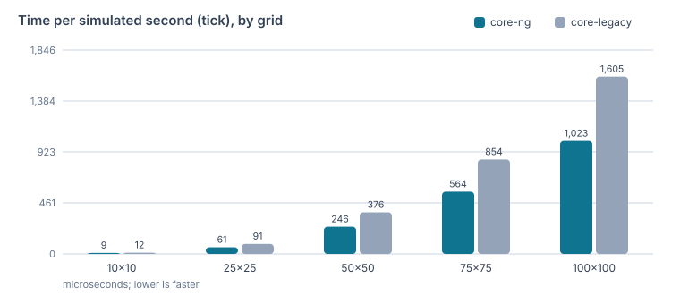
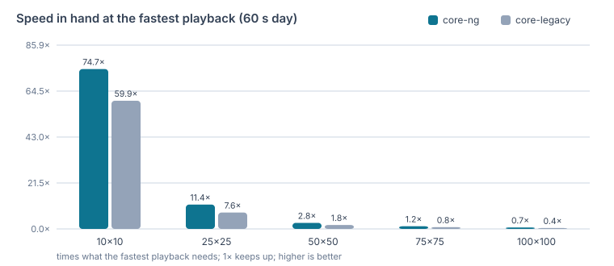
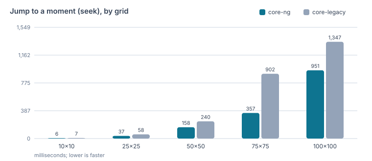
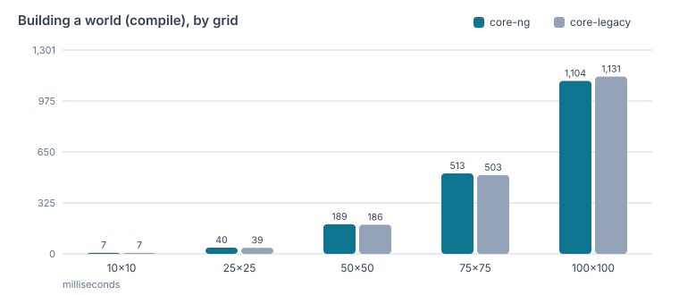
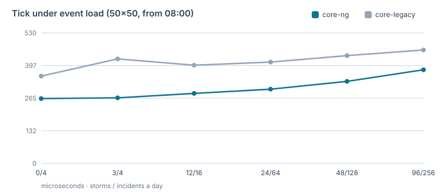
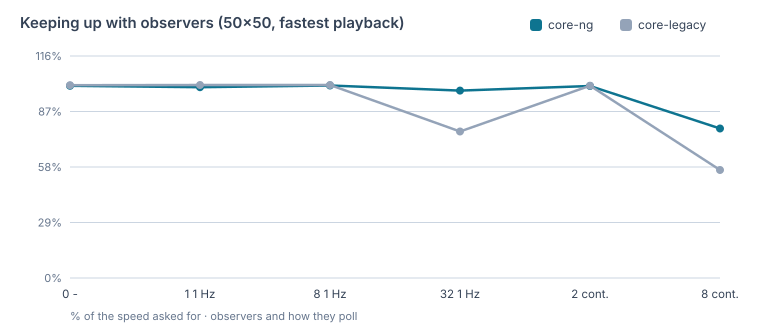
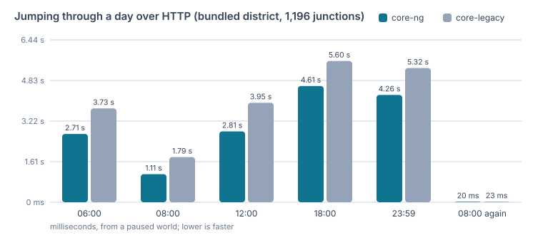
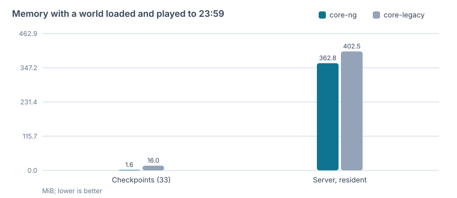

---
search:
  boost: 2
---
# Engine benchmarks

core-ng and core-legacy, measured side by side on every grid size, under event load, with observers watching, and
end to end through the HTTP API on a real district. Both engines make the same world from the same seed, bit for
bit (the hashes below match), so every difference here is speed or memory, never a different result.

!!! summary "In short"
    - **Each simulated second** takes 20 to 36% less time on core-ng, more on larger grids: 246 µs
      against 376 µs on a 50 × 50 grid, 1.02 ms against 1.60 ms on 100 × 100.
    - **Jumping to a moment** takes 34% less at 50 × 50 and 60% less at 75 × 75;
      over HTTP on the bundled district, 13 to 38% less.
    - **The fastest playback** (a day in 60 seconds) keeps up on grids up to 75 × 75 on core-ng (1.2×), and only
      up to 50 × 50 on core-legacy (0.8× at 75 × 75).
    - **Checkpoints** take 90% less memory (1.6 MiB against 16.0 MiB for a day of the
      bundled district), and the server 10% less resident memory.
    - **What both share is the same**: building a world, snapshots, the topology, routing, and HTTP response times.

## How it was measured

| | |
|---|---|
| Machine | Apple M4 (4P+6E), 10 hardware threads, macOS, nothing else running |
| Build | Release (`-O3`), DSTNS 3.13.3 (core-ng 1.2.2), one build for both engines |
| Program | `build/dstns_benchmark --suite network,events,observers --engine NAME` |
| Repeats | Network sizes: three full runs per engine, the median of each figure. Event load and observers: one run each |
| End to end | A real `dstns_server` per engine on the bundled 1,196-junction district (`data/fixtures/real_network.osm.xml`, seed 382923), measured over HTTP: 200 requests after 20 to warm up for each figure |
| Grids | Synthetic street grids, from 10 × 10 (100 junctions, 360 roads) to 100 × 100 (10,000 junctions, 39,600 roads) |

A **tick** is one simulated second of the whole network. **Headroom** is ticks a second over the 1,440 that the
fastest playback (a day in 60 seconds) needs: below 1× that speed falls behind. The default one-hour day needs 24
ticks a second, so every grid here keeps up with it on either engine, with at least 23 times to spare.

To run them yourself:

```bash
./build/dstns_benchmark --engine core-ng                  # every suite, every grid
./build/dstns_benchmark --engine core-legacy --suite network 50 100
./build/dstns_benchmark --quick --json out.json           # a shorter run, as JSON
```

core-legacy is disabled for runs by default; the benchmark program runs it directly, so no setting is needed.

## Time per simulated second



| Grid | Junctions | Roads | core-ng | core-legacy | Difference |
|---|---|---|---|---|---|
| 10 × 10 | 100 | 360 | 9 µs | 12 µs | 20% less |
| 25 × 25 | 625 | 2,400 | 61 µs | 91 µs | 33% less |
| 50 × 50 | 2,500 | 9,800 | 246 µs | 376 µs | 34% less |
| 75 × 75 | 5,625 | 22,200 | 564 µs | 854 µs | 34% less |
| 100 × 100 | 10,000 | 39,600 | 1,023 µs | 1,605 µs | 36% less |

What makes the difference is in [how core-ng works](../guide/engines.md): one pass over the roads where core-legacy
makes several, values that never change during a day worked out once, and an event queue that moves no text. The
arithmetic, and its order, are the same, which is why the results are.

### Headroom at the fastest playback



| Grid | Junctions | Roads | core-ng | core-legacy | Difference |
|---|---|---|---|---|---|
| 10 × 10 | 100 | 360 | 74.73× | 59.91× | 25% more |
| 25 × 25 | 625 | 2,400 | 11.38× | 7.65× | 49% more |
| 50 × 50 | 2,500 | 9,800 | 2.82× | 1.85× | 53% more |
| 75 × 75 | 5,625 | 22,200 | 1.23× | 0.81× | 52% more |
| 100 × 100 | 10,000 | 39,600 | 0.68× | 0.43× | 57% more |

## Jumping to a moment

A jump restores the nearest checkpoint before the target and plays the seconds after it, so it gains what the tick
gains, and core-ng's compressed checkpoints restore as fast as plain copies.



| Grid | Junctions | Roads | core-ng | core-legacy | Difference |
|---|---|---|---|---|---|
| 10 × 10 | 100 | 360 | 6.0 ms | 7.4 ms | 19% less |
| 25 × 25 | 625 | 2,400 | 37.5 ms | 58.1 ms | 36% less |
| 50 × 50 | 2,500 | 9,800 | 158 ms | 240 ms | 34% less |
| 75 × 75 | 5,625 | 22,200 | 357 ms | 902 ms | 60% less |
| 100 × 100 | 10,000 | 39,600 | 951 ms | 1,347 ms | 29% less |

## Building a world

Both engines compile a world with the same calculations; core-ng only arranges them in smaller parts.



| Grid | Junctions | Roads | core-ng | core-legacy | Difference |
|---|---|---|---|---|---|
| 10 × 10 | 100 | 360 | 6.7 ms | 6.5 ms | the same |
| 25 × 25 | 625 | 2,400 | 40.2 ms | 39.1 ms | the same |
| 50 × 50 | 2,500 | 9,800 | 189 ms | 186 ms | the same |
| 75 × 75 | 5,625 | 22,200 | 513 ms | 503 ms | the same |
| 100 × 100 | 10,000 | 39,600 | 1,104 ms | 1,131 ms | the same |

## Under event load

A 50 × 50 grid from 08:00, with more storms and incidents a day than the defaults ever make. The news items are the
same on both engines, as the events are.



| Storms a day | Incidents a day | core-ng | core-legacy | Difference | News items |
|---|---|---|---|---|---|
| 0 | 4 | 263 µs | 355 µs | 26% less | 4,487 |
| 3 | 4 | 266 µs | 424 µs | 37% less | 4,542 |
| 12 | 16 | 284 µs | 399 µs | 29% less | 4,702 |
| 24 | 64 | 301 µs | 411 µs | 27% less | 4,862 |
| 48 | 128 | 333 µs | 437 µs | 24% less | 5,218 |
| 96 | 256 | 380 µs | 461 µs | 17% less | 5,946 |

## With observers watching

A 50 × 50 grid at the fastest playback while observers ask for snapshots, once a second or as fast as they can. "Keeps
up" is the share of the requested speed the run achieves.



| Observers | Polling | core-ng keeps up | core-legacy keeps up | Snapshot median (ng / legacy) | Snapshot p95 (ng / legacy) |
|---|---|---|---|---|---|
| 0 | - | 101% | 101% | - / - | - / - |
| 1 | 1 Hz | 100% | 101% | 80 ms / 81 ms | 317 ms / 324 ms |
| 8 | 1 Hz | 101% | 101% | 81 ms / 83 ms | 101 ms / 100 ms |
| 32 | 1 Hz | 98% | 77% | 133 ms / 137 ms | 177 ms / 212 ms |
| 2 | continuous | 101% | 101% | 90 ms / 95 ms | 100 ms / 112 ms |
| 8 | continuous | 78% | 57% | 177 ms / 173 ms | 208 ms / 204 ms |

With 32 observers polling once a second, core-ng holds 98% of the speed and core-legacy 77%; with 8 polling
continuously, 78% and 57%. The time to build a snapshot is the same on both; core-ng has more time left between them.

## What both share

Snapshots, the topology and routing are the host's code, the same for both engines, and measure the same:

| Grid | Snapshot (ng / legacy) | Snapshot as JSON | Snapshot size | Topology, first time | Topology, cached | One A* route |
|---|---|---|---|---|---|---|
| 10 × 10 | 2.3 ms / 2.4 ms | 0.7 ms | 0.15 MiB | 3.4 ms / 3.4 ms | 0.01 ms | 1.6 µs / 1.6 µs |
| 25 × 25 | 12.3 ms / 12.4 ms | 4.8 ms | 0.96 MiB | 22.2 ms / 22.7 ms | 0.04 ms | 30.6 µs / 29.6 µs |
| 50 × 50 | 50.6 ms / 49.6 ms | 19.7 ms | 3.93 MiB | 89.4 ms / 88.3 ms | 0.14 ms | 123.0 µs / 122.6 µs |
| 75 × 75 | 114 ms / 114 ms | 45.2 ms | 8.92 MiB | 203 ms / 203 ms | 0.39 ms | 316.1 µs / 310.3 µs |
| 100 × 100 | 203 ms / 204 ms | 80.9 ms | 15.95 MiB | 374 ms / 375 ms | 0.85 ms | 565.9 µs / 569.2 µs |

## End to end, on a real district

A server per engine, the bundled Berlin district (1,196 junctions, 2,554 roads), seed 382923, started paused and
measured through the API.

| Measure | core-ng | core-legacy | Difference |
|---|---|---|---|
| Scenario, event and map hashes | `7b7bc2f55f2c…`, `c22dae80f932…`, `3b6397c089e4…` | identical | the same world |
| Start to a world ready | 0.39 s | 0.38 s | the same |
| `GET /view/snapshot`, median / p95 (3.9 MiB) | 47.29 ms / 48.82 ms | 47.61 ms / 49.22 ms | the same |
| `GET /playback/status`, median / p95 | 0.26 ms / 0.33 ms | 0.26 ms / 0.32 ms | the same |
| `GET /view/topology`, median / p95 (5.2 MiB) | 81.69 ms / 85.23 ms | 83.33 ms / 110.13 ms | the same |
| Checkpoints after playing to 23:59 | 33, 1.64 MiB | 33, 15.99 MiB | 90% less |
| Server memory, idle | 8.6 MiB | 8.6 MiB | the same |
| Server memory, world loaded and played | 363 MiB | 402 MiB | 10% less |



| Jump to | core-ng | core-legacy | Difference |
|---|---|---|---|
| 06:00:00 | 2.71 s | 3.73 s | 27% less |
| 08:00:00 | 1.11 s | 1.79 s | 38% less |
| 12:00:00 | 2.81 s | 3.95 s | 29% less |
| 18:00:00 | 4.61 s | 5.60 s | 18% less |
| 23:59:00 | 4.26 s | 5.32 s | 20% less |
| 08:00:00 again | 20 ms | 23 ms | 12% less |

A jump forward plays every second from the last checkpoint, so it takes longest late in the day and is quickest back
to a moment just visited: once a checkpoint exists there, the jump is a restore.



## Reading these figures

- They come from one machine and show how the engines compare, not a guarantee for yours. Run the benchmark on your
  own hardware with the commands above.
- Timing varies a few per cent from run to run; the network figures are medians of three runs for that reason.
- Every grid keeps up with the default one-hour day on both engines. The difference shows at the fastest playback,
  on large districts, when jumping often, and with many observers.
- Results are identical on both engines (golden fixtures, and the hashes above), so choosing core-ng costs nothing in
  reproducibility.

See also [Performance](performance.md) for tuning a deployment, and [Engines](../guide/engines.md) for what each
engine does.
