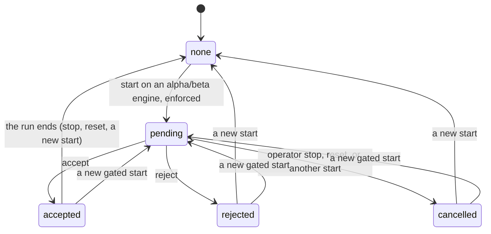

# Engine governance

How DSTNS names its engines, chooses one, and protects a run on an engine that is not yet stable. Engine 3.6.0,
launcher 3.7.0, observer 3.2.0, API contract 1.7.

## Engines

| Engine | Kind | Channel | Version | What it is |
|---|---|---|---|---|
| `core-legacy` | real | stable | the build's (`3.6.0`) | The engine DSTNS has always had. The default; it cannot be disabled |
| `core-ng` | real | alpha | its own (`0.6.0`) | The next-generation engine, built beside core-legacy ([migration plan](v3-core-ng-migration.md)) |

Every engine describes itself with an **identity**: `id`, `version`, `kind` (`real` runs worlds; `pseudo` would only
delegate), `channel` (`alpha`, `beta` or `stable`), `owns` (the parts of a run it implements itself), `shared` (the
parts it still takes from core-legacy) and `changes` (what changed, newest first). The identity comes from the build,
never from a configuration file, so a file cannot promote an engine to stable.

Where it is reported:

| Where | What |
|---|---|
| `GET /api/v1/playback/status` → `data.engine`, `data.engine_identity` | The engine of the world **now loaded**, from the world itself, not from what was asked for |
| `GET /api/v1/engine` → `running`, `catalogue` | The same, and every installed engine |
| `GET /api/v1/system/info` → `engine_catalogue` | Every installed engine |
| The observer's About | "This run" names the running engine; "The system" lists the installed ones |
| Downloaded reports | Configuration, Environment and Integrity sections, the PDF's creator, and XMP `dstns:engine`, `dstns:engineVersion`, `dstns:engineChannel`, `dstns:engineKind` (`dstns:server` is the server's version) |
| The launcher | The start line names a non-default engine; launch codes record the world's engine |

### Release channels

| Channel | Meaning | A run on it |
|---|---|---|
| `stable` | Complete, and its results do not change without a new algorithm version | Starts at once. A new version is announced once, in a notice at the lower left that needs no answer |
| `beta` | Complete, but not yet proven over enough runs | Held until acknowledged (yellow), when enforcement is on |
| `alpha` | Not yet complete: it still shares parts of a run with another engine | Held until acknowledged (orange to red), when enforcement is on |

core-ng is **alpha** because the physics step, checkpoints and seeking, operator commands and the HTTP API are still
shared with core-legacy (issue #15). It becomes beta when it owns every part of a run, and stable, and the default,
only with full parity (issue #22).

### Core Hybrid: not implemented

A Core Hybrid pseudo-engine was to delegate each capability to core-ng where it works and to core-legacy where it does
not. It is not built, for these reasons:

- **It would add nothing.** core-ng already works by delegation at the seams that exist. `ScenarioCompiler::Hooks` and
  the transition guards route selection and compilation through core-ng, and everything else is core-legacy's. A
  hybrid would be core-ng under another name.
- **State would have two owners.** The physics step, checkpoints and the world job share one `SimulationEngine`. Falling
  back "where a capability fails" in the middle of a run would hand state between two implementations, and the golden
  fixtures could no longer say which one produced a result.
- **Failures would be hidden.** The migration needs to see where core-ng fails, so that each failure can be fixed in
  core-ng. A fallback would hide them.

The migration path stays: one capability at a time moves into core-ng, behind a seam, with the golden fixtures green
on both engines. If a pseudo-engine is ever added, it is `kind: "pseudo"`. It never counts towards core-ng's parity,
and it is never offered when a run on an unstable engine is rejected.

## Engine policy: `config/engines.json`

The one place that says which engines may run. The launcher edits it (Settings → Simulation → Engine), and the
server reads it as it starts (`DSTNS_ENGINE_CONFIG`, which the launcher sets to the checkout's file; else
`config/engines.json` in the working directory). Its schema is `config/schema/engines.schema.json`.

```json
{
  "$schema": "./schema/engines.schema.json",
  "schema_version": 1,
  "_about": "…", "_help": {"…": "…"},
  "selected": "core-legacy",
  "default": "core-legacy",
  "auto_switch": "offer",
  "engines": {
    "core-legacy": {"enabled": true},
    "core-ng": {"enabled": true, "acknowledgment": {"enforce": true, "ui": true}}
  }
}
```

| Key | Values | Default | Meaning |
|---|---|---|---|
| `selected` | an installed engine | `core-legacy` | The engine the launcher starts. `--engine` changes it for one run |
| `default` | `core-legacy` | `core-legacy` | The stable engine every installation starts on. Written by the launcher; it cannot be disabled |
| `auto_switch` | `offer`, `off` | `offer` | Whether a rejection offers the enabled stable real engines for the same seed |
| `engines.ID.enabled` | true, false | true | Off: installed, but nothing can start a run on it (`403 ENGINE_DISABLED`) |
| `engines.ID.acknowledgment.enforce` | true, false | true | Hold each run on an alpha or beta engine until it is acknowledged |
| `engines.ID.acknowledgment.ui` | true, false | true | Ask in the observer. Off with enforcement on: the launcher asks (`--accept-risk`) |

Rules, enforced by the launcher and the server alike:

- **Enforcement off turns the observer's acknowledgment off.** There is nothing left to acknowledge. The launcher sets
  `ui` off with it. The server treats `ui: true, enforce: false` as `ui: false` and logs a warning.
- **The observer's acknowledgment off leaves enforcement as it was.** The operator decides separately whether runs
  are still held. If they are, the launcher's `--accept-risk` (or the Start screen's **Accept engine risk**) is the
  acknowledgment. Without it, the launcher stops the start and says how.
- **The default engine cannot be disabled, and a disabled engine cannot be selected.**
- **A file that cannot be read is replaced by the defaults, with a warning in the system log.** A newer
  `schema_version`, an unknown `auto_switch`, or a disabled default engine counts as unreadable. The defaults
  enforce every acknowledgment, so a mistyped file never weakens the protection.
- **Precedence:** a run's `--engine` overrides `selected`. A launch code with a world sets `selected` to that world's
  engine. The server checks every start against `enabled` and the acknowledgment policy, however it arrives.
- **Migration:** launchers 3.1 to 3.6 kept the selected engine in `defaults.json` as `engine.implementation`. It moves
  to `engines.json` the first time the launcher reads it.

## The unstable-engine gate

A start (`POST /api/v1/playback/start`, `…/prepare`, or the Fabric equivalents) names an engine. If that engine is
alpha or beta, and its acknowledgment is enforced, the server **holds** the start instead of running it:

```json
202 {"ok": true, "data": {"state": "approval_required", "deferred": true, "approval_id": "9f1c…",
     "engine": {"id": "core-ng", "version": "0.6.0", "channel": "alpha", "kind": "real", "…": "…"},
     "acknowledge_in": "observer", "wait": "/api/v1/engine/approval/wait?since=1"}}
```

Nothing is compiled or downloaded, and the lifecycle stays `IDLE`. Until someone decides:

- **Everything that would run the engine is deferred, for everyone.** This covers play, pause, seek, step, control,
  world regeneration and applications' `…/control`. Each gets `409 APPROVAL_REQUIRED` with `approval_id`, the
  client's `Idempotency-Key` as `request_id`, and how to wait. **The request is not kept and not run later:** the
  client retries after the approval is accepted. So nothing runs that its sender did not see run, and nothing runs
  twice.
- Reading is never deferred. Stop and reset are never deferred: they cancel the waiting start.
- One start waits at a time. Another is `409 APPROVAL_PENDING`, unless it carries the same `Idempotency-Key`, which
  returns the same answer.

### Deciding

The observer asks once the interface is ready (after its start-up film, where that plays). Its dialog is above
everything else on a blurred scene, and the tour, notifications and other dialogs wait. The dialog says:
- which engine, its version, channel and kind;
- what the engine still shares with core-legacy;
- what changed, opened at once when the version is new to that browser, behind **What changed** otherwise;
- the seed.

| Answer | Effect |
|---|---|
| **Accept the risk and start** | `decision: accept`: the held start runs, once |
| Reject → **Start the seed on core-legacy …** | `decision: reject, then: regenerate`: a new start of the same seed on that engine. Only the seed carries over; the world is new and may differ |
| Reject → **Start nothing** | `decision: reject`: the server stays idle |
| Reject → **End the session** | `decision: reject, then: terminate`: the server shuts down |

Only enabled, stable, real engines are offered, and none when `auto_switch` is `off`. A pseudo-engine is never
offered. Deciding is the observer's (`X-DSTNS-Host`) or the operator's. When the engine's acknowledgment is set to the
launcher, only the operator may decide (`403 ACKNOWLEDGE_IN_LAUNCHER`). The same decision twice is the same answer;
the other decision afterwards is `409 APPROVAL_DECIDED`.

### Waiting and retrying

A client told `APPROVAL_REQUIRED` either polls `GET /api/v1/engine/approval` or long-polls
`GET /api/v1/engine/approval/wait?since=REVISION&timeout=25`. The long poll returns as soon as the approval changes.
Fabric applications also receive an `engine.approval` event on their event queue at every change, with `state`,
`approval_id` and `revision`. On `accepted`, a client retries what it wanted. On `rejected` or `cancelled`, it
does not.

The launcher waits the same way: "Accept or reject the risk in the observer". It continues once the start is accepted,
or once a rejection starts the seed on a stable engine. It stops on a plain rejection or a cancellation.

### The gate's states



The table is `fabric::gate::allowed` (`Fabric/src/gate.cpp`), and every move is checked against it. The approval
lives only in the server, for one run:
- **Every run is acknowledged afresh.** A new start on core-ng is a new approval, with a new ID.
- **Nothing in a browser can answer it.** The observer stores only which engine versions it has announced, never an
  approval, so clearing the cache, opening a second tab or reconnecting changes nothing.
- **A server restart drops the waiting start.** The launcher starts again, and the new start waits again.
- **Regeneration within an accepted run is not a new start.** A new world asked for from the observer during an
  accepted run is not held again.

### Seed and world

A regeneration on another engine, and any restart, keeps **only the numeric seed** (up to 128 bits, in decimal). It
never keeps the world, the simulation state, the operator's changes or the map selection: a stable engine starts the
seed under `urban-crfg-v3`, over every city. Today core-ng and core-legacy make the same world from the same seed
under `urban-crfg-v3`, as the golden fixtures prove. An engine with another generation algorithm may make a different
one, and nothing in DSTNS assumes otherwise.

## Version notices

| Engine | When a browser first sees a new version | Later runs of the same version |
|---|---|---|
| stable | One notice at the lower left, which needs no answer | Nothing |
| alpha, beta (enforced) | The risk dialog, with the version marked new and its changes open | The risk dialog, with its changes behind **What changed** |
| alpha, beta (not enforced) | Nothing is asked; the engine is named in About and in reports | Nothing |

Which versions a browser has seen is kept in its `localStorage` (`dstns.engine-versions-seen`). It is only display
state. Losing it shows a notice again; it can never answer the gate.

## Parity: core-ng against core-legacy

Evidence for each capability. "core-ng" means core-ng's own code runs it. "shared" means the run goes through
core-legacy's code. A shared capability does not count towards core-ng's parity, however it behaves.

| Capability | core-ng | Evidence |
|---|---|---|
| Seed → city and anchor, urban-crfg-v3 | core-ng (delegates to the frozen legacy draw by design) | `dstns_golden`: 75 seeds, bit-exact on both engines |
| urban-geo-v1: countries, cities, one city, exclusions | core-ng only | `dstns_selection_ng`, `dstns_golden` (4 policies × 4 seeds), `dstns_http_engine_switch` |
| Scenario compilation: grid, OSM, auto | core-ng | `dstns_golden`, `dstns_compile_ng`: identical hashes on both engines |
| Lifecycle transitions | table in core-ng, checked on every move | `dstns_lifecycle_ng` (48 races), 4 faults fixed |
| World job (regeneration, staging) | table in core-ng | `dstns_lifecycle_ng`, 3 faults fixed |
| Dynamic Fastboot pointer | policy-aware, shared | `dstns_next_world_ng` |
| Physics step | shared | issue #15 |
| Checkpoints and seeking | shared | issue #15 |
| Operator commands (signals, closures, weather, modules, undo) | shared | issue #15 |
| HTTP API, Fabric, WebFabric | shared, engine-neutral | every HTTP test runs against the shared API |
| Runtime snapshots | identical, per platform | `dstns_golden` |

core-ng is not ready to be the default. Four capabilities are still shared, and the default stays core-legacy until
core-ng owns them, with the golden fixtures green on every platform (issue #22).
