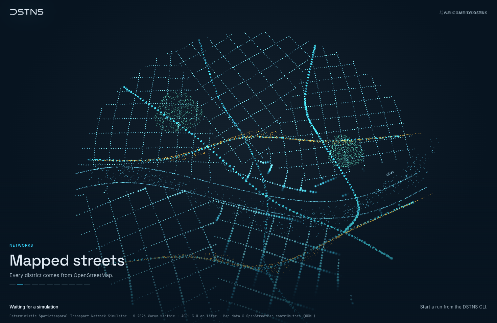
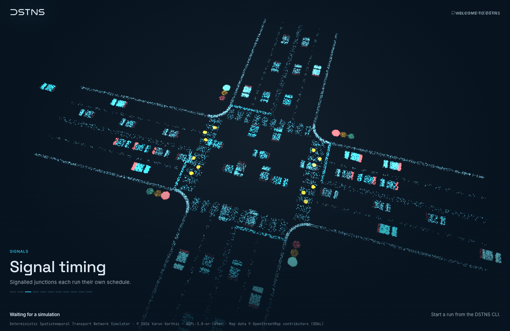
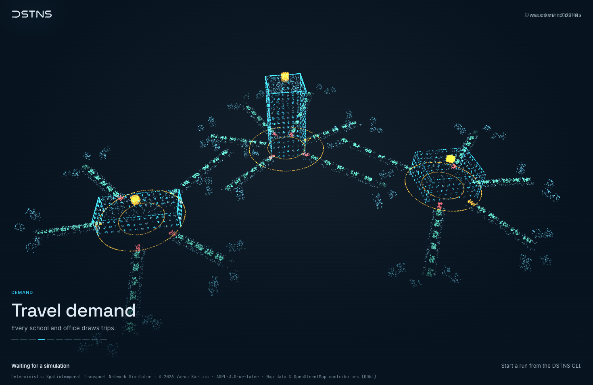
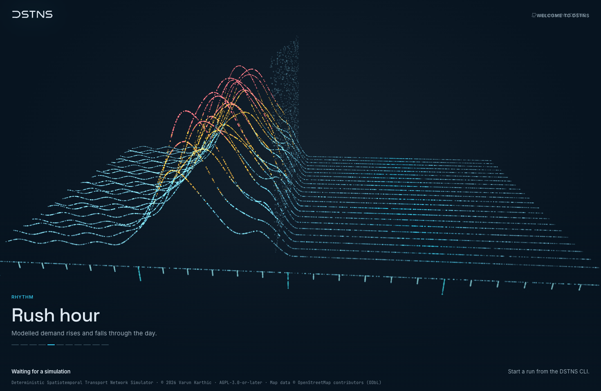
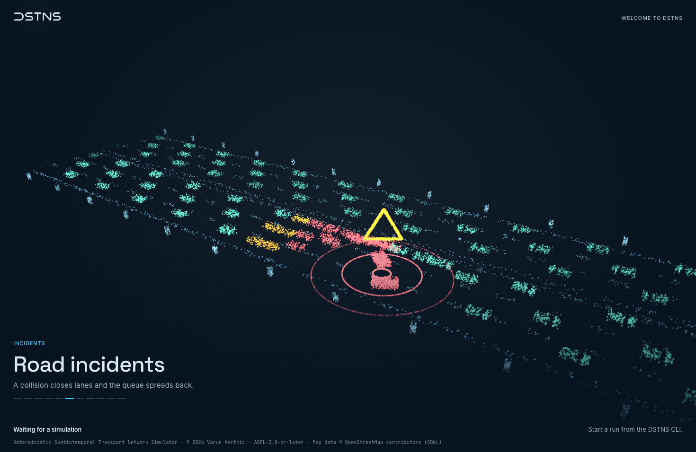
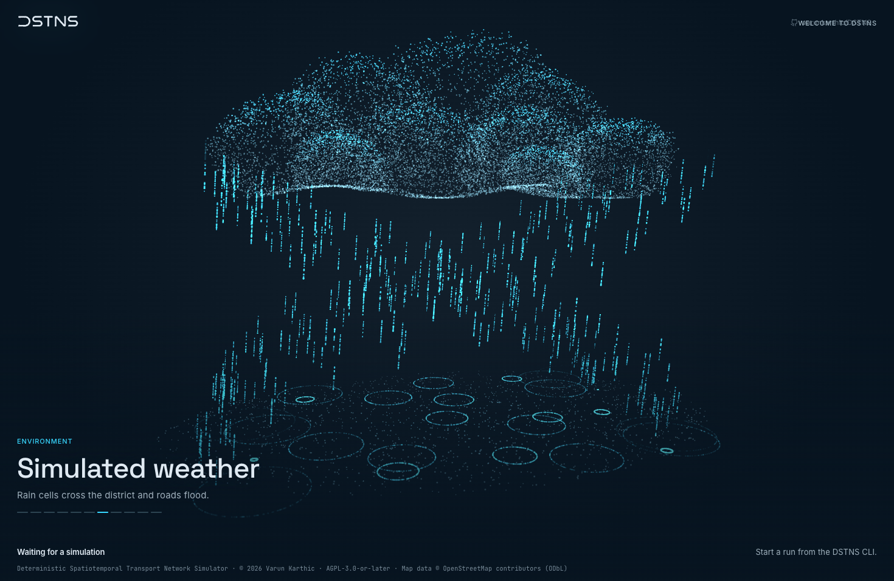
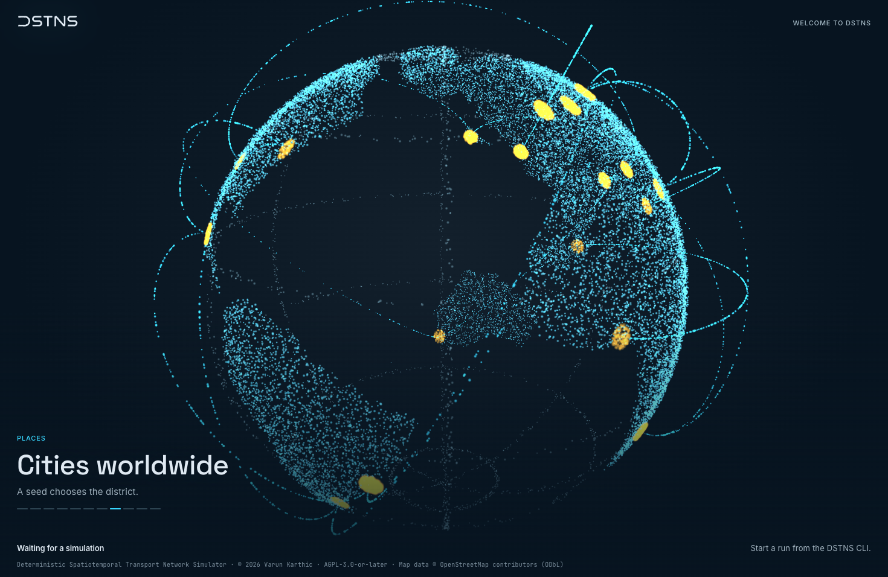
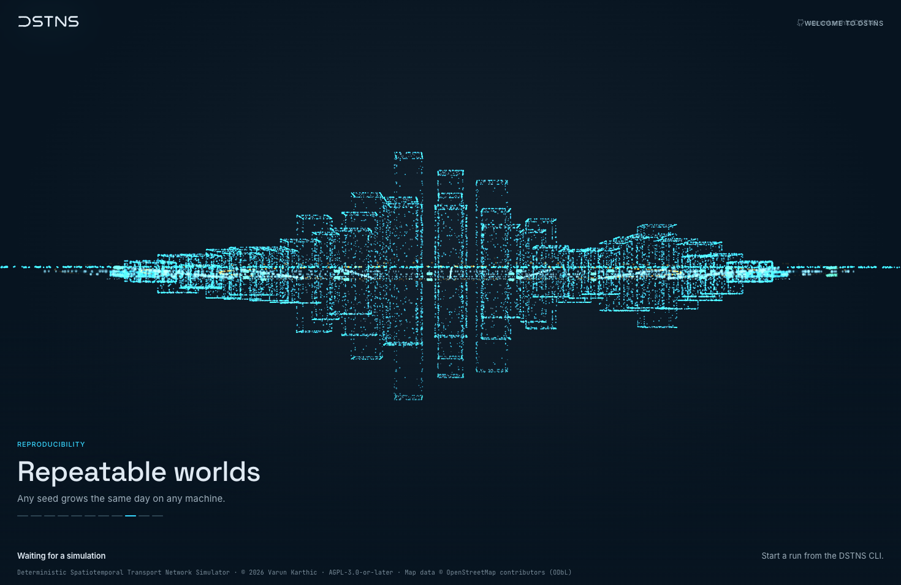
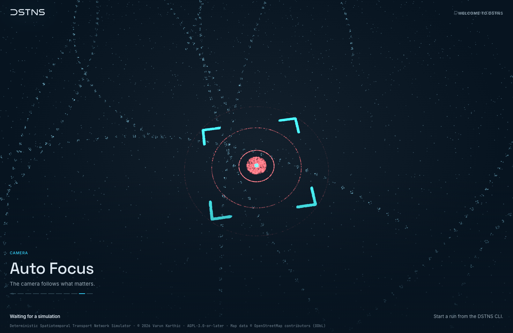
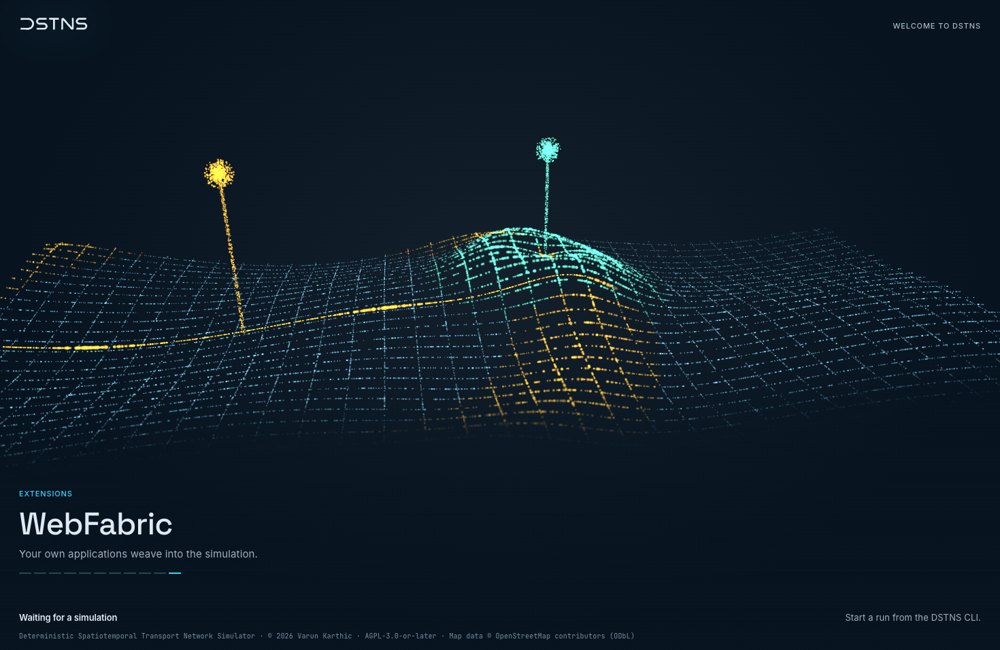

# Motion and graphics mathematics

Every formula behind what moves in the observer, down to the small ones. The simulation's own mathematics is in the
[mathematical foundation](mathematical-foundation.md). Nothing on this page feeds back into the simulation: it's all
presentation, and it can change without affecting a single result.

The numbers here are the ones in the code. Where a formula lives is noted in each section.

Notation: \(t\) is time in seconds, \(\Delta t\) a frame's duration, \(\operatorname{clamp}(x)\) means clamping to \([0, 1]\), \(\text{ss}\) is smoothstep and \(\operatorname{mix}(a, b, u) = a + (b - a)u\).

## Easing functions

The observer uses a small number of curves, each with a reason.

| Name | Formula, for \(x\) clamped to \([0, 1]\) | Used for | Why |
|---|---|---|---|
| Smoothstep | \(x^2(3 - 2x)\) | Shader fades and short reveals | Zero speed at both ends |
| Smootherstep | \(x^3(x(6x - 15) + 10)\) | Scene changes, film camera | Zero speed **and** zero acceleration at both ends |
| Cubic in-out | \(4x^3\) below \(\tfrac12\), else \(1 - \tfrac12(2 - 2x)^3\) | Landing on the map, slow push, report line | A longer, more even middle |
| Overshoot | With \(u = x - 1\): \(1 + 2.4u^3 + 1.4u^2\) | Things growing into place | Passes 1, and settles back with no spring |
| Gaussian pulse | \(e^{-(k(x - x_0))^2}\) | Fronts, flashes, what catches the light | Smooth, with no ends to see |

Smootherstep is the one that matters most. Its first and second derivatives are zero at both ends:

$$
s(x) = 6x^5 - 15x^4 + 10x^3, \quad s'(x) = 30x^2(x-1)^2, \quad s''(x) = 60x(2x-1)(x-1)
$$

So a move built on it has no jolt where it starts or stops, and its speed peaks at \(s'(\tfrac12) = 1.875\) times the average.

## Springs

`WebKit/src/CoreMotion/motion.ts`. Everything in the interface that moves is a damped harmonic oscillator with unit mass.

$$
\ddot{x} = -k(x - x_\text{target}) - c\dot{x}
$$

It's defined by stiffness \(k\) and damping \(c\), not by a duration and a curve, so it can be interrupted at any moment and
keep its velocity. Two quantities describe it:

$$
\omega_0 = \sqrt{k}, \qquad \zeta = \frac{c}{2\omega_0}
$$

### Closed form

From rest, moving from 0 to 1 (`springProgress`):

Under-damped, \(\zeta < 1\), with \(\omega_d = \omega_0\sqrt{1 - \zeta^2}\):

$$
x(t) = 1 - e^{-\zeta\omega_0 t}\left(\cos\omega_d t + \frac{\zeta\omega_0}{\omega_d}\sin\omega_d t\right)
$$

Critically damped, \(\zeta = 1\):

$$
x(t) = 1 - e^{-\omega_0 t}(1 + \omega_0 t)
$$

Over-damped, \(\zeta > 1\), with \(a, b = -\zeta\omega_0 \pm \omega_0\sqrt{\zeta^2 - 1}\):

$$
x(t) = 1 - \frac{b e^{at} - a e^{bt}}{b - a}
$$

An under-damped spring's overshoot is:

$$
\text{overshoot} = e^{-\pi\zeta / \sqrt{1 - \zeta^2}}
$$

### The springs in use

Settle time is the last moment \(|1 - x(t)| > 0.005\), found by sampling at 240 Hz up to 10 s (`settleTime`).

| Spring | \(k\) | \(c\) | \(\omega_0\) | \(\zeta\) | Overshoot | Settles in |
|---|---|---|---|---|---|---|
| `spatialFast` | 800 | 52 | 28.3 | 0.92 | 0.1% | 208 ms |
| `spatialDefault` | 420 | 38 | 20.5 | 0.93 | 0.0% | 296 ms |
| `spatialSlow` | 220 | 28 | 14.8 | 0.94 | 0.0% | 429 ms |
| `effectsFast` | 900 | 60 | 30.0 | 1.00 | 0% | 250 ms |
| `effectsDefault` | 400 | 40 | 20.0 | 1.00 | 0% | 375 ms |
| `effectsSlow` | 196 | 28 | 14.0 | 1.00 | 0% | 533 ms |
| `lively` | 420 | 30 | 20.5 | 0.73 | 3.4% | 350 ms |
| `expressiveFast` | 700 | 34 | 26.5 | 0.64 | 7.2% | 321 ms |
| `expressiveDefault` | 380 | 24 | 19.5 | 0.62 | 8.6% | 462 ms |
| `expressiveSlow` | 200 | 17 | 14.1 | 0.60 | 9.4% | 646 ms |
| `camera` | 42 | 13 | 6.5 | 1.00 | 0% | 1158 ms |
| `cameraZoom` | 260 | 32.2 | 16.1 | 1.00 | 0% | 462 ms |

Effects springs are critically damped because opacity and blur can't go past their end.

### Springs in CSS

CSS can't run a spring, but it can sample one. `springEasing` takes 41 evenly spaced samples of \(x(t)\) over the settle time and
publishes `linear(x₀, x₁, …, 1)` as `--spring-<name>`, with the settle time as `--spring-<name>-ms`. So a CSS transition and a
running spring follow the same curve, and they can't drift apart.

### Running a spring

`stepSpring` uses semi-implicit Euler, sub-stepped so that a stiff spring stays stable at any frame rate:

$$
n = \lceil \Delta t \cdot 480 \rceil, \quad h = \frac{\Delta t}{n}, \qquad v \leftarrow v + (-k(x - x_t) - cv)h, \qquad x \leftarrow x + vh
$$

Velocity is updated first, which keeps the integrator stable for an oscillator where explicit Euler would gain energy.

There's one frame loop for everything (`animate`), and it stops itself when nothing is moving. Its step is
\(\Delta t = \min(\tfrac{1}{20}, t_\text{now} - t_\text{prev})\), so a tab that comes back from the background doesn't leap.

### Velocity and snapping

Velocity on release comes from the oldest and newest samples in a 100 ms window, which holds up against uneven event timing:

$$
v = \frac{x_\text{last} - x_\text{first}}{t_\text{last} - t_\text{first}}
$$

A released gesture carries its momentum into choosing a snap point (`projectSnap`), by the geometric series of a per-millisecond
decay \(d = 0.992\):

$$
x_\text{projected} = x + \frac{v}{1000} \cdot \frac{d}{1 - d}
$$

The nearest snap point to that is the destination.

## Edges that give

`WebKit/src/CoreMotion/resistance.ts`. Whatever has a limit answers being pushed past it the same way: it follows at first, then gives less
and less, up to a bound it never reaches.

$$
\operatorname{resist}(p) = \operatorname{sign}(p) \cdot \left(1 - \frac{1}{\frac{|p|c}{b} + 1}\right) b, \qquad c = 0.55
$$

The bound follows the size of what's being stretched, so the same gesture feels the same on a small menu and a long panel:

$$
b = \min(120, \max(28, 0.28 \cdot \text{size}))
$$

Its inverse, for carrying on from a position already shown (`unresist`), with \(q = \min(0.98, |s|/b)\):

$$
p = \operatorname{sign}(s) \left(\frac{1}{1 - q} - 1\right) \frac{b}{c}
$$

### Scrolling past the end

The bounce back is a critically damped spring on the displayed position, \(k = 121\), \(c = 22\). It leaves at the speed it arrived,
peaks about 90 ms later, and is home about 0.6 s after that. While a finger is pulling, content follows on \(k = 900\), \(c = 60\),
at most a frame or two behind. A region gives up to 30% of its size, at most 120 px. A wheel has no release, so 120 ms
without being pushed counts as letting go.

Momentum only ever fades, so the code tells it from a finger: it takes 5 shrinking events in a row to call it momentum, and 3 holding at
6 px or more to call it a finger again.

### The map's zoom limit

The same curve, on a log scale because that's how zoom is perceived. Fit is 1, and it's free down to \(r = 0.95\). Then it
approaches 0.9 and never gets there:

$$
\operatorname{zoom}(s) = \begin{cases} s & s \ge r f \\ r f \cdot \exp\left(\operatorname{resist}\left(\ln\frac{s}{rf},\ \ln\frac{0.95}{0.90},\ 1.8\right)\right) & \text{otherwise} \end{cases}
$$

where \(f\) is the fit scale. The furthest in is a scale of 8 pixels per metre.

## The map

`WebKit/src/map/NetworkMap.tsx`, `autoFocus.ts`, `mapProjection.ts`.

### View

A view is a scale \(s\) in pixels per metre and an offset. The map's north is up and canvas \(y\) is down:

$$
X = o_x + s x_m, \qquad Y = o_y - s y_m
$$

### Fitting an area

Fit an area inside the viewport minus its insets, with padding \(p\) as a fraction of the area's size (`viewportFor`):

$$
s = \operatorname{clamp}_{[0.025,\ 4]}\left(\min\left(\frac{W_\text{usable}}{\Delta x(1 + 2p)},\ \frac{H_\text{usable}}{\Delta y(1 + 2p)}\right)\right)
$$

Areas smaller than a minimum span are grown first, so a single junction isn't zoomed to absurdity.

### Camera moves

The camera springs the centre and the **logarithm** of the scale, so a zoom feels even all the way:

$$
c_x = \frac{C_x - o_x}{s}, \quad c_y = \frac{C_y - o_y}{s}, \quad z = \ln s
$$

Each of the three runs on the same preset, which is `camera` for long moves and `cameraZoom` for wheel and buttons. It's settled when:

$$
\|c - c_t\| s < 0.5\text{ px}, \quad |z - z_t| < 0.001, \quad \|v_c\| s < 5\text{ px/s}, \quad |v_z| < 0.01
$$

With reduced motion, it jumps.

### Zooming about the pointer

The point under the pointer stays there:

$$
s' = \operatorname{zoom}(s \cdot \text{factor}), \quad \rho = \frac{s'}{s}, \qquad o'_x = P_x - (P_x - o_x)\rho, \quad o'_y = P_y - (P_y - o_y)\rho
$$

Zooming out also blends the view toward the fitted one, so the network is already in the middle by the time it's in view:

$$
n = \operatorname{clamp}\left(3 - \frac{2s'}{s_\text{fit}}\right), \qquad o' \leftarrow o' + \left(C - (C - o_\text{fit})\frac{s'}{s_\text{fit}} - o'\right) n
$$

### Coasting

A pan released with speed slows under friction, framerate-independent:

$$
v \leftarrow v e^{-5.5\Delta t}, \quad \text{so that the total distance is } \frac{v_0}{5.5}
$$

It stops below 12 px/s, or on leaving the pan limits, where it springs back.

### Scale bar

The largest of 1, 2 or 5 times a power of ten that fits in about 96 px:

$$
r = \frac{96}{s}, \quad m = 10^{\lfloor\log_{10} r\rfloor}, \quad \text{step} = \begin{cases}5 & r/m \ge 5 \\ 2 & r/m \ge 2 \\ 1 & \text{otherwise}\end{cases}, \quad \text{bar} = \text{step} \cdot m
$$

## Traffic on the map

`WebKit/src/map/flowTraffic.ts`. The core's traffic model is aggregate: it reports how many vehicles a road has and their mean speed. Markers
stand for those figures and don't feed back into anything.

Each marker follows a rule from the same family as the Intelligent Driver Model:

$$
a = \operatorname{clamp}_{[-B,\ A]} \left( A\left(1 - \left(\frac{v}{v_0}\right)^4 - \left(\frac{g + vT}{\text{room}}\right)^2\right) \right)
$$

| Symbol | Value | Meaning |
|---|---|---|
| \(A\) | 2.2 m/s² | Acceleration |
| \(B\) | 4.5 m/s² | Braking |
| \(g\) | 2.2 m | Gap kept at rest |
| \(T\) | 1.1 s | Headway kept while moving |
| \(v_0\) | From the core | Mean speed on that road |
| room | Measured | Distance to the one ahead, or to a stop line |

With no room at all, the crowd term is 100, which brakes at full. A vehicle is 4.6 m long and stops 3 m short of a junction. A road is
held when the core's signal multiplier is below 0.3. The longest simulated step is 0.25 s, so that a fast rate can't jump a queue. A road
draws at most 12, with at most 40 new markers a frame, and each fades over 0.4 s.

Their heading turns the short way, framerate-limited:

$$
\theta \leftarrow \theta + \operatorname{atan2}(\sin(\theta_t - \theta), \cos(\theta_t - \theta)) \cdot \min(1, 11\Delta t)
$$

## Application paths

`WebKit/src/webfabric/spatial.ts`, `direction.ts`, `Overlay.tsx`.

### Position on a track

A track is a polyline with cumulative lengths \(L_i\). A distance is placed by binary search for the segment, then linear interpolation:

$$
u = \frac{d - L_i}{L_{i+1} - L_i}, \quad p = p_i + (p_{i+1} - p_i) u, \quad \theta = \operatorname{atan2}(\Delta y, \Delta x)
$$

### Gliding along a path

A **guide** moves at exactly the speed asked, and holds at junctions for `dwell_s`. The mark follows the guide on the path's spring, which is what
shapes how it pulls away and settles (`PathRun`):

$$
g \leftarrow g + \text{dir} \cdot v \cdot \Delta t, \qquad (d, \dot{d}) \leftarrow \operatorname{stepSpring}(d, \dot{d}, g)
$$

A line drawn with `draw_s` is a path with nothing on it, at \(v = L_\text{total}/\text{draw\_s}\).

### Driving along a path

The same rule as the map's traffic, scaled to the speed asked for, since an application's map speed is often far above a real vehicle's (`DriveRun`):

$$
A = \max(2.2,\ 0.45 v_0), \quad B = \max(4.5,\ 1.1 v_0), \quad T = \min\left(1.1,\ \frac{18}{v_0}\right)
$$

Vehicles keep \(\text{room} = d_\text{ahead} - d - 4.6\), and they count as braking when \(a < -0.4A\).

### Line styles

| `style` | Dash, in pixels | Note |
|---|---|---|
| `solid` | None | |
| `dashed` | 10, 8 | |
| `dotted` | 0.01, 7 | A near-zero dash with round caps draws a dot |
| `flow` | 12, 10 | Offset \(= -0.04\, t_\text{ms}\), so it runs at 40 px/s. Zero under reduced motion |

`glow` is a canvas shadow of the line's own colour, with a blur of 12 px.

### Automatic colour

`"auto"` picks one of the palette's 8 series by a 32-bit FNV-1a hash of the application and the feature ID. It's stable across reloads and
machines:

$$
h_0 = 2166136261, \qquad h_{i+1} = (h_i \oplus c_i) \cdot 16777619 \pmod{2^{32}}, \qquad \text{series} = h \bmod 8
$$

Using the palette's series means it follows the colour vision setting by itself.

### Keeping a named colour legible

Relative luminance by WCAG, with each channel linearised:

$$
c' = \begin{cases} c / 12.92 & c \le 0.03928 \\ \left(\dfrac{c + 0.055}{1.055}\right)^{2.4} & \text{otherwise} \end{cases}, \qquad L = 0.2126 r' + 0.7152 g' + 0.0722 b'
$$

$$
\text{contrast} = \frac{L_\text{lighter} + 0.05}{L_\text{darker} + 0.05}
$$

If it's below 3, the WCAG figure for graphics, the colour moves in 20 steps toward white if the map is dark (\(L < 0.18\)), or black if it's
light, and stops at the first step that reaches 3:

$$
c_n = c + (T - c)\frac{n}{20}
$$

With a colour vision mode on, it instead becomes the series colour at the least squared RGB distance. A person's accessibility choice comes first.

### What's shown

For each layer and place: start from the person's choice; for each application in registration order, apply what it holds, unless a person
has taken that item back at this revision, or detail is reduced and it would turn on something the person's state has off.

$$
\text{allowed}(a, k) = \text{released}(a, k) \ne \text{rev}(a)\ \wedge\ \neg(\text{reduced} \wedge a_k \wedge \neg\text{own}_k)
$$

$$
\text{shown}_k = \begin{cases} a_k & a = \text{the last holder with } \text{allowed}(a, k) \\ \text{own}_k & \text{if there is none} \end{cases}
$$

Only keys where \(\text{next}_k \ne \text{shown}_k\) ever reach the person's settings, which is what stops an application's choice from being
saved as theirs when they change something else.

### Limits

A token bucket on the server: \(b \leftarrow \min(4, b + 2\Delta t)\), a request costs 1, and below 1 it's `429`.

## The film

`WebKit/src/film/BootScene.tsx`, `bootScenes.ts`. 32,000 particles in WebGL2. Each has ten floats per scene: position (3), velocity (3), tint, kind, phase, hue.
Everything about a scene is calculated in the vertex shader from these, the scene's age and the time, so a frame costs one draw call and
nothing is uploaded per frame.

| | |
|---|---|
|  Mapped streets |  Signal timing |
|  Travel demand |  Rush hour |
|  Road incidents |  Simulated weather |
|  Cities worldwide |  Repeatable worlds |
|  Auto Focus |  WebFabric |

A shader function `live(p, v, m, age)` gives each particle's place, opacity, size, tint and hue in a scene. Each is computed for both
scenes in a transition, then blended.

### Crossing between scenes

Scene changes are timed, not sprung. \(\mu\) goes from 0 to 1 over 1.95 s, or 1.15 s when gathering for the map:

$$
\mu \leftarrow \min(1, \mu + \Delta t / 1.95)
$$

A front crosses the scene, so that they don't set off as a block or as noise. Its direction \(\hat{f}\) differs from scene to scene, and a zero vector means
outward from the middle:

$$
a = \begin{cases} \operatorname{clamp}(\|p_\text{to}\| / 2.4) & \hat{f} = 0 \\ \operatorname{clamp}(p_\text{to} \cdot \hat{f} / 3.8 + \tfrac12) & \text{otherwise} \end{cases}
$$

$$
o = \operatorname{mix}(\text{seed},\ a,\ 0.62), \qquad m = s\left(\operatorname{clamp}(1.5\mu - 0.5 o)\right)
$$

where \(s\) is smootherstep and seed is the particle's own random number. So a particle starts moving when \(\mu = o/3\), and has arrived by
\(\mu = (2 + o)/3\). Each is on the move for exactly two thirds of the crossing, with the front decided by \(o\).

Off the straight line between scenes, the swell is:

$$
w = \sin(\pi m), \qquad \alpha = w^2 \quad (\text{and 0 during the burst})
$$

Squaring is important: \(\frac{d}{dm}w^2 = 2\pi\sin(\pi m)\cos(\pi m)\) is zero at both ends, so the swell doesn't add any speed where a particle starts or stops.

They ride one current, a smooth field, so that neighbours move together as water does:

$$
\vec{F}(p, t) = \begin{pmatrix} \sin(1.7 p_y + 0.5t) + \cos(1.3 p_z - 0.4t) \\ \sin(1.9 p_z + 0.45t) + \cos(1.1 p_x + 0.35t) \\ \sin(1.6 p_x - 0.5t) + \cos(1.2 p_y + 0.3t) \end{pmatrix}
$$

$$
p \leftarrow p + \alpha\left(0.17\vec{F} + (\cos\phi,\ 0.7\sin 1.3\phi,\ \sin\phi)(0.025 + 0.07\,\text{seed})\right)
$$

$$
\phi = 40\,\text{seed} + 0.6t
$$

And turn around the vertical axis, each a little differently, one way on even scenes and the other on odd ones:

$$
\psi = \pm\alpha(0.26 + 0.14\,\text{seed}), \qquad p_{xz} \leftarrow R(\psi) p_{xz}
$$

They dim in flight, so that the crossing is a veil and not a blaze: opacity \(\times (1 - 0.3w)\).

A scene's own story starts when the particles arrive, not when they set off: the new scene's age advances only when \(\mu > 0.55\).

### The film's camera

A perspective camera of half-angle 0.42 rad, between near 0.1 and far 30. It turns about \(y\) by yaw, tilts about \(x\) by pitch, and moves back by distance. In a tall
window it draws back further, so that a scene still fits:

$$
d' = d \cdot \begin{cases} 1.5 / \text{aspect} & \text{aspect} < 1.5 \\ 1 & \text{otherwise} \end{cases}
$$

Each scene has a framing: yaw, pitch, distance, a slow spin, and a push. A change of scene is one move over \(T = 2.5\) s, from exactly where it is, to where the
next is seen from. With \(\tau = \min(1, \text{elapsed}/T)\) and \(e = s(\tau)\):

$$
\text{yaw} = y_0 + (y_1 - y_0)e, \qquad \text{pitch} = q_0 + (q_1 - q_0)e
$$

$$
\text{distance} = (d_0 + (d_1 - d_0)e)(1 + 0.065\sin\pi e)
$$

The last factor draws back slightly in the middle of the move, as a crane does. Yaw is unwrapped first, so that it goes by the short way:

$$
y_0' = y_1 + ((y_0 - y_1 + \pi) \bmod 2\pi) - \pi
$$

The drift comes in only after it has arrived, so it doesn't fight the move:

$$
\text{orbit} \leftarrow \text{orbit} + \omega\,\Delta t \cdot s\left(\frac{\tau - 0.55}{0.45}\right)
$$

So does the slow push, starting 70% of the way through the move, using the cubic in-out curve \(E\), where \(H\) is how long the scene holds:

$$
\text{push}(h) = 1 - P \cdot E\left(\frac{h - 0.7T}{H + 1 - 0.7T}\right)
$$

The push at the moment of leaving is folded into \(d_0\), so there's no jump. A slight sway is always present, so that it's never quite still:

$$
\text{yaw}_\text{view} = \text{yaw} + \text{orbit} + 0.008\sin(0.23t), \qquad \text{pitch}_\text{view} = \text{pitch} + 0.01\sin(0.31t)
$$

### Depth of field, size and colour

Particles away from the focal distance fade, as with a lens, where \(D\) is the clip-space \(w\):

$$
\text{focus} = \operatorname{clamp}_{[0.18,\ 1]}(1.5 - 0.5|D - 3.1|)
$$

$$
\text{opacity} = (0.32 + 0.68\,\text{tint}) \cdot \text{focus} \cdot \operatorname{mix}(\alpha_a, \alpha_b, m)
$$

$$
\text{point size} = \text{pixels} \cdot \text{size} \cdot (1 + 0.9\,\text{seed} + 0.6\,\text{near}) \cdot \operatorname{clamp}_{[0.35,\ 2.6]}(3.4 / D)
$$

Each point is a soft disc, with a coverage part so that crowded points keep their colour and don't add up to white, which is what lets a signal look red:

$$
a = \min(1,\ \text{smoothstep}(0.5, 0.08, r) \cdot \text{opacity}), \qquad \text{output} = (\text{colour} \cdot a,\ a \cdot \text{cover})
$$

### The pointer

The pointer's position runs on a spring, \(k = 70\), \(c = 15\). It moves through particles as a hand moves through water, in screen space, corrected for aspect. With \(\vec{d}\) from pointer to particle and \(\hat{o} = \vec{d}/(\|\vec{d}\| + 0.05)\):

$$
\text{near} = e^{-11\|\vec{d}\|^2} \cdot \text{reach}
$$

$$
\vec{n} = 0.05\hat{o} + (0.018 + 0.02\,\text{seed})\hat{o}^\perp + \vec{v}_\text{pointer}(0.5 + 0.6\,\text{seed})
$$

They ease aside, turn around it, are carried along with its movement, and catch the light: opacity \(\times (1 + 0.9\,\text{near})\), colour mixed toward accent by \(0.35\,\text{near}\).

A press sends a ripple. With \(\rho\) its age and \(R = \|r\| - 1.5\rho\):

$$
\text{ndc} \leftarrow \text{ndc} + \hat{r}\, e^{-60R^2} \cdot 0.07\, e^{-2.2\rho}
$$

### The kinds of particle

`age` is the scene's clock, \(f\) a repeating fraction with the particle's phase in it, and each row is what `live` does for that kind.

| Kind | Motion | Opacity |
|---|---|---|
| `rest` | Stays, with a drift of 0.009 | 1 |
| `flow` | \(f = \operatorname{fract}(0.22t + 37\phi)\), \(p + vf\) | Fades in over 8%, out over 8% |
| `arc` | \(f\) at 0.3, \(p + v\,\text{ss}(f)\), height \(4f(1-f) \cdot 0.3\|v\|\) | Fades in over 10%, out over 14% |
| `route` | \(f\) at 0.2. Along a globe: \(\text{normalize}(p + v\,\text{ss}(f))\|p\|(1 + 0.22\sin\pi f)\) | As `arc` |
| `rise` | Overshoot \(g\) on \((\text{age} - 0.1 - 1.3\phi)/0.75\), height \(v_y + (p_y - v_y)g\) | \(\text{ss}(4g)\), windows twinkling at \(0.72 + 0.28\sin\) |
| `fall` | \(f\) at 1.08, \(p + vf\) | Fades in over 6%, \(1 - 0.25f\) |
| `ring` | \(f\) at 0.42, \(p + vf\) | \(1 - f\) |
| `pulse` | \(w = (\tfrac12 + \tfrac12\sin(2.3t + 2\pi\phi))^2\), size \(1.5 + 1.5w\) | \(0.4 + 0.6w\) |
| `reveal` | Front at \(r = \text{age}/2.3\); \(y\) drops by \(0.16(1 - g)\) | \(g = \text{smoothstep}(\phi, \phi + 0.05, r)\). Size and tint peak at \(e^{-(16(r - \phi))^2}\) |
| `boil` | \(p + 0.035(\sin, \sin, \cos)\) of the position and time | 1 |
| `shimmer` | A band \(e^{-(3.4(x - x_b))^2}\) crossing at 0.3, with \(x_b = 4\operatorname{fract}(0.3t) - 2\) | Tint and size rise in the band |

The scenes then have their own.

**Signal timing.** A junction's cycle is 6 s: 2.4 s green, 0.6 s amber, 3 s red, and the other direction is 3 s out of step.

$$
x = (\text{age} + 0.5 + \text{offset}) \bmod 6
$$

A vehicle in a `lane` is held by how far it is behind the stop line, so that a queue moves off from the front:

$$
\text{held}(x, b) = \begin{cases} 1 - \text{smoothstep}(b, b + 0.5, x) & x < 2.4 \\ \text{smoothstep}(2.4, 2.95, x) & \text{otherwise} \end{cases}
$$

Those that turn follow a quarter circle of radius 0.2. Tail lights take the same value. `lamp` is lit when its phase matches the current state, and `walker` crosses while the other way is red.

**Rush hour.** A `ridge` particle is carried along its road through the day, with \(h = 24f\). The road's traffic is a sum of Gaussians, a morning peak at 8.3, an evening at 17.6 and a midday, with a shift for each road:

$$
r(h) = 0.05 + 0.62 e^{-(h - 8.3 - \delta)^2 / (2 + 2.4 z)} + 0.76 e^{-(h - 17.6 + \delta)^2 / (2.6 + 2.8 z)} + 0.2 e^{-(h - 12.8)^2 / \ldots}
$$

It lies flat until the moment of the day has passed it, at \(\text{smoothstep}(f - 0.03, f + 0.03, \text{age}/3.4)\), and its colour is chosen by height, ramp to warm to danger.

**Road incidents.** In a `queue`, the tail of the jam works back up the road at 0.6 a second, up to 3.3. A vehicle reaching it moves at 30% of its speed, then drives on from the wreck. With \(u\) its free position and tail \(q\):

$$
x = \begin{cases} q + 0.3(u - q) & q < u < q + (w - q)/0.3 \\ w + u - \text{cleared} & \text{otherwise} \end{cases}
$$

Those in the outer lane squeeze inward around the wreck. A `crash` flashes at \(e^{-(5(\text{age} - 0.9))^2}\).

**Travel demand.** A `trip` leaves a home once the scene has begun, so roads fill as demand builds. The queue length is \(\operatorname{clamp}_{[0, 0.62]}(0.2(\text{age} - 1.4)) \cdot v_y \cdot \text{length}\), and those reaching it crawl at 30%. A `beam` rises by \(\text{ss}((\text{age} - 0.5)/3.6)\).

**Repeatable worlds.** Two seeds fall to a seam with gathering speed, \(y = 1.3 v_y (1 - x^2)\). A `ripple` runs out at 1.9 from each moment they meet. A `tower` grows as the first ripple passes and turns into the second city as the second one does, so that it's the same city on both sides of the seam:

$$
h = \operatorname{mix}\left(\operatorname{mix}(0, v_x, \text{ss}(\tfrac{1.75(\text{age} - t_1) - d}{0.42})),\ v_y,\ \text{ss}(\tfrac{1.9(\text{age} - t_2) - d}{0.42})\right)
$$

**WebFabric.** A woven sheet, as `cloth`: threads across and through it. At a point \(q\), its height is two travelling waves plus rings spreading out from each place an application joined, each lasting 3.6 s before coming round again:

$$
y = 0.055\sin(2.1q_x + 1.3q_z - 1.1t) + 0.028\sin(3.4q_z - 0.9q_x + 0.8t) + 0.15\sum_i \text{ring}_i
$$

$$
\text{ring}_i = e^{-(3.4(\|q - J_i\| - 1.35 x_i))^2} e^{-0.5 x_i}\,\text{smoothstep}(0, 0.2, x_i), \qquad x_i = (\text{age} - t_i) \bmod 3.6
$$

A point takes the colour of the strongest ring passing it, once that ring is above 0.1. Each application is an `orb` above the sheet, growing with overshoot and bobbing by \(0.022\sin(1.1t + 1.7i)\). A `strand` falls with \(y = \operatorname{mix}(\text{top}, \text{cloth}, f^2)\). Its `thread` runs out along the row where it joined, at 1.5 a second, with a brighter front and pulses travelling along it.

**Auto Focus.** A `bracket` widens while the world moves under it and snaps tight on arrival. `IN_WORLD` particles are moved together: aim and zoom are mixed by \(\text{ss}\) between two targets, and clamped to ±2.6.

### Landing on the map

At the end of the film, each particle flies to a place on a road, nearest the middle first, along a curve. With \(\ell\) its order:

$$
l = \text{ss}\left(\operatorname{clamp}(1.5 u - 0.5\ell)\right)
$$

$$
\text{ndc} = \operatorname{mix}(\text{ndc}, R, l) + (R - \text{ndc})^\perp \sin(\pi l)(0.1 + 0.14(\text{seed} - 0.5))
$$

\(R\) is the road's position, plus a shift so that they stay on their roads while the camera moves. The map fades in under them at \(1.15 + 0.86 \cdot 2.3 = 3.13\) s, and the panels at 650 ms after that.

Letting go of the logo at the start is a sweep from left to right over 1.2 s. As it passes, each particle kicks out, with \(k = \sin(\pi\operatorname{clamp}(\text{swept}/0.42))\), moving \((0.6\cos\kappa + 0.5,\ \sin\kappa)k^2(0.004 + 0.022\,\text{seed})\).

### The end

The panels leave, the map goes from under its roads, and they fly into the name. It draws in on itself by 7.5% just before it goes. Then it's blown outward all at once, with a soft spring (\(k = 16\), \(c = 7.2\)) and a hard ease-out:

$$
m = 1 - (1 - \operatorname{clamp}(1.12\mu - 0.12\,\text{seed}))^{3.4}
$$

Nothing is drawn after 10.5 s.

### Keeping up

If a machine can't keep up, the film draws fewer particles rather than stuttering. With reduced motion it draws one still picture.

## The report

`WebKit/src/report/report.ts`, `reportMap.ts`, `ReportFilm.tsx`, `pdfLayout.ts`.

### The cover

A dark page, with this run's own city set behind the words: drawn from its map and its state at the moment of the report, and not fetched from anywhere. It's painted on a canvas of 2480 × 3508 px, which is A4 at 300 dpi, and saved as a JPEG at 0.94. The words go on top as real text.

The picture is chosen from the data, so each city gets its own. Over all road segments of length \(L\), the middle of the traffic is the length-weighted centroid. The main roads' direction comes from the segments of weight 4 and above, with the angles doubled, so that a road and the same road reversed count alike:

$$
\theta = \tfrac12 \operatorname{atan2}\left(\sum L \sin 2\alpha,\ \sum L \cos 2\alpha\right)
$$

The map is turned so that those roads run up the page at a slant of 0.42 rad, which leads the eye from the name up into the city:

$$
\tau = \theta - \frac{\pi}{2} + 0.42, \qquad u = \Delta x\cos\tau + \Delta y\sin\tau, \qquad v = -\Delta x\sin\tau + \Delta y\cos\tau
$$

It's scaled past the page, since being cut off by the page is what makes it a picture and not a plan:

$$
s = 1.12 \max\left(\frac{W}{u_\text{max} - u_\text{min}},\ \frac{0.67 H}{v_\text{max} - v_\text{min}}\right)
$$

The centroid goes at \((0.54W,\ 0.36H)\), unless that would leave part of the band with no city in it. So the origin is clamped:

$$
x_0 \in [W - s u_\text{max},\ -s u_\text{min}], \qquad y_0 \in [0.7H + s v_\text{min},\ 0.03H + s v_\text{max}]
$$

The layers, in order:

1. A dark gradient, `#0b2030` to `#071420`, with two washes of light. One is mint, low on the left, at 0.09. The other, high on the right at 0.3, takes the colour of the simulated hour: blue at night, amber at dawn, cyan by day and rose at dusk, interpolated between 5.2, 7, 9.5, 16.2, 18.4 and 20.6 hours.
2. Buildings, green and water, each one path at a low opacity.
3. Streets, brighter where the core reports more vehicles: opacity \(0.2 + 0.42b\), with \(b = \min(1, n / \max(4, L/18))\), so a report at the rush hour looks different from one at dawn.
4. Places that draw people as small points, and rain cells as a pale blue radial.
5. Main roads in a gradient across the page, `#5ee3bf` to `#37d7ff` to `#8fe0ff`, and any road in trouble in the colour of its trouble. Both are on their own sheet, so that their light can spread: two blurs added at opacities 0.34 and 0.5, then the line.
6. All of it dissolved into the dark above the words with a vertical mask, with opacity 0.1, 0.72, 1, 1, 0.5, 0, 0 at 0, 14%, 24%, 48%, 60%, 69% and 100% of the height.
7. Soft focus: the drawing is split between a sharp copy and a blurred one, using one mask and its complement, with the blurred copy's opacity at 1, 0.85, 0, 0, 1, 1 at 0, 13%, 26%, 42%, 56% and 100%. So nothing doubles where they meet.

The name stands low on the page, at no more than 60 pt, and is set smaller if it doesn't fit. It's hung from the country's line beneath it, so that a smaller name stays as close to it.

The animation paints the same picture at most 460 px wide, without buildings, which takes about 20 ms on the page.

### Blurring on a worker

`ctx.filter` isn't available everywhere on a worker, so a blur is made of repeated halving and doubling, which only needs `drawImage`. Halving averages 2 × 2 pixels, a box filter, and doubling is a tent filter. Each pair of steps approaches a Gaussian, with a radius of about \(2^n\) pixels for \(n\) steps.

Halving must be exact. If a sheet of width 2481 is halved to 1241, then 621, the ratio isn't exactly 2, the sampling points drift against the pixels, and a thin line comes back as a row of beads. So a sheet is padded up to a multiple of \(2^n\) before it starts:

$$
W' = \lceil W / 2^n \rceil 2^n
$$

### Keeping things together on a page

`ensure(h)` starts a new page if \(y + h\) doesn't fit, so a heading is measured with what follows it, and a heading and one line never sit at the foot of a page.

### Putting it together

`WebKit/src/report/ReportFilm.tsx`. The same language as the start-up film: soft points and timed easing, and one thing happening at a time. There are 18,000 particles in one draw call, and nothing is uploaded per frame, so the work on the worker can't disturb it.

Each particle has a place on a road on the map as it is now, and the same place on the same road as the cover draws it. Sampling along the roads is deterministic, so running it once with the map's view and once with the cover's turned frame gives two lists whose entries correspond. They land exactly on the cover's roads, and the cover then fades in under them, which is what the map does under its roads at the start.

The timeline, in seconds, with \(\mu\) the crossing and \(s\) smootherstep:

| From | To | What happens |
|---|---|---|
| 0 | 0.5 | The roads brighten where they are, while the interface blurs over 0.9 s |
| 0.35 | 2.75 | \(\mu\) goes from 0 to 1, and the particles cross |
| 2.17 | 3.22 | The cover fades in under them, by \(s\), and they settle to 32% as its light |
| 3.22 | Until ready | A slow light passes down the page's roads every 2.6 s |
| At least 4.1 | + 1.95 | The file saves, the cover fades out over 0.75 s, and \(\mu\) goes back from 1 to 0 |

Each particle's own motion is the same as in the film's crossings. With \(o\) its order, by distance from the middle of the screen:

$$
m = s(\operatorname{clamp}(1.5\mu - 0.5 o)), \qquad p = \operatorname{mix}(p_\text{map}, p_\text{page}, m), \qquad w = \sin\pi m
$$

So it's on the move for two thirds of the crossing. In aspect-corrected space, they ride one current, and turn a little:

$$
\vec{F} = \begin{pmatrix} \sin(1.9 q_y + 0.5t) + \cos(1.3 q_x - 0.4t) \\ \sin(1.7 q_x + 0.45t) + \cos(1.1 q_y + 0.35t) \end{pmatrix}
$$

$$
q \leftarrow q + w^2\left(0.075\vec{F} + (\cos\phi,\ \sin 1.3\phi)(0.012 + 0.03\,\text{seed})\right), \qquad \psi = w^2(0.22 + 0.12\,\text{seed})
$$

Scaling by \(w^2\) adds no speed where a particle starts or stops. They dim in flight by \(1 - 0.3w\).

A particle whose place is past the page's edge, or where the cover's own drawing has faded out, disappears as it lands, by \(\text{keep}\), which follows that same fade: rising from 0.1 to 1 over the top 24% of the page, and falling from 1 to 0 between 48% and 69%.

The light passing down the page is \(e^{-(9(y - y_s))^2}\), adding to each particle's size and opacity.

The progress shown follows the real progress, and never goes faster than a person can follow, with \(T_\text{min} = 4.1\) s:

$$
\text{shown} \leftarrow \text{shown} + \left(\min\left(\text{real},\ \frac{t}{T_\text{min}}\right) - \text{shown}\right)\min(1, 5\Delta t)
$$

The words beneath it keep pace with what's shown, not with the worker, which is usually ahead. With reduced motion there are only the words and the bar. With a hidden tab, which draws no frames, the file saves as soon as it's ready.

## Shapes

`WebKit/src/styles/design.css`. Radii are a ladder, not one number, because what matters is how they look.

| Token | Radius | For |
|---|---|---|
| `--r-xs` | 8 | Small items inside a card |
| `--r-sm` | 12 | Cards inside a panel |
| `--r-md` | 18 | Groups, menus |
| `--r-lg` | 26 | Panels |
| `--r-pill` | Half the height | One-line controls, which are stadiums |

A thing inside another with a gap \(g\) follows the outer curve, so that the gap looks even all the way around:

$$
r_\text{inner} = r_\text{outer} - g
$$

So a panel at 26 holds a card 8 px in at 18, which holds a tile 6 px in at 12, which holds a chip 4 px in at 8. Lists are one card with divider lines, not a stack of rounded rectangles.

The tutorial's outline takes its radius from what's actually on screen, not what's declared on its anchor: it looks at the anchor, what surrounds it at the same size and what fills it, and uses the radius of what is painted.

## Keeping up with the simulation

`WebKit/src/simulation/useBackpressure.ts`. The score and the control law are in [Adaptive backpressure](../concepts/backpressure.md). What the observer contributes is measured passively, by asking for a pair of frames four times a second, and not for every frame, since that would itself keep the main thread busy. Frame cost is an exponential mean, which responds to a sustained stall and isn't moved by one slow frame:

$$
\text{cost} \leftarrow 0.7\,\text{cost} + 0.3\min(\delta, 30)
$$

A hidden page says it's away, and reports nothing. Coming back gets 6 s of grace, as does making a report. Reported lag is \(\max(0, v_\text{core} - v_\text{rendered})\).

## Starting applications

`LaunchKit/src/supervisor.rs`. An application set to restart waits a growing time before each attempt, \(w_n = w_0 2^{n-1}\). Readiness is one of: registered with Fabric, the process having started, a fixed delay, or a URL answering.
