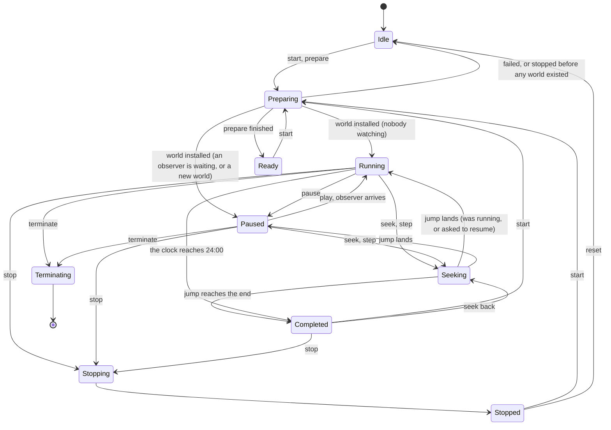
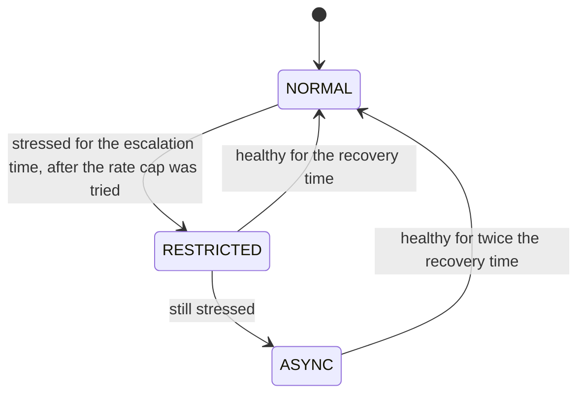
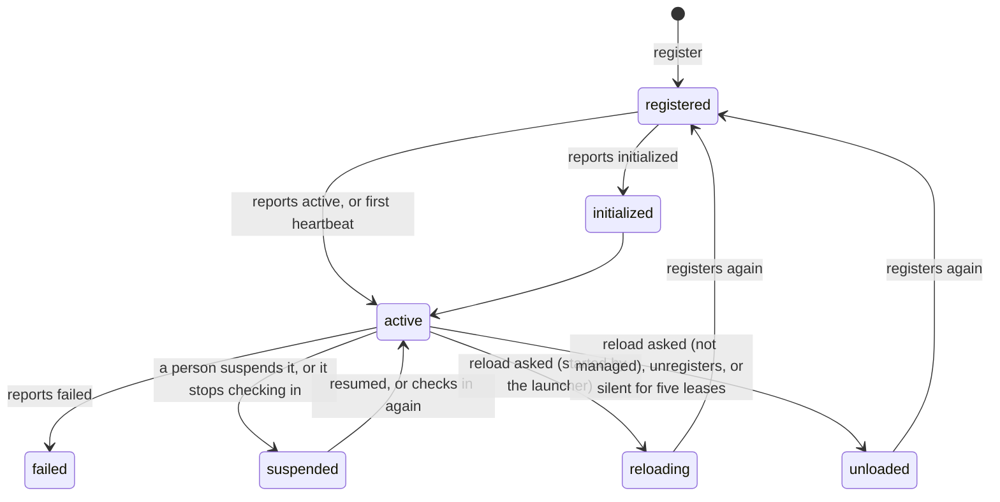
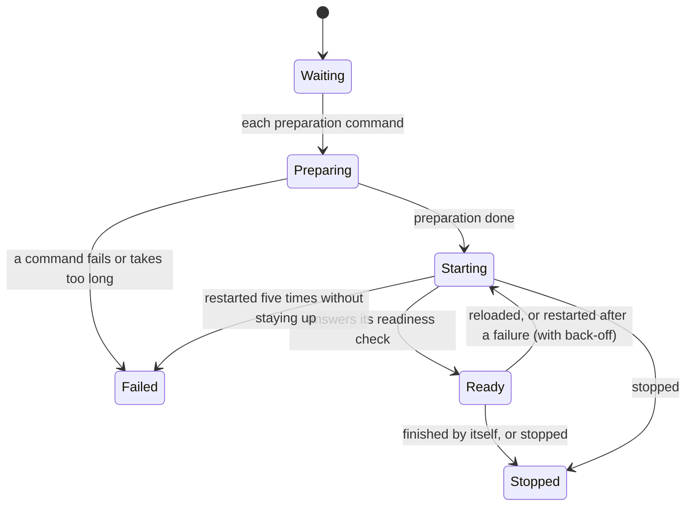

# State machines

Every part of DSTNS that waits, prepares, runs or recovers is a state machine, whether its states are named in
code (an `enum`, a string union) or only implied by flags. This page lists each one: its states, what moves it
from one to the next, what it refuses, and where it lives. A change to any of them should keep this page true.

**Explicit** machines have their states named in one type. **Implicit** ones are held in flags and refs; they are
described here so that they can be reasoned about as a whole.

## The server

### Engine lifecycle (explicit)

`Lifecycle` in `Core/core-legacy/include/dstns/engine.hpp`; every change goes through `SimulationEngine::transition`, which
mirrors the state for lock-free health reads, raises the playback revision and logs the change. Every allowed
transition is listed as data in core-ng's `lifecycle::table()` (`Core/core-ng/src/lifecycle.cpp`); the server checks
each transition against it, and one outside it is logged as an `ERROR` from `lifecycle` (it is still made, so a run is
never wedged). `dstns_lifecycle_ng` requires that ordinary use, a failed preparation, termination and 48 races between
a jump and each control that may interrupt it make none. The state is
reported as `data.lifecycle` by `GET /api/v1/fabric/engine/status`.

| Rule | Where |
|---|---|
| `start` refuses while Running, Paused or Preparing; everything refuses once termination is asked | `start`, `start_async`, `prepare` |
| A jump already under way is redirected to a later target instead of queued; an earlier one is refused | `seek` |
| A jump lets go of the lock every 20 ms; if anything else changes the state meanwhile, the jump ends as "interrupted" and leaves the run where that change put it | `seek` |
| `play` accepts only Paused; `pause` only Running (Paused is a no-op) | `play`, `pause` |
| A stop cancels any world still being prepared, the first or the next, by advancing the compile generation | `stop` |
| A stop never replaces Terminating | `stop` |
| `Booting` and `Error` are named for the API contract and never entered: a start-up failure leaves Idle with `preparation_error`, and a fault ends the process | `engine.hpp` |
| A failed preparation with a world already installed returns to that world's state (Stopped if it was live), never to an Idle that holds a world | `return_after_failed_preparation` |
| A second stop changes nothing; a reset during termination changes nothing | `stop`, `reset` |
| `prepare` stops a run that is jumping, as it stops one running or paused | `prepare` |

The complete table, beyond the diagram's main paths:

| From | To |
|---|---|
| Idle | Preparing, Idle (reset), Terminating |
| Preparing | Ready, Idle, Stopping, Stopped, Completed, Terminating |
| Ready | Running, Paused, Preparing, Seeking, Stopping, Idle, Terminating |
| Running | Paused, Seeking, Completed, Stopping, Preparing (a new world committed), Terminating |
| Paused | Running, Seeking, Stopping, Preparing, Terminating |
| Seeking | Running, Paused, Completed, Stopping, Preparing, Idle, Terminating |
| Completed | Seeking, Preparing, Stopping, Idle, Terminating |
| Stopping | Stopped |
| Stopped | Preparing, Seeking, Idle, Terminating |
| Terminating | nothing |

### World generation job (explicit, strings)

`WorldJob` in `Core/core-legacy/src/engine.cpp`; reported by `GET /api/v1/world/status`. It runs beside the lifecycle:
the current world keeps running while the next is prepared.

```mermaid
stateDiagram-v2
    [*] --> idle
    idle --> generating: regenerate
    failed --> generating: regenerate
    ready --> generating: regenerate
    generating --> staged: prepared, waiting to be confirmed
    generating --> ready: installed (not staged, or confirmed while preparing)
    staged --> generating: commit (installing)
    staged --> idle: discard
    generating --> idle: discard (staged only; the compile finishes and is dropped)
    generating --> failed: map fetch failed, compile failed, cancelled by a stop, reset or termination
    staged --> failed: cancelled by a stop, reset or termination
```

A second `regenerate` while `generating` is refused. Each job carries a generation number and the engine's compile
generation; a result whose numbers no longer match is dropped rather than installed. Every change of state goes through
`SimulationEngine::world_transition`, checked against core-ng's table (`Core/core-ng/src/world.cpp`); one outside it is
logged as an `ERROR` from `world`.

| Rule | Where |
|---|---|
| A stop, reset or termination cancels a staged world at once, and frees it | `cancel_world_job` |
| One still being prepared is marked cancelled and fails as `WORLD_CANCELLED` when its preparation ends, never staged or installed. Until then it reads `generating`, since the compile still holds the lease and a new start would be refused | `cancel_world_job`, the world worker |
| Only a world that could not be made marks its seed as failed, for the next world to avoid that city; a cancelled or discarded one does not | the world worker's `fail` |

### Scenario compile stages (explicit)

`ScenarioCompiler::Stage`: **Selecting** (choose the district from the seed) → **Acquiring** (read the cached map or
download it) → **Building** (graph, places, demand, signals). Reported as `preparing_stage` while Preparing, and read by
the start-up film's progress.

### Adaptive Simulation Backpressure (explicit)

`AsbState` in `Core/core-legacy/include/dstns/asb.hpp`, reported as `asb.state`.

Inside NORMAL a rate cap is lowered and raised with hold times that double when it is released too soon. A long jump
reports RESTRICTED (`restriction: "jump"`) while it lasts without changing the stored state.

### Incidents (implicit)

Each incident is **scheduled** until its start time, **active** until its end time, then **resolved**: two timed
events in `Core/core-legacy/src/events.cpp`, so a seek backwards returns it to scheduled or active exactly as the day had it.
`IncidentLifecycle` in `model.hpp` names the same three states for the API contract; the engine derives them from the
clock rather than storing them.

### WebFabric applications (explicit, strings)

`App::state` in `Fabric/src/webfabric/registry.cpp`; the observer's `AppState` in `WebKit/src/webfabric/store.ts`.

| Rule | Where |
|---|---|
| An unloaded application must register again before anything else, reports included | `require_loaded`, `set_state`, `heartbeat` |
| A state report counts as checking in | `set_state` → `touch` |
| Resuming one that has stopped checking in shows it as not answering, not as active | `suspend` |
| A failure report is ignored while a person has it suspended | `report_failure` |

## The launcher

### Supervised applications (explicit)

`supervisor::Phase` in `LaunchKit/src/supervisor.rs`.

A run that stays up for a minute stops counting its earlier restarts. A reload asked for while an application is
still Preparing is dropped, since it is about to start afresh; killing a preparation step would fail it.

### Checks (explicit)

`environment::State`: **Pending** → **Running** → **Pass**, **Warning**, **Fail** or **Skipped**. Every check, at
start-up and in Diagnostics (`./launcher ui diagnostics`), moves once along this path; the symbol and word, never colour alone, show it.

### The running page (explicit)

`tui::screens::running::Phase`: **Preparing** → **Live** → or **Failed**, from the server's lifecycle and world
status.

### Launch codes (implicit)

`./launcher launch CODE` writes `config/.launch-pending.json` with the world to resume; the next start reads it,
starts that seed, replays the operator's changes at their moments, sets the rate and seeks to the saved time with
the saved play state, then removes the file. No file, nothing pending. See
[Launch codes](../guide/operator-cli.md#launch-codes).

### The launcher's seal (implicit)

`config/.launcher-seal` records what was built. **Sealed** → **Tampered** (a file changed outside a build) →
**Sealed** again by `./launcher security accept` or a build. The server refuses to start while tampered.

## The observer

### Connection (implicit, derived)

`RuntimeStatus` in `WebKit/src/simulation/telemetryRecorder.ts`, recomputed from each reading:
**offline** (no answer) › **restricted** (a long jump) › **degraded** (stale data, backpressure, a rate cap, or out
of sync) › **online**. The first that applies wins.

### Start-up (explicit)

`BootPhase` in `WebKit/src/film/LoadingSurface.tsx`: **blank** → **title** → **film**, then the map. The map's
own arrival, `stage` in `App.tsx`: **covered** → **map** → **all** (panels last).

### Tutorial (explicit)

`useTutorial` in `WebKit/src/tutorial/useTutorial.ts`: **closed** → **starting** (pauses the run, with a guard on the
run and its playback revision) → **active** → **finishing** (plays again only if the tour made the pause and nothing
has changed since) → **closed**. A new run, a backpressure suspension or a playback change by anyone else while it is
open closes it at once, without resuming.

### Panels and dialogs (explicit and implicit)

- A dividing panel (`FluidPanel`): **closed** → **moving** → **open** → **moving** → **closed**, driven by a spring
  that can be turned round mid-way; see [Interface system](interface-system.md).
- Before anything that takes the whole screen (a dialog that asks, a new world, the end of a session, a report),
  `settle()` asks every open surface to close and waits for the slowest, then can reopen them all.
- Reset in Settings: **idle** → **asking** → **done** → **idle**, in the same place.

### Reports (implicit)

Save Report on the day's end: the card closes → open panels settle → the report film plays while the PDF is made →
the panels that were open come back. Each step waits for the previous one.

## Faults found and fixed in this review

| Machine | Fault | Now |
|---|---|---|
| Engine lifecycle | A stop while a world was still being prepared did not cancel it: the world arrived afterwards and started by itself | The stop cancels it, and returns to Idle when there was no world before |
| Engine lifecycle and world job | A stop while a new world was being generated let it install itself afterwards, paused | The stop cancels it; the job reports it was cancelled |
| Engine lifecycle | A stop after termination began replaced Terminating with Stopped | Terminating stays |
| World job | A confirmed world that could not be installed had no finish time | It has one, so its duration reads correctly |
| WebFabric | An unloaded application could revive itself by reporting a state | It must register again |
| WebFabric | A state report did not count as checking in | It does |
| WebFabric | Resuming an application that had stopped checking in showed it as active | It shows as not answering |
| WebFabric (observer) | An application reloading by the launcher had no label in Settings | It reads Reloading |
| Launcher supervisor | A reload asked while an application was preparing killed the preparation step and failed it | The reload is dropped |
| Engine (failed start retry) | Looking for a seed outside the failed city was an unbounded loop, and named the city by the legacy rule whatever the policy | Bounded to 64 tries, through the run's own engine and policy (3.2.0) |
| Engine lifecycle | A reset during termination moved Terminating to Idle | Terminating stays (3.2.1) |
| Engine lifecycle | A failed start or prepare with a world already installed left Idle holding that world | It returns to that world's state (3.2.1) |
| Engine lifecycle | A second stop went Stopped → Stopping → Stopped | It changes nothing (3.2.1) |
| Engine lifecycle | `prepare` during a jump moved Seeking to Preparing without stopping the run | It stops the run first (3.2.1) |
| World job | A stop or reset while a world was staged left it reading `staged`, though it could never be installed; confirming it then failed | It is cancelled at once (3.3.1) |
| World job | A world staged while still being prepared, then stopped, was staged anyway when its preparation finished | It fails as cancelled (3.3.1) |
| World job | A discarded or cancelled world that then failed marked its seed as failed, so the next world avoided that city | Only a world that could not be made does (3.3.1) |
| Dynamic Fastboot | Its prepared seed would be handed to a run under another policy, which would resolve it to a city Fastboot never fetched | Fastboot stood aside for any policy other than `urban-crfg-v3` (3.2.0); the pointer records its policy and extent, and a seed is offered only to a run that matches, in the server and the launcher (3.3.0) |
