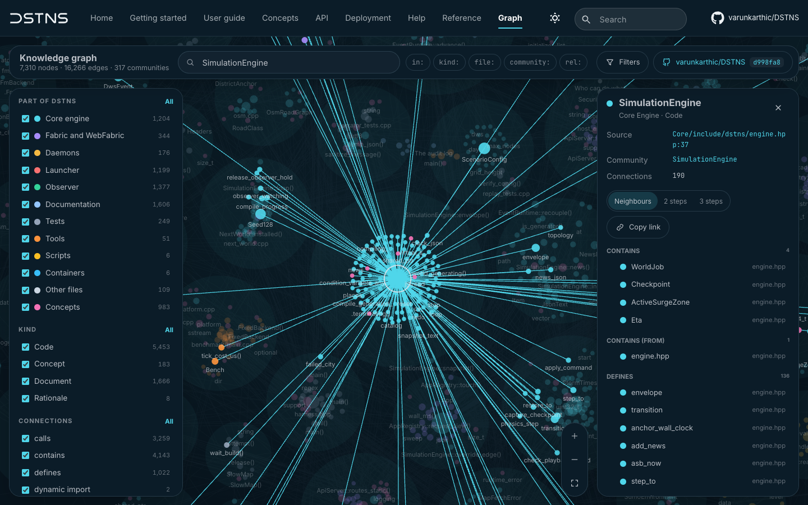

# The knowledge graph

The [Graph](../graph.md) page is a map of DSTNS: every file, class, function, document and section, and how they
connect, as the repository stood when this documentation was built. Use it to find where something lives, what calls
it, and what depends on it, without reading the source first.



## What it shows

| On the map | What it is |
|---|---|
| A dot | A node: a source file, a class, a function or method, a document or one of its sections, or a concept |
| Its colour | The part of DSTNS it belongs to: the engine, Fabric, the daemons, the launcher, the observer, the documentation, tests, tools or configuration |
| Its size | How many connections it has |
| A faint disc | A community: nodes that connect more among themselves than to the rest, named after their most central member |
| A line | A connection: `calls`, `imports`, `contains`, `defines`, `references`, `method`, `inherits`, `implements` and others |

## Using it

| To… | Do this |
|---|---|
| Move and zoom | Drag, scroll or pinch. The buttons at the lower right zoom and show everything |
| Find something | Type in the search field, or press ++slash++ anywhere on the page. ++arrow-up++ and ++arrow-down++ walk the results; ++enter++ goes to one |
| Narrow a search | Add operators: `in:Core`, `kind:document`, `file:engine.cpp`, `community:scenario`, `rel:calls`. Words without one match names, then file paths, then initials (`se` finds `SimulationEngine`) |
| Read about a node | Choose it. The panel names its file and line, with a link to that line on GitHub at the commit the graph was built from, its community and its neighbours by kind of connection |
| See further round it | **Neighbours**, **2 steps** or **3 steps**: everything else fades |
| Share it | **Copy link**: the address names the node, and opens on it |
| Show less | **Filters**: by part of DSTNS, by kind, by kind of connection, and by how connected a node must be |

## How it is built

Every documentation build makes the graph again, so the page always matches the source it documents:

1. `hooks/graph.py` copies the files Git tracks to a temporary folder, so nothing ignored or generated is read.
2. [graphify](https://github.com/safishamsi/graphify) reads them with its AST extraction (`graphify update`). It uses
   no language model and no key, and the same files always give the same graph.
3. The hook lays the graph out: the communities first, placed by how much they share and kept apart as discs, then
   each community's own nodes inside its disc. The browser is given the positions, so it has nothing to work out.
4. It writes one file, `graph/data.json`: names, files, lines, parts, communities, positions and connections as
   arrays, about a tenth of graphify's own `graph.json`. The page asks for it with `no-cache`, so a visit after the
   first reuses the browser's copy unless a build has changed it.

Read the Docs and CI install graphify from `docs/requirements.txt`, and a build there that cannot make the graph
fails. A local build without graphify uses the copy in the repository, `data/graph/dstns-graph.json`, which the
**Knowledge graph** workflow rebuilds and commits after every push that changes the source, so a clone always has a
recent graph for the launcher, its MCP Handler and the Claude skill. `DSTNS_DOCS_GRAPH=off` skips the graph;
`DSTNS_DOCS_GRAPH=required` makes a local build insist on making it.

## Asking it from Claude

<a class="md-button" href="../../downloads/dstns-graph-skill.zip" download>Download the Claude skill</a> and unpack it into a skills folder
(for Claude Code, `~/.claude/skills/`). It asks the same graph from the command line, in plain words or by
relation, and points at the file and line of each answer:

```bash
python3 scripts/graph.py search "functions in the launcher that save settings"
python3 scripts/graph.py callers physics_step
python3 scripts/graph.py deps next_world.cpp
```

Its source is `skills/dstns-graph/` in the repository. The launcher and its MCP Handler ask the graph in the same
way: see [the launcher](../guide/operator-cli.md#the-knowledge-graph).

## Locally

```bash
.venv-docs/bin/pip install -r docs/requirements.txt   # includes graphify
.venv-docs/bin/mkdocs serve                           # the Graph tab, built once for the files as they are
```

The same graph answers questions from the command line:

```bash
graphify update .                                    # graphify-out/graph.json, ignored by Git
graphify query "how does a seek reach the engine"
graphify path "SeekFilm" "SimulationEngine"
graphify explain "NextWorld"
```
