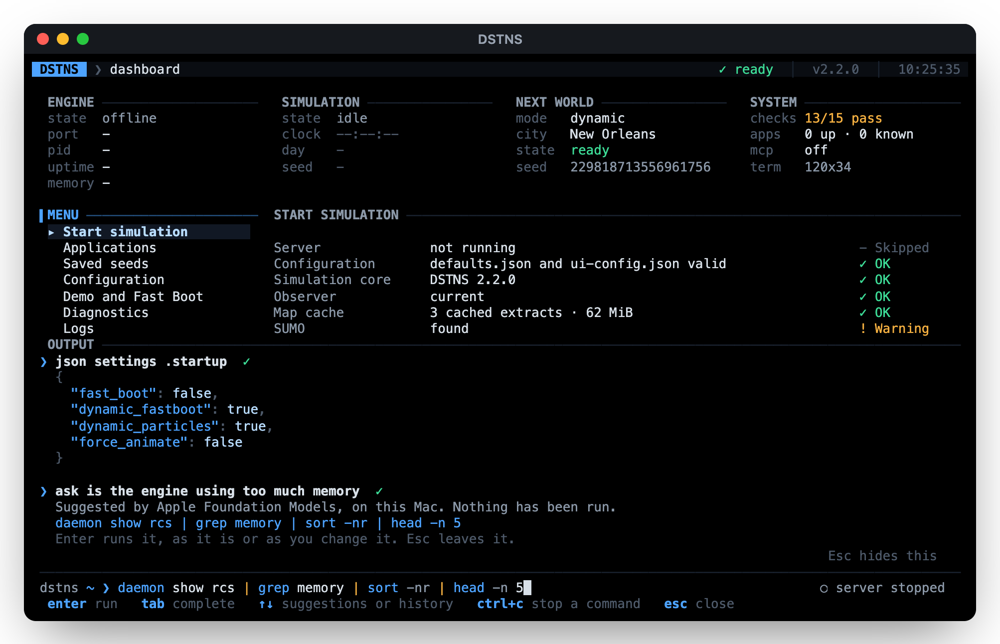

# The console

The launcher reads command lines as a Unix shell does. The same lines work in four places:

| Where | How |
|---|---|
| **The command bar**, at the foot of every page of the terminal interface | `:` or `/`, then type |
| **One line**, from any shell | `./launcher -c 'LINE'` |
| **Lines until `exit`**, from a terminal or a script | `./launcher shell` |
| **One command on its own**, piped by your own shell | `./launcher ps \| grep server` |

```bash
./launcher -c 'logs api | grep 500 | wc -l'          # how many requests failed
./launcher -c 'stop && start --seed 42 --no-open'    # restart on another seed
./launcher -c 'ps | grep -q running || start'        # start only if nothing is running
./launcher ls config/startup                         # every startup setting, as text
./launcher get api.port                              # one setting's value
printf 'ps\nuptime\n' | ./launcher shell             # a script of lines
```

## Joining commands

| Operator | Means |
|---|---|
| `A \| B` | `B` reads what `A` wrote |
| `A && B` | `B` runs if `A` succeeded |
| `A \|\| B` | `B` runs if `A` failed |
| `A ; B` | `B` runs whatever happened |

Operators inside quotes are text: `grep 'a|b'` looks for `a|b`. Words are split as a shell
splits them, with `'…'` and `"…"` keeping spaces, and `\` escaping inside double quotes.
A line's exit status is its last command's. A line that cannot be read (an unclosed quote)
exits with 2, and a command that does not exist with 127, as in a shell. `grep` that finds
nothing fails, so `grep -q x && …` reads as it should.

## Commands that run in the console

These run in the launcher itself, read its state, and print plain text:

| Command | Prints |
|---|---|
| `ls [PLACE]` | What is here. `ls` the pages; `ls apps`, `ls seeds`, `ls logs`; `ls config` the categories and `ls config/startup` a category's settings and values |
| `cat logs/SOURCE`, `cat config/KEY`, `cat FILE` | A log (`system`, `api`, `event`, `playback`), a setting, or a file. With nothing named, what was piped to it |
| `tail [-n N] [logs/SOURCE]`, `head [-n N] …` | The last or first lines of a log, or of their input. `tail -20` works too |
| `ps` | The server (its pid, from the server itself), its port and state, and the simulation's clock and seed |
| `ps -a` | Every DSTNS server, map download and launcher on this machine, with its pid, how long it has been up, its port and where it writes; this launcher's server is marked |
| `get KEY` | A setting's value, as the Configuration page shows it |
| `json PLACE [PATH] [-k] [-c]`, `view …` | Any of the launcher's state, or the running server's, as indented JSON; see [Looking inside](#looking-inside) |
| `env` | The `DSTNS_` variables in use, those kept in `config/launcher.env` marked `# kept` |
| `history` | The commands typed so far, in the interface and here |
| `security` | Whether [Advanced Security](operator-cli.md#advanced-security) is on, how this machine asks, and whether this session is verified |
| `ask REQUEST` | A request in plain words, as a line of commands, from the launcher's model; it is printed, never run. See [Asking in plain words](operator-cli.md#asking-in-plain-words) |
| `model` | Which model answers those requests, and whether Apple's is here; `model test` tries it |
| `daemon`, `daemon show NAME`, `daemon queue emergency\|notification` | The [daemons](daemons.md): which run, what one reads, and what they have said |
| `graph QUESTION`, `graph show\|callers\|callees\|deps\|users\|members NAME`, `graph path A B` | The [knowledge graph](operator-cli.md#the-knowledge-graph): where code is, and what calls and depends on what |
| `uptime` | How long the server has been up, its state and clock, and its peak memory |
| `about` | Version, copyright, licence and map-data attribution |
| `docs [TOPIC]` | Opens the documentation (in a terminal) and prints its address. Topics: `launcher`, `console`, `mcp`, `fastboot`, `api`, `endpoints`, `config`, `apps`, `testing`, `troubleshooting` |
| `echo WORDS`, `true`, `false`, `help` | As in a shell; `help` lists every command |

These change things, with the same checks as everywhere else:

| Command | Does |
|---|---|
| `set KEY VALUE` (or `KEY=VALUE`), `unset KEY` | Change a setting, or put it back to its default, with its checks and [rules](operator-cli.md#settings-that-go-together); what else had to change is listed |
| `env set NAME=VALUE…`, `env unset NAME…` | Keep a variable in `config/launcher.env` for every later start, or forget it. Names are capital letters, digits and `_` |
| `edit settings\|ui\|env\|apps\|FILE` | Open it in `$VISUAL`, `$EDITOR`, nano or vi. A copy is edited, and saved only if it still reads: JSON that parses, settings that pass their checks, `NAME=VALUE` lines, a catalogue that loads. Otherwise nothing changes and the draft's path is printed |
| `api [METHOD] PATH [BODY\|@FILE]` | Any route on the running server, as the operator, its reply as indented JSON; a status other than 2xx is printed first |
| `security on`, `security off`, `security verify`, `security accept` | Turn Advanced Security on or off (each asks the system first), ask now to try it, or accept files changed outside the launcher (asks, then records it in `logs/security-audit.log`) |
| `model use auto\|apple\|ollama\|groq\|off [NAME]`, `model key KEY` | Choose the model, and keep a Groq key in `config/launcher.env` |
| `daemon on NAME`, `daemon off NAME` | Turn one daemon on or off until the server stops |
| `graph update` | Build the knowledge graph again from the checkout (needs graphify) |

And these filter what is piped to them:

| Filter | Does |
|---|---|
| `grep [-i] [-v] [-c] PATTERN` | Lines that match a regular expression; `-i` ignores case, `-v` inverts, `-c` counts |
| `head [-n N]`, `tail [-n N]` | The first or last N lines (10 by default) |
| `wc [-l]` | Lines, words and characters; `-l` lines only |
| `sort [-r] [-n]` | Sorted; `-r` reversed, `-n` by the leading number |
| `uniq [-c]` | Repeated adjacent lines once; `-c` with their count |
| `cut -d DELIM -f N[,N]` | Fields of each line (tab-separated by default) |
| `tee FILE` | Its input, also written to a file |

## Looking inside

`json` reads a place, a file, or what is piped to it (`-`), and prints it as indented JSON,
coloured in a terminal. A path looks inside it; `-k` lists the keys there, `-c` prints it on
one line, and a string on its own prints as it is, so that it pipes:

| Place | What it is |
|---|---|
| `settings` | Every setting as it is in effect, defaults included (`stored`: only what `config/defaults.json` holds) |
| `ui` | The observer's settings, `config/ui-config.json` |
| `env` | The variables in use, each with where it came from |
| `seeds`, `apps` | Saved seeds; the applications catalogue |
| `next-world` | Dynamic Fastboot's next world, `next-world.json` |
| `eta` | How long preparing worlds has taken, which the server's estimates come from |
| `launcher` | The server this launcher is running |
| `status`, `world`, `system`, `features`, `endpoints`, `daemons` | From the running server: the simulation, world generation, its build and process, what it has on, every route, and the daemons |

```bash
./launcher json settings .api.port                      # 8090
./launcher json settings .startup -k                    # the startup settings' names
./launcher -c 'json endpoints .items -c | wc -c'
./launcher -c 'api /api/v1/view/traffic | json - .edges[0]'
./launcher -c 'json status .lifecycle | grep -q RUNNING && pause'
```

## Everything else

Every other command is one of the launcher's own (`start`, `stop`, `apps list`,
`fastboot status`, `test unit`, `mcp tools`…, the whole [command list](operator-cli.md#commands)),
run as a process of its own with `NO_COLOR=1` and its output captured, so that it pipes like
any other:

```bash
./launcher -c 'apps list | grep -c org.example'
./launcher -c 'test unit | tail -5'
./launcher -c 'fastboot status | grep cities'
```

## In the command bar

{ .screenshot }

The command bar adds what only makes sense inside the interface:

| Command | Does |
|---|---|
| `cd PLACE` | Go to a page: `config`, `apps`, `seeds`, `logs`, `diagnostics`, `tests`, `tools`, `about`, `running`, `start`, `demo`, `setup`. `cd config/performance` goes to a section; `cd ..`, `cd /` or `cd ~` back to the dashboard |
| `pwd` | Where you are |
| `kill APP \| server` | Stop an application this launcher started, or the server |
| `start …`, `pause`, `resume`, `restart`, `open` | Start a run on the running page, control it, open the observer |
| `set KEY VALUE` (or `KEY=VALUE`), `config` | Change a setting, or open the Configuration page |
| `setup`, `reset` | The setup again; reset runtime data, after a confirmation |
| `history`, `clear`, `man COMMAND`, `exit` | The commands typed so far, clear the output, how to use a command, leave |

A line whose first word is not a command is a request in plain words, as is anything after
`ask` or `?`: the launcher's model turns it into commands and puts them on the prompt, where
Enter runs them and Esc leaves them. See [Asking in plain words](operator-cli.md#asking-in-plain-words).

What is typed is coloured as it is read: each command in the accent, `|`, `&&`, `||` and `;`
in amber, quoted text in green and options dimmed. `json`, `view` and `api` print in colour
too: keys, strings, numbers and `true`, `false` and `null` each their own. `edit` lends the
terminal to the editor and takes it back after. With Advanced Security verified, the prompt
reads `dstns·secure`.

As you type, suggestions appear above the prompt with what each does, and the rest of the
first is shown dimmed. **Tab** takes it, **↑ ↓** walk the suggestions while typing and
the history otherwise, **Enter** runs, **Ctrl+C** stops a running command, the wheel or **Shift+↑ ↓**
(or **PgUp/PgDn**) scroll the output, **Home** and **End** on an empty line go to its oldest and
newest, **+** and **−** on an empty line (or **Ctrl+↑ ↓** and **Alt+↑ ↓**, where the terminal
passes them on) or dragging its top edge size it,
**Ctrl+L** clears it, and **Esc** closes. The history is kept between
sessions in `logs/command-history` (the last 500 lines). A line with an operator in it runs
as `dstns-launcher -c`, so a long pipeline never holds up the interface, and its output
streams into its own block:

```text
 OUTPUT ─────────────────────────────────────────────────────────────────────────
❯ logs api | grep 500 | wc -l  ✓
  3
❯ frobnicate  ✗ 127
  frobnicate: command not found. help lists them, and Tab completes.
 ─────────────────────────────────────────────────────────────────────────────────
 dstns ~ ❯                                   ● :8090 running · 08:12:44 · cpu 12% · mem 214M
```

The readings at the right of the prompt are the server's, refreshed every two seconds off
the interface's thread: its port and state, the simulated clock, the share of a processor
it used since the last reading, and its peak memory, from `GET /api/v1/system/info`.
