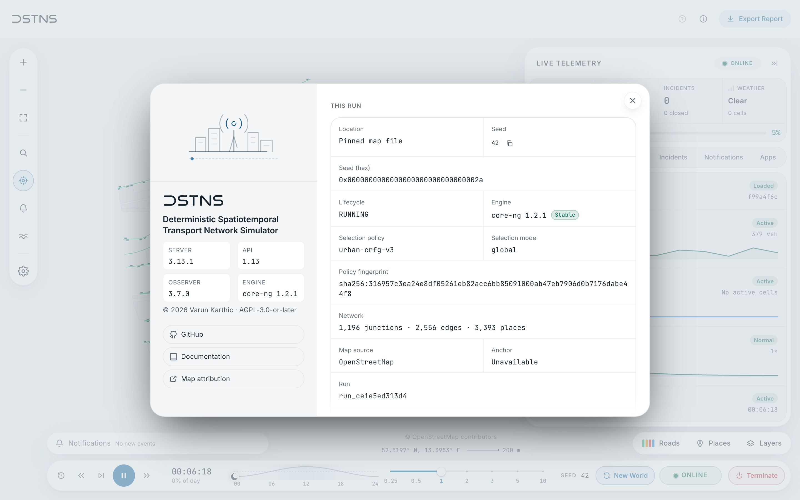
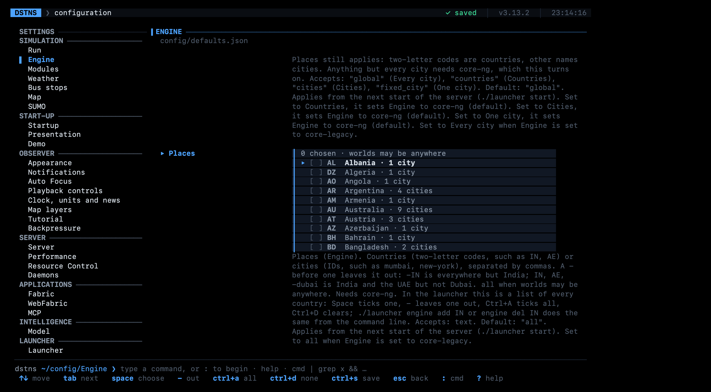
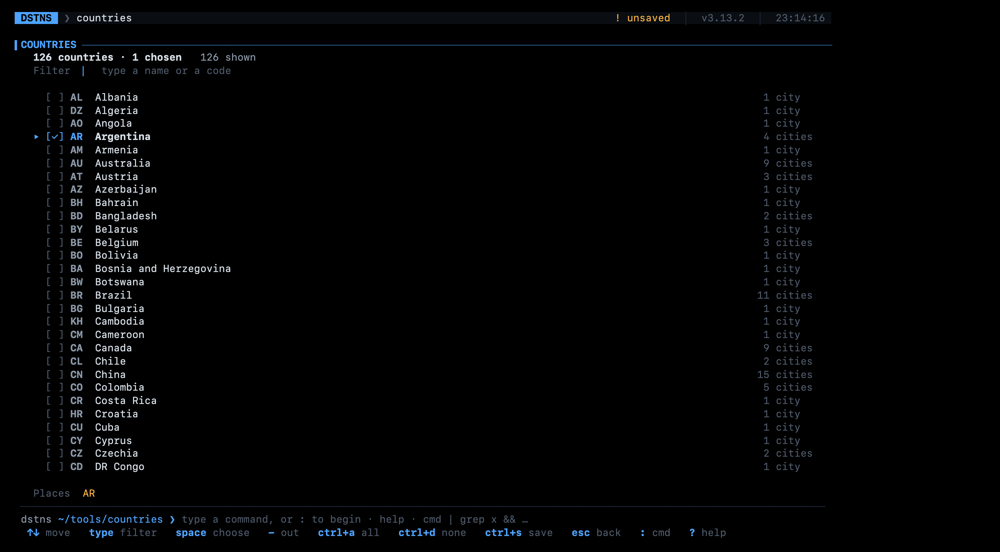
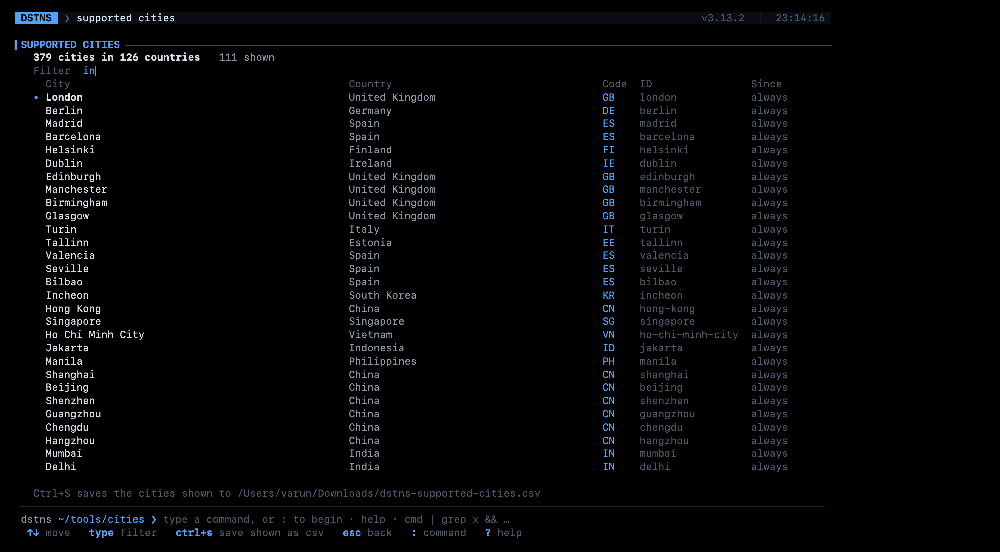
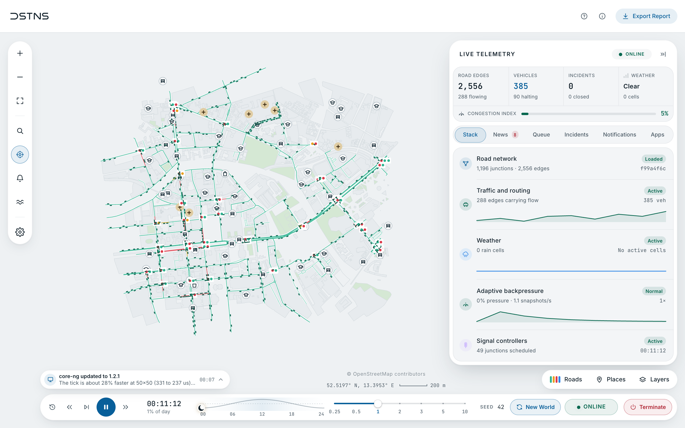

---
search:
  boost: 3
---

# Engines

An **engine** builds a world from a seed and runs it: it chooses the city, compiles the district, advances every
tick, and keeps the checkpoints that let you jump through the day. DSTNS has two, behind one HTTP API, so everything
that talks to DSTNS (the observer, the launcher, your applications, an AI client) works the same whichever runs.

| Engine | Version | Channel | Type | By default | What it is |
|---|---|---|---|---|---|
| **core-ng** | 1.2.2 | stable | standalone | **The engine.** Selected, and it cannot be disabled | The next-generation engine: its own world selection, compiler, physics tick, checkpoints and lifecycle tables |
| **core-legacy** | the build's (3.13.3) | stable | standalone | Disabled | The engine DSTNS had before core-ng, kept unchanged. Enable it to compare the two |

Both make **the same world from the same seed**, to the last bit: the same city and district, the same hashes, the
same state at every moment of the day. The golden fixtures prove it on every build (see
[Proof that the two agree](#proof-that-the-two-agree)).

## How the code is laid out

```text
Core/common        what every engine uses: the runtime host (SimulationEngine: lifecycle, clock, commands, undo,
                   world jobs, views, news), the model, maps (OpenStreetMap loading and fetching), the city
                   catalogues, events, weather, the SUMO bridge. It has no engine of its own.
Core/core-ng       core-ng: selection (urban-crfg-v3, urban-geo-v1, urban-geo-v2), compile (network, plans),
                   physics, timeline (checkpoints), lifecycle and world-job tables. Links Core/common only.
Core/core-legacy   core-legacy: ScenarioCompiler, its physics step and checkpoints, and its hooks. Frozen.
Core/engines       install_engines(): registers both, and core-ng's guards. The server calls it at start-up.
```

The host calls an engine only through its **hooks**: `select` (which city and anchor a seed chooses), `validate` and
`describe` (the selection policy), `compile` (the world), `step` (one tick), `capture` and `rewind` (checkpoints). An
engine that is not registered does not exist for the server: a start that names it is refused.

`dstns_core_ng_alone` is a test program that links core-ng and the common layer and nothing else. It registers
core-ng alone, runs a day and back, and checks that core-legacy is refused. It is the proof that core-ng needs none of
core-legacy's code.

## Every engine says what it is

Each engine reports an **identity**, taken from the build, never from a configuration file:

| Field | Values | Meaning |
|---|---|---|
| `id` | `core-ng`, `core-legacy` | Its name |
| `version` | core-ng: its own (`1.2.2`); core-legacy: the build's | Which release of it |
| `type` | `standalone`, `delegating` | A standalone engine runs worlds itself; a delegating one would hand them to other engines. API 1.12 and before called this `kind` (`real` or `pseudo`), and the API still reports it beside `type` |
| `channel` | `alpha`, `beta`, `stable` | How far it has come (see [Release channels](#release-channels-and-the-acknowledgment)) |
| `owns` | a list | The parts of a run it implements itself |
| `shared` | a list | The parts it takes from the common layer |
| `changes` | a list, newest first | What changed in each of its versions |

Where you see it:

| Where | What |
|---|---|
| `./launcher version` | Every part's version, and each engine with its channel, type and whether it is the default, selected or disabled |
| `./launcher engine` | The engines and their policy |
| `dstns_server --version` | The build, the API contract, and `Engine: ID VERSION CHANNEL TYPE` for each |
| The observer's About | The running engine under the name; every engine, what it owns, and which runs this world |
| `GET /api/v1/engine` | `running`, `catalogue` and the policy (`config`) |
| `GET /api/v1/system/info` | `engine_catalogue` |
| `GET /api/v1/playback/status` | `engine` and `engine_identity` of the world loaded now |
| Reports | The engine in the Configuration, Environment and Integrity sections, and XMP `dstns:engine`, `dstns:engineVersion`, `dstns:engineChannel`, `dstns:engineType` |

```text
$ ./launcher version
DSTNS 3.13.3
 Launcher         3.16.0
 Server           3.13.3 (local channel, built unknown (arm64))
 API contract     1.13
 Observer         3.9.0
 Engines          core-ng 1.2.2 (stable, standalone): default, selected
                  core-legacy 3.13.3 (stable, standalone): disabled
```

{ .screenshot }

About reads the versions from the server every few seconds while it is open, so a server restarted on a new version
shows it without reloading the page.

## Which engine runs a world

Three settings in `config/engines.json` decide it, with the launcher's rules on top:

| Setting | Default | Meaning |
|---|---|---|
| `selected` | `core-ng` | The engine the launcher starts worlds on. `--engine` changes it for one run |
| `default` | `core-ng` | The engine a start request that names none runs on. It cannot be disabled |
| `engines.core-legacy.enabled` | `false` | Disabled, core-legacy stays installed but nothing can start a run on it |
| `engines.core-ng.enabled` | `true` | core-ng is the default, so it is always enabled |
| `auto_switch` | `off` | What rejecting an unstable engine's run offers: `off` only stops; `offer` lists the enabled stable engines to start the same seed on |

Change them from the launcher (Configuration, Engine), or from any shell:

```bash
./launcher engine                       # the engines and their policy
./launcher engine enable core-legacy    # allow core-legacy to run worlds
./launcher engine use core-legacy       # start worlds on it
./launcher engine use core-ng           # back to the engine
./launcher engine disable core-legacy   # disabling the selected engine selects the default
./launcher engine auto-switch offer     # a rejection offers a stable engine
./launcher start --engine core-ng       # this run only
```

The rules, enforced by the launcher and by the server alike:

- **A disabled engine cannot run.** The launcher refuses `--engine` naming it before calling the server; the server
  answers `403 ENGINE_DISABLED`. The start page offers only enabled engines.
- **The selected engine is always enabled.** Disabling it selects the default instead, and says so.
- **The default cannot be disabled.** `./launcher engine disable core-ng` is refused.
- **Anything but every place needs core-ng.** core-legacy has only `urban-crfg-v3`. Choosing places moves the
  selection to core-ng; selecting core-legacy sets Places back to `all`.
- **A launch code keeps its world, on an engine that may run.** A code from a core-legacy world, applied where
  core-legacy is disabled, runs on core-ng, which makes the same world.

## Where worlds are

A seed is not a place lookup: SHA-256 cannot be run backwards to find a seed for a city. To choose where worlds go,
the start names a **selection policy** beside the seed.

| Policy | Catalogue | Modes | Who |
|---|---|---|---|
| `urban-crfg-v3` | 181 cities | every city only | Both engines. Every seed's city, as engine 3.0 chose it |
| `urban-geo-v1` | the same 181 | every city, countries, cities, one city; exclusions | core-ng |
| `urban-geo-v2` | **379 cities in 126 countries**: the 181, in their order, then 198 more | the same as v1 | core-ng. **What the launcher uses on core-ng** |

A policy never changes meaning. New cities came with a new policy, `urban-geo-v2`, so every seed recorded under
`urban-crfg-v3` or `urban-geo-v1` keeps its city for good. A world chosen under a filtering policy is identified by
its seed, the policy and the policy's **fingerprint** (`sha256:` of its canonical text), all in the manifest and in
About.

| Mode | Eligible cities |
|---|---|
| `global` | Every city of the catalogue, less any left out |
| `countries` | Those in the named countries (ISO 3166-1 alpha-2 codes, such as `IN`) |
| `cities` | The named cities (IDs, such as `mumbai` or `new-york`) |
| `fixed_city` | One city; the seed still chooses the district |

### Places, in the launcher

**Places** (Configuration, Engine) is a list of every country, with its code and how many cities it has. Tick the
ones worlds may be in; leave every box clear and worlds may be anywhere.

{ .screenshot }

| Key | Does |
|---|---|
| ↑ ↓, PgUp, PgDn, Home, End | Move through the list |
| Space or Enter | Choose a country, or take it back |
| `-` | Leave a country out: worlds anywhere else |
| Ctrl+A | Choose every country |
| Ctrl+D | Clear the list: anywhere |
| Ctrl+S | Save |

Places written as text is the same thing: `IN, AE` is India and the UAE; `-IN` is everywhere but India;
`IN, -mumbai` is India without Mumbai; `all` is anywhere. Cities named in Places stay in the list, ticked.

Tools, **Choose countries** is the same list on a page of its own, with a filter: type to narrow it.

{ .screenshot }

### Places, from the command bar or a shell

```bash
./launcher places                 # where worlds may be now, and the policy
./launcher engine add IN AE       # tick India and the UAE
./launcher engine add -PK         # leave Pakistan out
./launcher engine del AE          # untick the UAE
./launcher engine add mumbai      # a city
./launcher engine add all         # tick every country
./launcher engine del all         # clear the list: anywhere
./launcher places IN, AE          # set the whole list at once
./launcher places all
```

`places add` and `places del` are the same as `engine add` and `engine del`. A code the catalogue does not have is
refused (`./launcher countries` lists them). In the launcher's command bar (`:`), the same commands change what the
Configuration page shows at once.

### Every supported city

**Tools, Supported cities** lists all 379 cities with their country, code, ID and since when they are offered
(`always` for the 181, `new` for `urban-geo-v2`'s). Type to filter; Ctrl+S saves what is shown as CSV in Downloads
(or `output/`).

{ .screenshot }

```bash
./launcher cities                       # every city
./launcher cities india                 # filtered by any column
./launcher countries                    # every country, with its code and number of cities
./launcher cities export cities.csv in  # save as CSV: city, id, country, country_code, lat, lon, policies
dstns_server --list-cities              # the server's own list, as JSON
```

## A session's new worlds

Within one server session, a new world (Regenerate in the observer, `POST /api/v1/world/regenerate`, or trying again
after a failed download) goes to **a city the session has not shown yet**, among those the policy allows. It comes
back to one only when there is no other, and the round then starts again from the city on screen. Dynamic Fastboot
prepares its next world the same way.

The seed is drawn afresh as always, so the rule never changes what any given seed chooses. A pinned map file is the
same place whatever the seed, and is not affected. `dstns_http_no_repeat` checks it end to end: three cities,
six regenerations, every city once in each round of three.

## Release channels and the acknowledgment

| Channel | Means | A run on it |
|---|---|---|
| `alpha` | Incomplete | Held until a person accepts the risk |
| `beta` | Complete, not yet proven over enough runs | Held until a person accepts the risk |
| `stable` | Proven | Starts at once |

Both engines are stable. The acknowledgment only matters if an engine is ever marked alpha or beta (in testing,
`DSTNS_ENGINE_CHANNEL=core-ng=beta`). Then:

- The observer asks first, over everything else, with the engine's version and what changed. Accept, or reject; with
  `auto_switch` set to `offer`, a rejection offers the same seed on an enabled stable engine.
- With the observer's acknowledgment off (`engines.ID.acknowledgment.ui`), the launcher asks instead:
  `./launcher start --accept-risk`.
- With enforcement off (`engines.ID.acknowledgment.enforce`), runs start at once. The launcher calls this a risk and
  asks before saving it.

## When an engine is updated

A new version of the running stable engine is announced **once**, in the notifications at the bottom left, as soon as
the interface has loaded: the version before and after, and what changed. The first engine a browser sees is not
announced.

{ .screenshot }

## Proof that the two agree

| What | Checked by |
|---|---|
| The same seed chooses the same city and anchor | `dstns_selection_ng`, `dstns_golden` |
| The same world: map, graph, event and scenario hashes | `dstns_golden`, `dstns_http_engine_switch` |
| The same state at every snapshot of a day | `dstns_golden` (runtime snapshots, per platform) |
| The same state after every seek, forward and back | `dstns_timeline_ng` |
| core-ng without core-legacy's code | `dstns_core_ng_alone` |
| Every lifecycle and world-job transition | `dstns_lifecycle_ng` |
| New cities change no recorded seed | `dstns_selection_ng` (`urban-geo-v1` keeps its catalogue; `urban-geo-v2` begins with the same 181) |

An optimisation of core-ng is accepted only if every one of these stays identical. The tick has been made about 28%
faster at 50×50 since 3.13.0 that way (331 to about 240 µs on an Apple M4; see
[Performance](../deployment/performance.md)).

## The API

| Request | Field | Meaning |
|---|---|---|
| `POST /api/v1/playback/start` | `engine` | `core-ng` (the default) or `core-legacy` |
| | `map_selection_version` | `urban-crfg-v3` (the default), `urban-geo-v1` or `urban-geo-v2` |
| | `map_selection` | `{"mode": "countries", "countries": ["IN"], "cities": [], "exclude_countries": [], "exclude_cities": []}` |
| `GET /api/v1/engine` | | The running engine, every installed one, the policy and the approval |
| `GET /api/v1/engine/approval` | | A held start, if any |
| `POST /api/v1/engine/approval` | `approval_id`, `decision` | Accept or reject a held start |

| Error | Status | When |
|---|---|---|
| `ENGINE_DISABLED` | 403 | The engine is installed but disabled |
| `INVALID_REQUEST` | 400 | An unknown engine, policy, mode, country or city, or a policy the engine does not have |
| `APPROVAL_PENDING` | 409 | Another start on an unstable engine is waiting for acknowledgment |
| `APPROVAL_REQUIRED` | 409 | A request would run an engine whose start is still held |

See [Every endpoint](../api/endpoints.md) and [Versioning](../api/versioning.md).

## Troubleshooting

| You see | Do |
|---|---|
| `core-legacy is disabled; core-ng is the engine.` | `./launcher engine enable core-legacy`, or run on core-ng: it makes the same world |
| `Enable core-ng: core-ng is the default engine and cannot be disabled.` | Nothing: core-ng always runs |
| `No city in the catalogue is in XX.` | `./launcher countries` lists the codes |
| `core-legacy chooses from every city, but this run names countries or cities` | Choose core-ng, or `./launcher engine del all` |
| The same city again after Regenerate | Every city the policy allows has been shown this session; widen Places |
| About shows an old version | It reads the server every few seconds; if it still does, the server running is that version: `./launcher stop && ./launcher start` |

See also [Engine governance](../design/engine-governance.md) for the design, and
[Deterministic seeding](../concepts/deterministic-seeding.md) for how a seed chooses its city.
