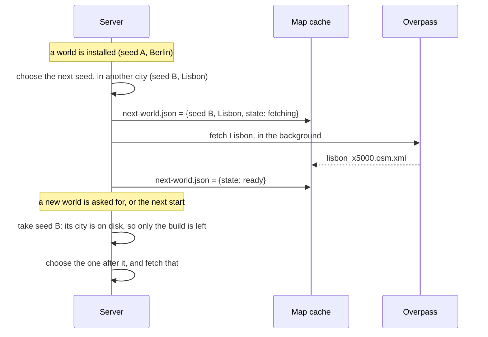
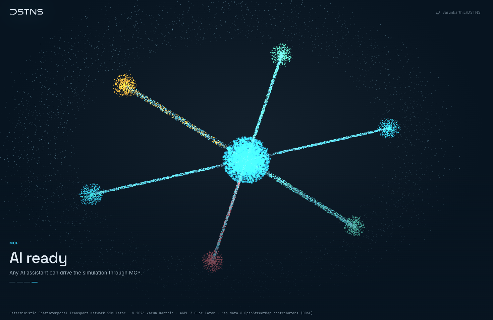

# Fast starts and the start-up film

A world is a real city district, cut from OpenStreetMap the first time a seed chooses it.
That first download is the slow part of starting, often tens of seconds and sometimes
minutes. DSTNS has three ways to take it out of the wait, and a start-up film that plans
itself around whatever wait is left.

| | What it does | On by default |
|---|---|---|
| [Dynamic Fastboot](#dynamic-fastboot) | While a world runs, fetches the next world's city in the background | Yes |
| [Fast Boot](#fast-boot) | Uses every city, downloaded once in advance | No |
| [Prepared new worlds](#new-worlds-prepared-ahead) | Prepares a new world while a person is still deciding to ask for it | With either of the above |
| [The adaptive film](#the-adaptive-film) | Plays as many scenes as fit the wait, then goes straight to the map | Yes |

## Dynamic Fastboot

Only the very first start downloads while anyone waits. From then on:



| When | What happens |
|---|---|
| A world is installed | The next seed is chosen at random, in a city other than this one, and its city fetched in the background. A seed prepared earlier and not yet used is kept instead |
| A new world is asked for | It takes the prepared seed. If its city is still downloading, it takes a city already in the map cache instead, other than the one running, and the city on its way stays next. With none cached, it waits for that download rather than starting another, and shows its progress |
| The launcher starts a run with no `--seed` | It reads `next-world.json` and starts with that seed |
| The server starts | The map cache sweep keeps the next world's city, whatever the cache policy |
| The background download fails | The pointer is removed, and the next world chooses for itself, as it always did |

The pointer, `next-world.json`, lives in the map cache beside the city it names, so it
outlives the server:

```json
{
  "seed": "9021178532209915623",
  "city": "Lisbon",
  "country": "Portugal",
  "key": "lisbon_x5000",
  "extent_m": 5000.0,
  "state": "ready"
}
```

`GET /api/v1/world/status` reports it as `data.next` (`enabled`, `state`: `idle`,
`fetching`, `ready`, `failed` or `off`, and the seed, city and country), and the launcher's
dashboard shows it under **Next world**. A background download publishes no progress of its
own, never blocks a request, and is stopped with every other download when the server
terminates.

It applies only to worlds whose seed chooses the city (`map.osm_file` is `auto`); a pinned
map stays pinned. `startup.dynamic_fastboot` turns it off, as does
`DSTNS_DYNAMIC_FASTBOOT=0` for a server started by hand.

## Fast Boot

Fast Boot downloads every city once, in advance, and keeps each compressed:

```bash
./launcher fastboot download                     # every city not yet here; Ctrl+C stops, and it carries on later
./launcher fastboot download --cities berlin,london
./launcher fastboot status                       # how many cities, and how much room
./launcher fastboot clear                        # delete them all
```

It pauses between downloads to be fair to the Overpass service, so a full download takes a
long while. The cities go to `fastboot/` in the map cache. With `startup.fast_boot` on, the
server unpacks a city from there (a moment, with no network at all) rather than downloading
it; a city that isn't there, or whose file is damaged, is downloaded as usual. The observer
then opens as a reload does: the name alone, with a quiet light passing across it, and no
title or film.

Fast Boot and Dynamic Fastboot work together: a city Fast Boot has is never downloaded at
all, and Dynamic Fastboot simply finds it already on disk.

## New worlds prepared ahead

With either on, asking for a new world in the observer starts preparing it **the moment the
dialog opens**, before *Generate* is pressed:

1. The dialog opens. The observer asks for `POST /api/v1/world/regenerate` with
   `{"stage": true}`. The server compiles the new world, from Dynamic Fastboot's seed, while
   the current one keeps running, and holds it in state `staged`.
2. **Generate**: `POST /api/v1/world/regenerate/commit` puts it in at once, or as soon as
   it is ready if it is still being built.
3. **Cancel**, or the dialog closing any other way:
   `POST /api/v1/world/regenerate/discard` forgets it. The current world is untouched.

On screen, the old world's ending plays as always, its particles gather back into the name,
and, because the new world is already there, the name goes straight on to its map: no
caption, and no film between. If the new world is still being built, the name moves on as
soon as it has formed, and the film plays its scenes until the world is ready. The particles build the new roads, the map comes in under
them, and then the panels, in the same order as a first start.

## The adaptive film

The start-up film is a cloud of particles that re-forms into what DSTNS does, one scene at a
time. With `startup.dynamic_particles` (the default) it plans itself by the server's estimate
of when the world will be ready:

- **It always opens and closes on the name.** The title's logo dissolves into the particles,
  and at the end they gather into the name and fly into the map's roads.
- **Only as many scenes as fit.** Before each scene, it checks that the scene, and the way
  back to the name, fit in the time left. A world from the cache leaves no time: the name goes
  straight to the map.
- **A new order every time,** with **WebFabric last**, and only once every other scene has
  played.
- **Ready sooner than planned?** The scene playing cuts back to the name within a moment, and
  the film lands.
- **A long wait** plays the scenes through, rests on the name for a moment, and begins
  another round in another order.
- No progress dashes under the captions: it plays as many scenes as the wait allows, not a
  fixed list.

The estimate is the server's `eta_s`, on `GET /api/v1/playback/status` while a run is
prepared and on `GET /api/v1/world/status` while a new world is generated:

| While the server is… | `eta_s` comes from | `eta_confident` |
|---|---|---|
| Choosing the city | How long the last fetches and builds took | No |
| Waiting on Overpass to prepare the extract | How long the last fetches took, and never less than half of that, however long the wait | No |
| Downloading, with the size known | The bytes still to come at the rate they are arriving, plus the build | Yes |
| Reading a city from the cache or Fast Boot | The build alone | Yes |
| Building the network | How long the last builds took, less the time spent so far | Yes |

The film plans only by a confident estimate. While the estimate is a guess, as during a long
Overpass request, it keeps playing scenes, so it never rests on the name for the length of a
download. The timings it learns from are kept in `preparation-times.json` in the logs
directory and smoothed, so one slow mirror does not set every estimate after it.

The adaptive film and **Play the whole film** (`startup.force_animate`) cannot both be on:
turning either on turns the other off. With the whole film, every scene plays in order before
the map, however soon the world is ready.

## Demo Mode

```bash
./launcher demo                     # the film on a loop, full screen, with music, until Ctrl+C
./launcher demo --no-music --no-fullscreen
./launcher ui demo                  # the same, from the terminal interface's Demo page
```

Demo Mode plays the film's scenes and three of its own, about what sets DSTNS apart, on a
loop, with nothing on screen but the film, its captions and the licence line:

| Scene | Id | Shows |
|---|---|---|
| Time control | `time-control` | The day as a track with a playhead: it plays forward, fast-forward streams past above, rewind streams back below, and the checkpoints stand up along it |
| Many worlds | `many-worlds` | One seed at the centre, and from it districts of every kind (a grid, rings and spokes, an old town, a diagonal plan, a waterfront) |
| AI ready | `ai-ready` | The simulation at the centre, with its controls reached as tools by the programs around it, through the [MCP Handler](mcp.md) |

|  |  |  |
|---|---|---|
| Time control | Many worlds | AI ready |

`demo.scenes` chooses which scenes play and in what order, by id. On the Configuration
page, under **Demo**, it is a list: **Space** turns a scene on or off and **Shift+↑ ↓** moves
it. The name always opens the loop. As text, it is the ids separated by commas:

```bash
./launcher config set demo.scenes "time-control, many-worlds, ai-ready, streets, incidents"
```

The film's own scenes are `streets`, `signals`, `demand`, `rush-hour`, `incidents`, `weather`,
`cities`, `repeatable`, `auto-focus` and `webfabric`.

The music is an original score in the manner of a cinematic hero's theme: strings driving
in sixteenths under timpani, brass answering off the beat, and a horn line of its own over
the top, in D minor, building over four phrases, breaking down, and building again. It is
written in code and played by the browser, so there is nothing to license or download, and a
small button at the bottom right mutes it. `demo.music` and `demo.fullscreen` turn either off
for good; `--no-music` and `--no-fullscreen` for once.
