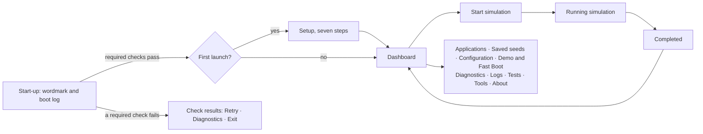

# The launcher

`./launcher` is how an operator builds DSTNS, checks that a machine can run it, starts
and supervises simulations, edits every setting, manages saved seeds and applications,
reads logs and runs the tests. It is also the only supported way to start a simulation:
the server refuses a start request that lacks the operator credential the launcher
holds.

It is one program, written in Rust, in `LaunchKit/`. It has three faces, and all three
drive the same operations, so anything one can do the others can too:

| Face | What it is | Start it with |
|---|---|---|
| **Terminal interface** | A keyboard-driven console: a dashboard with live telemetry, a page for every task, and a command bar at its foot | `./launcher` |
| **Commands** | One operation per invocation, with plain output and an exit status, for scripts | `./launcher start`, `./launcher apps list`… |
| **Console** | Command lines as a Unix shell reads them, joined by `|`, `&&`, `||` and `;` | `./launcher -c '…'`, `./launcher shell`, or the command bar |

## At a glance

```bash
./launcher                                   # open the terminal interface
./launcher ui demo                           # …on its Demo page, with Demo Mode running
./launcher start --seed 382923               # start a particular run
./launcher ps | grep server                  # read state as plain text, and pipe it
./launcher -c 'stop && start --no-open'      # a command line, as a shell runs it
./launcher help                              # every command and option
```

## Building it

The `launcher` script at the top of the checkout builds the program the first time it
is used, and again whenever its sources change, then runs it:

```text
$ ./launcher
DSTNS: building the launcher (only when its sources change)...
```

The first build takes about a minute; after that the script starts the program in a few
milliseconds. It needs [Rust](https://rustup.rs) (1.89 or later, with Cargo) and the
system's SQLite. Nothing is downloaded at run time, and nothing is installed outside the
checkout: the build goes to `LaunchKit/target/`, or, in a checkout a cloud client syncs,
to the local cache (see [Checkouts in a synced folder](#checkouts-in-onedrive-icloud-drive-or-dropbox)).

If Cargo is missing and a build already exists, the script uses it and says so. If
neither is there it explains how to install Rust and exits.

## First launch: the setup

The first time the terminal interface opens, it walks through a setup of seven steps
before the dashboard:

| Step | What it asks |
|---|---|
| 1. Welcome | Nothing: what the setup covers, and whether this machine passed its checks |
| 2. Starting up | Dynamic Fastboot, the adaptive start-up film, Fast Boot, whether the whole film plays, the observer's settings, Realistic News |
| 3. Looks and sound | Music, its volume, full screen, and the same for Demo Mode |
| 4. Performance | A preset (Light, Balanced, Best) or each value: compression, threads, the map's frame rate, render scale, film particles |
| 5. Fabric | What applications may do: connect, the legacy API, launch proposals, signatures, each capability |
| 6. MCP | Whether an AI client may connect, and whether it may change things or start runs |
| 7. Review | Every choice, before anything is written |

**Ctrl+N** and **Ctrl+P** move between steps, **Tab** between fields, and **Enter** on
*Skip the setup* keeps every default. Nothing is written until the review is accepted;
then the choices go to `config/defaults.json`, and `DSTNS_SETUP_COMPLETE=1` is recorded in
`config/launcher.env`.

That file is the launcher's own state. It is never committed, and
`DSTNS_LAUNCHER_ENV` moves it. A variable already set in the shell wins over the file, so
`DSTNS_SETUP_COMPLETE=1 ./launcher` skips the setup for one run. `./launcher setup`, the
command bar's `setup`, and **Reset runtime data** (which forgets the setup) bring it back.

## The terminal interface

{ .screenshot }



### Its look

It is a console: a black field, one blue accent used sparingly, and thin rules between
things rather than boxes around them.

```text
 DSTNS  ❯ dashboard                                         ◌ running  │  v2.2.0  │  14:02:11
  ENGINE ───────────────   SIMULATION ────────────   NEXT WORLD ───────────   SYSTEM ────────────
  state   online           state   running           mode    dynamic          checks  15/15 pass
  port    8090             clock   08:12:44          city    Lisbon           apps    1 up · 2 known
  pid     48211            day     ▰▰▰▱▱▱▱▱▱▱ 34%    state   ready            mcp     off
  uptime  00:12:31         seed    382923            seed    90211…           term    120x35
  memory  214 MiB

 ▍MENU ─────────────────  RUNNING SIMULATION ─────────────────────────────────────────────
  ▸ Running simulation
    Start simulation      Server             port 8090 · running                  ✓ OK
    Applications          Simulation time    08:12:44 (34%)
    …
                          SYSTEM LOG ──────────────────────────────────────────────────────
                          14:02:09 [INFO] [world] World run_8b2e… ready
 ───────────────────────────────────────────────────────────────────────────────────────────
 dstns ~ ❯ type a command, or : to begin · help · cmd | grep x && …
  ↑↓ navigate   enter select   q quit   : command   ? help
```

| Part | What it shows |
|---|---|
| **Status line** | The name, where you are, the page's state (a symbol and a word), the version and the time. On a narrow terminal the right side is shortened before it can reach the left |
| **Page** | Sections, each named on a thin rule. The section that has the keyboard is marked `▍` and takes the accent |
| **Prompt** | Always there: `dstns ~/page ❯`, and at its right the server's live readings (`● :8090 running · 08:12:44 · cpu 12% · mem 214M`, every two seconds). `:` or `/` puts the cursor in it. The `❯` turns red after a command that failed |
| **Keys** | What the keys do on this page, shortened to fit |

The selected item in a list carries `▸` (or `>` without Unicode), so selection never
depends on colour. Every state is a symbol **and** a word: `✓ ok`, `! warning`, `✗ failed`,
`◌ running`, `○ pending`, `- skipped`.

### Start-up

The wordmark assembles itself out of particles: each of its cells starts somewhere on the
screen as a faint dot, flies in, and becomes the glyph it is when it lands, from left to
right. A band of light then passes across it once, the product's full name types itself
out beneath it, and the start-up checks scroll by as a boot log, each with the time it
settled:

```text
              ▄██████████▄▄      ▄██████████  ▄██████████▄  ▄██▄        ▄█    ▄█████████▄
                              …
                  DETERMINISTIC SPATIOTEMPORAL TRANSPORT NETWORK SIMULATOR

                                    v2.2.0  ·  boot: complete
              [  0.214] ✓ Map cache          3 cached extracts · 111 MiB
              [  0.390] ✓ Simulation core    DSTNS 2.2.0
              [  0.512] ! Observer bundle    older than its sources
              [  0.640] ✓ API port           8090 available
```

The whole sequence takes about three and a half seconds, drawn at 30 frames a second: the
dust appears, the particles curve in from left to right and land, the light passes, the
name is typed, and the boot log reads out a line at a time under a progress bar. The
checks run meanwhile, so a slow check does not add to it, and if they take longer the
screen waits for them. `--no-animation` (or a terminal without motion)
shows the finished frame, and `--no-splash` skips it and runs the same checks on the
check-results page.

### Start-up checks

| Check | Required | Fails or warns when |
|---|---|---|
| Host platform | Yes | Not macOS or Linux (warning) |
| Rust | No | Cargo is missing: the launcher cannot be rebuilt when its sources change |
| Build tools | Yes | The core is not built and CMake or a C++ compiler is missing |
| Node.js | No | Missing or older than 20; needed only to rebuild the observer |
| Licence | No | `LICENSE` is missing or not the AGPL text |
| Configuration | Yes | `config/defaults.json` or `config/ui-config.json` is invalid |
| Observer settings | No | `config/ui-config.json` has values the observer ignores |
| Workspace | Yes | The logs directory is not writable |
| Map downloader | Yes | The server does not answer `--fetch-osm --help` |
| Map cache | Yes | `data/maps/` is not writable |
| Simulation core | Yes | The binary is missing (warning: it is built on start) |
| Observer bundle | No | Not built, or older than its sources (rebuilt on start) |
| API port | No | Informational: in use by a running server, or free |
| Apple Foundation Models | No | Informational: whether [Realistic News](narration.md) can be written on this Mac |
| SUMO | No | Installed but does not start |

If every required check passes, the launcher goes on. If one fails it explains why and
what to do, and offers **Retry**, **Diagnostics**, **Continue to the dashboard** and
**Exit**. These are readiness checks, not the regression suites; **Tests** runs those.

### Dashboard

Along the top, four sections of short readings, refreshed every two seconds off the
interface's own thread:

| Section | Readings |
|---|---|
| **Engine** | Online or offline, port, the server's pid, uptime and peak memory (from `GET /api/v1/system/info`) |
| **Simulation** | Lifecycle, simulated clock, how far through the day (with a bar), seed |
| **Next world** | [Dynamic Fastboot](fast-boot.md#dynamic-fastboot): its city, and whether that city is on disk yet. Without a server, read from `next-world.json` |
| **System** | Start-up checks passed, applications running and known, the MCP Handler, the terminal's size |

Below, the menu on the left and what is selected on the right; with room, the tail of the
server's `system.log` runs beneath it, coloured by level. When a simulation is running,
**Running simulation** heads the menu.

| Item | Opens |
|---|---|
| Running simulation | The live run, when there is one |
| Start simulation | The start form |
| Applications | Your programs, to start alongside a run; see [Applications](#applications) |
| Saved seeds | Saved configurations: start, inspect or delete |
| Configuration | Every setting, by category |
| Demo and Fast Boot | Demo Mode, and downloading every city |
| Diagnostics | Every check, optionally with the test suites; server, terminal and path details |
| Logs | The system log and the API, operator-event and lifecycle journals |
| Tests | The test stages, with live output |
| Tools | The SUMO toolchain check, rebuilding the observer, resetting runtime data |
| Documentation | This site, in your browser |
| About | Version, copyright, licence and map-data attribution |
| Exit | Leaves the launcher, stopping a simulation it started after confirmation |

### Start simulation

| Field | Meaning |
|---|---|
| Seed | Empty: the world [Dynamic Fastboot](fast-boot.md#dynamic-fastboot) prepared, else a fresh seed. Or decimal or `0x` hexadecimal up to 128 bits |
| Day type | Weekday or weekend |
| Map | Chosen by the seed, a cached city, the bundled offline district, or another file |
| Speed | Initial speed, more than 0 and at most 10 |
| Applications | A switch for each application in the catalogue |
| Save as, Description | Optionally save the configuration as a [saved seed](saved-seeds.md) |
| Open observer | Open the observer in your browser when the run starts |

Fields are single lines on a quiet band, marked at the left: the accent while it has the
keyboard, red when its value is wrong, with the reason beneath. **Ctrl+S** starts.

### Running simulation

The same layout as the dashboard: four sections of readings, a bar across the whole width,
and the live log beneath.

```text
  WORLD ────────────────   CLOCK ────────────────   TRAFFIC ───────────────   ENGINE ───────────────
  place    Lisbon, PT       time     08:12:44        vehicles 4,812             port     8090
  seed     382923           state    running         halting  211               owner    this launcher
  day      Weekday          speed    1×              congest  23.4% · 15m 21.0% cpu      38%
  network  3,906 junctions  ends in  52m 13s         roads    2 flooded · 1 closed memory 214 MiB
                                                     storms   1 active          observer 127.0.0.1:8090
  day   ▰▰▰▰▰▰▰▰▰▰▰▰▱▱▱▱▱▱▱▱▱▱▱▱▱▱▱▱▱▱▱▱▱▱▱▱▱  34%
  LIVE LOG ──────────────────────────────────────────────────────────────────────────────────────
  14:02:09 [INFO] [world] World run_8b2e… ready
```

| Section | Readings | Source |
|---|---|---|
| **World** | Place, seed, day type, the network's size | The loaded world |
| **Clock** | Simulated time, state, speed, when the day ends at this rate | `GET /api/v1/playback/status` |
| **Traffic** | Vehicles modelled and halting, congestion and its 15-minute average, flooded and closed roads, storms | `GET /api/v1/view/traffic`, `…/congestion` |
| **Engine** | Port, whether this launcher started it, processor and memory, the observer's address | `ps`, for a server this launcher started |

While the world is prepared, the bar is the map download (when the server knows its
size) and the activity line says what is actually happening: each build step, the server
starting, the download. Readings refresh four times a second, and watching never touches
the simulation. On a small terminal only place, seed, time and state are kept.

| Key | Action |
|---|---|
| Space or p | Pause or resume |
| o | Open the observer |
| s | Stop the simulation, after confirmation |
| Esc or b | Back to the dashboard; the simulation keeps running |
| f | Follow the newest log line, or not |
| c | Clear the visible log (the files are untouched) |
| End | Jump to the newest line |

**Stopping** asks first, requests a graceful shutdown, waits up to ten seconds, and only
then terminates a server the launcher started. It says the simulation stopped only once
the server has exited.

### Completed

At 24:00:00 the launcher shows the run's summary and offers **Open the observer** (where
**Save Report** makes the PDF), **Restart the same day**, **Run another simulation** and
**Back to main menu**.

### Configuration

Every setting, by category: **Run**, **Map**, **Modules**, **Weather**, **Launcher**,
**Server**, **Fabric**, **WebFabric**, **Startup**, **Presentation**, **Demo**,
**Performance** and **MCP**. Each is validated as you type, with its reason shown, and an
invalid value is never written. The status line shows `! unsaved` while there are changes;
**Ctrl+S** saves, and leaving with changes asks first. See
[Settings for every feature](#settings-for-every-feature).

### The command bar

`:` or `/` opens the prompt at the foot of every page. Type as in a shell:

```text
dstns ~ ❯ cd config/performance          # go to a page, and a section of it
dstns ~/config/Performance ❯ get performance.compression
dstns ~ ❯ ps | grep server && echo up    # pipelines and operators
dstns ~ ❯ apps list                      # any launcher command
```

As you type it suggests commands and their arguments, with what each does, and shows the
rest of the first suggestion dimmed; **Tab** takes it, **↑ ↓** walk the suggestions while
you type and the history otherwise (once in the history they stay there until you type),
**Enter** runs, **Ctrl+C** stops a command that is running, and **Esc** closes. The history
is kept between sessions, in `logs/command-history`.
Each command's output comes back in a block of its own under an `OUTPUT` rule, marked
`✓`, or `✗` with its exit status. The [Console](console.md) page has every command.

### Errors

A recoverable error stays inside the interface. It says what happened, what to do, and
where the details are, and offers the next steps:

```text
┌ Unable to start the simulation ────────────────────────┐
│ could not fetch the map                                │
│                                                        │
│ Check the network, VPN or proxy, or set                │
│ DSTNS_OVERPASS_ENDPOINTS to a reachable instance.      │
│                                                        │
│ Details have been written to: logs/launcher.log        │
│                                                        │
│ ▸ Retry                                                │
│   Diagnostics                                          │
│   Return to menu                                       │
└────────────────────────────────────────────────────────┘
```

If the terminal interface itself cannot start, the launcher says why in one line and
carries on in **compatibility mode**: numbered menus in plain text, with the same
operations. `--reduced-ui` asks for it, and `--no-tui` (or `TERM=dumb`) asks for plain
line-by-line output.

## Keyboard

| Key | Action |
|---|---|
| ↑ ↓, or k j | Move |
| Home, End, PgUp, PgDn | First, last, a page at a time |
| Enter | Select, or run |
| Tab, Shift+Tab | Next or previous field |
| Esc | Back, or close |
| `:` or `/` | The command bar |
| ? | Help for this page |
| q | Quit (from the dashboard and the check results) |
| Ctrl+C | Stop a command in the command bar; otherwise quit safely, asking first if a simulation this launcher started is running |

A mouse works but is never needed.

## Terminal size and capabilities

| Class | Size | Layout |
|---|---|---|
| Large | At least 100 × 30 | Telemetry, sidebar and content, the log tail, full key hints |
| Medium | At least 70 × 22 | Narrower sidebar, shorter hints |
| Small | At least 50 × 15 | One column: the menu above the content |
| Too small | Below 50 × 15 | A notice with the current and minimum size; R switches to compatibility mode |

Resizing reflows the page and keeps the selection, form values and a running simulation.
Prose wraps to the room there is and lists are clipped with `…`, so text never runs into
other text. The launcher needs only the terminal's own monospace font: no Nerd Fonts, no
ligatures, no images. Colour comes down from true colour to 256 and 16 colours to none
(`NO_COLOR=1` or `--no-color`), and it works over SSH and in IDE terminals.

## Commands

| Command | Does |
|---|---|
| *(none)* | In a terminal, opens the interface. Without one, starts a run, like `start` |
| `start` | Build what changed, start or reuse the server, start a run. In a terminal, shows it on the running page |
| `stop` | Stop the running server, and the applications this launcher started |
| `console` | Open the interface's dashboard |
| `ui PAGE` | Open the interface on a page: `start`, `apps`, `seeds`, `config`, `demo` (which runs [Demo Mode](fast-boot.md#demo-mode) there), `fastboot`, `logs`, `diagnostics`, `tests`, `tools`, `about`, `setup` |
| `ui open\|dev\|build\|install` | Open the observer, run its Vite development server, build its bundle, or install its dependencies |
| `setup` | Run the first-launch setup again |
| `seeds save\|list\|inspect\|delete [ID]` | Manage saved seeds, printing JSON; see [Saved seeds](saved-seeds.md) |
| `logs [system\|api\|event\|playback]` | Print a log. Without a source, in a terminal, opens the log viewer |
| `config [get KEY\|set KEY VALUE]` | Edit every setting; or read or change one |
| `test [all\|unit\|api\|replay\|benchmark\|sumo\|ui\|launcher]` | Run test stages and print a summary; non-zero if any fails |
| `sumo` | Check the SUMO toolchain on a synthetic grid |
| `apps …` | The applications this launcher can start; see [Applications](#applications) |
| `fabric [status\|capabilities\|grant\|settings\|audit]` | Look at and act on a running server through the Fabric API |
| `fastboot [download\|status\|clear]` | Every city in advance, for [Fast Boot](fast-boot.md) |
| `demo [--no-open] [--no-music] [--no-fullscreen]` | [Demo Mode](fast-boot.md#demo-mode): the film on a loop, until Ctrl+C |
| `mcp [serve\|tools\|client-config]` | The [MCP Handler](mcp.md), for AI clients |
| `-c 'LINE'`, `shell` | The [console](console.md): a command line, or lines until `exit` |
| `ls`, `cat`, `tail`, `head`, `ps`, `get`, `env`, `uptime`, `about`, `docs [TOPIC]` | The console's readers, run on their own: plain text to pipe. `docs mcp` opens that page |
| `reset [--yes]` | Delete runtime logs, the journal, checkpoints and temporary files, and forget the setup |
| `help`, `version`, `license` | Usage, version and licence notice, the licence text |
| `--mode=server` | Run `dstns_server` in the foreground with the configured host and port |

### Run options

For `start` and `seeds save`:

| Option | Range | Meaning |
|---|---|---|
| `--seed N` | Decimal or `0x` hex, up to 128 bits | The seed. Omitted: the prepared next world, else a fresh 64-bit seed |
| `--saved-seed ID` | | Run a saved configuration; excludes `--seed` |
| `--save-seed ID` | | Save this run's configuration under `ID` |
| `--description TEXT` | | Note stored with `--save-seed` |
| `--day-type weekday\|weekend` | | Day type |
| `--duration S` | Integer 60 to 3600 | Wall-clock seconds per virtual day at 1× |
| `--speed X` | 0.01 to 10 | Initial speed multiplier |
| `--max-nodes N` | Integer 2 to 50000 | Graph size cap |
| `--osm-file PATH` | Existing file | Pin a map instead of letting the seed choose |
| `--apps ID,ID`, `--no-apps` | | Start these applications with the run (it waits until they are ready), or none |
| `--default-settings` | | Open the observer with its settings at their defaults |
| `--open`, `--no-open` | | Open the observer in a browser. Default: when a desktop is present |
| `--narrator MODE` | `auto`, `fm`, `off`, `http://HOST:PORT`, `unix:/PATH` | [Realistic News](narration.md). Default: `narration.mode`, else `auto` |

### Narration

Before it starts a server, the launcher decides whether [Realistic News](narration.md) can
be written, and reports Apple's on-device model as **Available**, **Unavailable** (with the
reason and what would fix it) or **Disabled**:

```text
 [OK]    Apple Foundation Models: Available  Realistic News on: news written on this Mac from each event and its context
 [WARN]  Apple Foundation Models: Unavailable  the on-device model is not available (Apple Intelligence is turned off).
         Turn on Apple Intelligence in System Settings and let the model finish downloading. Using Standard news.
```

`--narrator` lasts for one invocation; `narration.mode` changes the default.

### Interface options

| Option | Effect |
|---|---|
| `--reduced-ui` | Compatibility mode |
| `--no-tui` | Plain mode |
| `--no-color` | No colour (`NO_COLOR` is also honoured) |
| `--no-splash` | Skip the start-up animation; keep the checks |
| `--no-animation` | No motion anywhere, while keeping activity labels |
| `--debug` | A verbose launcher log, and diagnostics on standard error |
| `--verbose`, `-v` | Show command output while builds and tests run |
| `--yes`, `-y` | Do not ask for confirmation (`reset`, `apps approve`) |

## Applications

{ .screenshot }

The launcher can start your own programs alongside a simulation. Each has one or more
commands. All but the last must finish successfully, and the last is the application,
which stays running.

```sh
./launcher apps add org.example.planner \
    --name "Route planner" \
    --command "npm ci" \
    --command "node planner.js --url {url}" \
    --required --autostart

./launcher start                                # starts it, because of --autostart
./launcher start --apps org.example.planner     # or name which to start
./launcher start --no-apps                      # or none at all
```

### When things happen

1. The engine is built and started, and the observer opens on its film.
2. The chosen applications start, all at once. The observer says *Starting applications*
   and how many are ready.
3. **Once they are all ready, the simulation starts.**

An application that fails stops the simulation from starting only if it is `--required`;
the launcher then says which, and why (`Planner is required, and did not start: … failed
with status 4`). Otherwise the run goes ahead without it. Its output goes to
`logs/apps/<id>.log`, and an application started this way stops when the launcher does.

### Options

| Option | Means |
| --- | --- |
| `--command CMD` | A command. Repeat it for several. `{url}`, `{port}`, `{id}` and `{root}` are filled in |
| `--name NAME` | What to call it |
| `--cwd DIR` | Where to run it, relative to the checkout |
| `--env KEY=VALUE` | An environment variable. Repeat it for several |
| `--ready HOW` | `fabric`: it reports itself active (the default). `process`: it stays up for a second. `delay:5`: after five seconds. Or a URL that answers |
| `--timeout S` | How long to wait for it, 1 to 600 seconds, 60 by default |
| `--restart POLICY` | `never` (the default), or `on-failure`, which tries five times, waiting longer each time |
| `--required`, `--autostart` | As above. `--no-required` and `--no-autostart` turn them off |
| `--grant CAPABILITY` | A permission to give it when it registers |
| `--setting KEY=VALUE` | A setting to give it when it registers |
| `--web URL`, `--web-label TEXT` | Its own web interface, which the observer offers to open |

There is no shell: a command is one program and its arguments, so what is in the
catalogue is exactly what runs. An application gets `DSTNS_URL`, `DSTNS_PORT` and
`DSTNS_APP_ID` in its environment, and never the operator's credential. To be ready, it
calls `PUT /api/v1/fabric/apps/{id}/state` with `{"state": "active"}`;
`Fabric/examples/hello_app.py` is the smallest whole one.

### Looking after them

| Command | Does |
| --- | --- |
| `apps list`, `apps show ID` | What is set up. `--json` for a script |
| `apps set ID …` | Change one. Only what is given changes |
| `apps doctor [ID]` | Find what would stop them from starting, such as a program not on `PATH` |
| `apps run [ID …]` | Start them on their own, with a server waiting for a run, until Ctrl+C |
| `apps status` | What the server knows of each: state, requests, refusals, permissions waiting |
| `apps logs ID [-n N]` | Its output |
| `apps proposals`, `apps approve ID`, `apps reject ID` | Launch entries proposed through the [Fabric API](../api/fabric-api.md#starting-applications-with-the-launcher): nothing runs until a person has read exactly what it would run |

A person can reload an application from the observer: its link ends, the launcher starts
it again, and because each process it starts is given a one-time key
(`DSTNS_FABRIC_LAUNCH_KEY`, presented as `X-DSTNS-Launch-Key`), it comes back as itself and
keeps what a person granted it. The catalogue is `config/apps.json`, which belongs to the
person at the machine and is never committed; `DSTNS_APPS_FILE` moves it.

## Settings for every feature

`./launcher config` lists every setting by category; the Configuration page edits them;
`config get KEY` and `config set KEY VALUE` read and change one. They are kept in
`config/defaults.json` and reach the server as it starts, so a change applies from the
server's next start. The observer reads them back from `GET /api/v1/system/features`.

| Category | Setting | Label | Default | What it does |
|---|---|---|---|---|
| Startup | `startup.dynamic_fastboot` | Dynamic Fastboot | on | While a world runs, choose the next and fetch its city in the background; see [Dynamic Fastboot](fast-boot.md#dynamic-fastboot) |
| | `startup.dynamic_particles` | Adaptive start-up film | on | The film plans itself by when the world will be ready; see [the adaptive film](fast-boot.md#the-adaptive-film) |
| | `startup.fast_boot` | Fast Boot | off | Use every city downloaded in advance, and open with the name alone |
| | `startup.force_animate` | Play the whole film | off | Every scene plays before the map, even when the world is ready sooner |
| Presentation | `presentation.music` | Music | off | An original score during the start-up film |
| | `presentation.fullscreen` | Full screen | off | Open the observer full screen |
| | `presentation.music_volume` | Music volume | 0.6 | From 0 to 1 |
| Demo | `demo.music`, `demo.fullscreen` | Music / Full screen in Demo Mode | on | The same, in Demo Mode |
| | `demo.scenes` | Demo scenes and order | every scene | Which scenes Demo Mode plays, and in what order; see [Demo Mode](fast-boot.md#demo-mode) |
| Performance | `performance.compression` | Compression | fast | How hard the server compresses large replies: fast, balanced, small or off |
| | `performance.api_threads` | Request threads | 0 | Requests answered at once; 0 lets the server choose |
| | `performance.engine_threads` | Snapshot threads | 0 | Threads that write a large snapshot; 0 lets the server choose |
| | `performance.map_fps` | Map frame rate | automatic | The map's frame rate for moving traffic: automatic, 60 or 30 |
| | `performance.render_scale` | Render scale | 2 | The most pixels per point the map draws at |
| | `performance.film_particles` | Film particles | 32000 | Particles in the start-up film |
| Fabric | `fabric.applications` | Applications may connect | on | Programs may register through the Fabric API |
| | `fabric.legacy_api` | Legacy routes | on | The older `/playback` and `/control` routes answer |
| | `fabric.launch_proposals` | Launch proposals | on | Applications may propose how to start them |
| | `fabric.require_signatures` | Signed requests only | off | Every application must sign every request |
| | `fabric.world_regeneration` | New worlds from the observer | on | A person in the observer may ask for a new world |
| | `fabric.allow_frames`, `allow_dialogs`, `allow_camera`, `allow_layers`, `allow_control`, `allow_notifications`, `allow_messages`, `allow_storage` | Embedded pages, Dialogs, Camera direction… | on | Whether that capability can be granted at all |
| WebFabric | `webfabric.enabled` | WebFabric | on | Applications appear in the observer |
| MCP | `mcp.enabled` | MCP Handler | off | An AI client may connect through the [MCP Handler](mcp.md), and read |
| | `mcp.allow_writes` | AI may change things | off | …and call routes that change things |
| | `mcp.allow_launcher` | AI may start and stop runs | off | …and start and stop simulations, and change settings |
| Launcher | `launcher.command_bar` | Command bar | on | The command bar and its prompt |
| | `launcher.default_settings` | Observer at its defaults | off | Open the observer with its settings at their defaults, every time |

### Settings that go together

Some settings cannot be on together, and some need another. Wherever one is changed (the
Configuration page, the setup, `config set`, compatibility mode, or an AI client), the
other follows, and the launcher says so:

| When this becomes | That becomes | Why |
|---|---|---|
| Adaptive start-up film **on** | Play the whole film **off** | The adaptive film plans its own length; the whole film plays every scene |
| Play the whole film **on** | Adaptive start-up film **off**, Fast Boot **off** | The reverse |
| Fast Boot **on** | Play the whole film **off** | Fast Boot opens with the name alone |
| AI may change things, or AI may start and stop runs, **on** | MCP Handler **on** | What an AI client may do needs the handler |
| MCP Handler **off** | Both permissions **off** | They go with it |
| Applications may connect **off** | WebFabric **off** | Nothing could connect to appear |
| WebFabric **on** | Applications may connect **on** | The reverse |

```text
$ ./launcher config set startup.force_animate on
 [OK]    Play the whole film is now on  startup.force_animate
 [INFO]  Adaptive start-up film is now off, as it must be  startup.dynamic_particles
```

The server applies the first rule too: when the adaptive film is on, it tells the observer
not to force the whole film, whatever the file says.

Full screen and music need a page to have been interacted with, so when either is on, the
launcher opens the observer in a window of its own from a Chromium-based browser, with a
profile of its own, where both are allowed from the start.

## What happens when a run starts

1. **Validate.** `config/defaults.json` and the options are checked against the bounds the
   engine enforces, and the start request is assembled. With no seed, the seed is the one
   [Dynamic Fastboot](fast-boot.md#dynamic-fastboot) prepared, when there is one.
2. **Build what changed.** The core and the observer are rebuilt only when their sources
   are newer than the last build.
3. **Find a server.** If the port (`DSTNS_API_PORT`, else the last one recorded in
   `logs/launcher.json`, else `api.port`) answers `/health` as a current DSTNS server, the
   launcher attaches to it. If something else holds the port, it uses the next free one.
   Otherwise it starts `dstns_server` with the settings as environment variables and waits
   up to 15 seconds for it to be healthy.
4. **Open the observer**, when asked, and wait for it to load, so that the world's
   preparation is watched in the browser rather than behind a blank tab.
5. **Start the applications**, and wait until each is ready.
6. **Start the run** with the operator credential from `logs/operator.token`, following
   the map download for a seed-selected city.
7. **Confirm the world**: a real OpenStreetMap network, its city and coordinates, whether
   the map was downloaded or cached, and its size.

Without a terminal, `start` then follows the server it started and exits with its status.
A server it attached to is left running.

## Ending a session

Leaving the launcher stops a server it started, after confirmation. A server it attached
to keeps running. On `SIGTERM`, `SIGHUP` (the terminal closed) or Ctrl+C in scripted use,
it stops a server it started before exiting, and cancellation during start-up reaches
build commands and their descendants.

## Exit codes

| Code | Meaning |
|---|---|
| 0 | Success |
| 1 | A launcher, configuration, environment or simulation failure, or a failed test stage |
| 2 | A command line that could not be read (an unclosed quote, an operator with nothing beside it) |
| 127 | A console command that does not exist |
| 130 | Interrupted with Ctrl+C |
| 143 | Terminated with `SIGTERM` |

## Checkouts in OneDrive, iCloud Drive or Dropbox

Sync clients evict files they have uploaded, and some refuse the burst of file creation a
build makes. When the checkout is in a synced folder, everything generated stays on local
disk and only the sources stay in the synced folder:

| What | Where (macOS; XDG state and cache directories elsewhere) |
|---|---|
| The launcher's build | `~/Library/Caches/DSTNS/checkout-<id>/launcher/` |
| C++ build | `~/Library/Caches/DSTNS/checkout-<id>/build/` |
| Observer build (a local mirror of `WebKit/` and `config/`) | `~/Library/Caches/DSTNS/checkout-<id>/source/` |
| Downloaded city extracts (when `map.cache_dir` is the default) | `~/Library/Caches/DSTNS/checkout-<id>/maps/` |
| Server logs, journal and credential | `~/Library/Logs/DSTNS/logs-<id>/` |
| Launcher log | `~/Library/Logs/DSTNS/launcher.log` |

`<id>` names the checkout, so two checkouts never share a build. `DSTNS_BUILD_DIR`,
`DSTNS_LOGS_DIR` and `CARGO_TARGET_DIR` choose those directories outright.

## Diagnostics

The launcher writes its own log to `logs/launcher.log`: its version and platform, the
terminal's capabilities, check results, server starts and stops, every console command,
every MCP call, and any unexpected error. It never records the operator credential or
environment values. `--debug` adds detail.

**Diagnostics** on the dashboard re-runs every check, optionally with the core, HTTP,
loading and observer suites, and shows the running server's version and SUMO status, the
terminal's size and capabilities, and the paths in use.

## Failure messages

| Message | Meaning and remedy |
|---|---|
| `playback.tick_rate must be in (0, 10]` | `config/defaults.json` asks for a speed the engine refuses |
| `Seed must be a decimal integer or 0x hexadecimal, within 128 bits` | Malformed `--seed` |
| `--seed and --saved-seed are mutually exclusive` | Pick one |
| `OSM data unavailable; provide --osm-file PATH` | A pinned map path does not exist |
| `MAP_FETCH_FAILED …` | The seed's district could not be downloaded. The launcher lists maps already on disk and the command to run one offline |
| `Server did not become healthy within 15s` | See [Troubleshooting](../troubleshooting.md#health-check-timeout-during-start-up) |
| `… is required, and did not start: …` | A required application failed; its log is named in the message |
| `NAME: command not found. help lists them.` | A console command that does not exist |
| `Unknown option: …`, `Unknown command: …` | See `./launcher help` |

More in [Troubleshooting](../troubleshooting.md#the-launcher).
